# FORTIX — API Security & Resilience Verification Platform
**Core Principle:** `PROTECT → BREAK → OBSERVE → PROVE → IMPROVE`  
**Degree Program:** Bachelor of Technology (B.Tech.) in Information Technology  
**Department:** Department of Information Technology, [Name of Institute / Engineering College]  
**Affiliating University:** [Name of Affiliating University] (Academic Year 2025–2026)  
**Repository:** https://github.com/mr-vdnt/FortiX

---

## PRELIMINARY PAGES

### Certificate

This is to certify that the B.Tech. Final Year Major Project Report entitled "FORTIX — API Security & Resilience Verification Platform" submitted by [Team Member 1 Name] ([Enrollment / Roll No. 1]), [Team Member 2 Name] ([Enrollment / Roll No. 2]), and [Team Member 3 Name] ([Enrollment / Roll No. 3]) in partial fulfillment of the requirements for the award of the degree of Bachelor of Technology in Information Technology at [Name of Institute / Engineering College], affiliated to [Name of Affiliating University], during the [Academic Year 2025–2026], is a bona fide record of software engineering design, implementation, and empirical verification carried out under our supervision.

The software artifacts, database schema, security controls, automated verification workflows, and test results documented in this report reflect actual engineering work implemented in the project repository and have not been submitted elsewhere for the award of any other degree or diploma.

### Declaration

We hereby declare that the project report entitled "FORTIX — API Security & Resilience Verification Platform" submitted in partial fulfillment of the degree of Bachelor of Technology in Information Technology is our original work carried out during the [Academic Year 2025–2026].

All architectural diagrams, database table specifications, source code excerpts, UI screenshots, and automated test summaries presented in this document are derived directly from the implemented FortiX software repository. External standards, textbooks, documentation, and peer-reviewed research papers consulted during this work have been duly cited in Section 6 (References). No fabricated test metrics, synthetic credentials, or unverified claims have been included.

### Acknowledgement

We express our sincere gratitude to our project supervisor, [Name of Project Guide, Designation], Department of Information Technology, [Name of Institute / Engineering College], for providing critical architectural guidance, encouraging rigorous scope discipline, and insisting on evidence-backed verification rather than superficial feature breadth.

We extend our appreciation to [Name of Head of Department, Department of IT] and the faculty members of the Department of Information Technology for providing the academic environment, technical review sessions, and evaluation feedback that shaped FortiX from an initial gateway prototype into a cohesive API security and resilience verification platform.

Finally, we acknowledge the maintainers of the open-source ecosystems—Node.js, TypeScript, Express, React, PostgreSQL, Drizzle ORM, Redis, BullMQ, Vitest, and Playwright—whose engineering foundations enabled deterministic testing and production-grade security practices throughout this project.

### Abstract

Modern cloud-native and microservice applications expose core business logic and sensitive multi-tenant data through HTTP Application Programming Interfaces (APIs). Organizations routinely configure defensive controls—such as API-key authentication, rate limiting, Web Application Firewall (WAF) filters, Server-Side Request Forgery (SSRF) guards, and upstream timeouts—under the assumption that configuration alone guarantees runtime protection. In practice, concurrency race conditions in rate limiters, middleware ordering defects, upstream dependency latency spikes, and cross-tenant authorization oversights frequently invalidate those assumptions under real traffic.

FortiX is an integrated API Security and Resilience Verification Platform built around a closed-loop engineering lifecycle: PROTECT → BREAK → OBSERVE → PROVE → IMPROVE. Rather than treating gateway protection, fault injection, and compliance reporting as disconnected tools, FortiX unifies (1) an HTTP reverse-proxy enforcement plane (/proxy/:routeId/*) implementing SHA-256/bcrypt scoped API-key validation, SSRF/DNS-rebinding defenses, URI-decoded SQLi/XSS/traversal WAF inspection, and atomic Redis Lua token-bucket rate limiting; (2) FortiX API Studio, a self-contained zero-backend API builder seeded with a canonical 100-record e-commerce Products dataset and OpenAPI 3.0.3 export; (3) an asynchronous BullMQ experiment engine that executes bounded latency, HTTP 5xx, timeout, and rate-limit burst workloads across three distinct observation windows (BASELINE, INJECTION, and RECOVERY); and (4) a deterministic Verification Engine synchronized via a telemetry flush barrier that produces non-vacuous PASS, FAIL, or INCONCLUSIVE verdicts backed by SHA-256 integrity-hashed PDF compliance reports.

The platform is implemented in TypeScript 5.8 on Node.js 22 (Express 4.21 backend, React 19 + Vite 6.2 control-plane SPA) backed by a normalized 21-table PostgreSQL 15 relational schema managed with Drizzle ORM 0.45 and hardened with PostgreSQL Row-Level Security (RLS) policies, alongside Redis 7 for Lua rate-limit state, Redis Streams telemetry ingestion, multi-replica key-revocation Pub/Sub, and BullMQ job queues. Operator authentication (FTX-AUTH-001) provides HttpOnly session cookies, rotating Remember-Me refresh token families with reuse detection, double-submit CSRF protection, and multi-step 6-digit HMAC-SHA256 OTP account recovery.

Empirical validation across the repository confirms 34 passing Vitest unit and integration test suites (261/261 passing assertions) and 12 passing Playwright end-to-end and security browser/API specifications, demonstrating deterministic enforcement and verifiable evidence generation.

**Keywords:** API Security Gateway, Resilience Engineering, Controlled Fault Injection, Atomic Token-Bucket Rate Limiting, Deterministic Verification Engine, Multi-Tenant Isolation, OTP Account Recovery, OpenAPI 3.0

### List of Abbreviations

| Abbreviation | Full Term | Operational Context in FortiX |
|---|---|---|
| **API** | Application Programming Interface | Protected HTTP/REST endpoints managed by FortiX |
| **ASVS** | Application Security Verification Standard | OWASP verification baseline for authentication and session security |
| **BOLA** | Broken Object Level Authorization | OWASP API1:2023 cross-tenant object access vulnerability prevented by project guards |
| **CRUD** | Create, Read, Update, Delete | Generated REST resource operations in FortiX API Studio |
| **CSPRNG** | Cryptographically Secure Pseudo-Random Number Generator | Node.js crypto.randomInt / randomBytes used for OTPs and tokens |
| **CSRF** | Cross-Site Request Forgery | Mitigated via double-submit cookie (fortix_csrf + X-CSRF-Token) on cookie mutations |
| **DDL** | Data Definition Language | SQL schema definitions and Drizzle ORM migrations (0000–0006) |
| **DFD** | Data Flow Diagram | Structured Level 0, Level 1, and Level 2 data movement models |
| **DLQ** | Dead-Letter Queue | Failed asynchronous BullMQ experiment and webhook jobs retained for inspection |
| **HMAC** | Hash-based Message Authentication Code | Keyed SHA-256 verification for recovery OTPs and outbound webhook signatures |
| **JWT** | JSON Web Token (RFC 7519) | Short-lived access session token bound to session family identifier (sid) |
| **OAS** | OpenAPI Specification (v3.0.3) | Machine-readable REST contract exported by FortiX API Studio |
| **ORM** | Object-Relational Mapping | Drizzle ORM type-safe SQL builder over PostgreSQL 15 |
| **OTP** | One-Time Password | Time-limited 6-digit verification code for password reset and phone enrollment |
| **P50 / P95 / P99** | 50th, 95th, and 99th Latency Percentiles | Statistical response-time distributions computed from gateway telemetry |
| **RBAC** | Role-Based Access Control | ADMIN, OPERATOR, DEVELOPER, and VIEWER authorization model |
| **RLS** | Row-Level Security | PostgreSQL engine-enforced tenant isolation via app.current_user_id |
| **RPM** | Requests Per Minute | Configured token-bucket rate-limit threshold per protected route |
| **SLA** | Service-Level Agreement / Policy Contract | Expected security and resilience thresholds verified by the Verification Engine |
| **SQLi** | SQL Injection | Malicious query payload pattern inspected and blocked by gateway WAF rules |
| **SSRF** | Server-Side Request Forgery | Blocked private/loopback/metadata IP targets and DNS-rebinding attacks |
| **TTL** | Time To Live | Automatic key expiration in Redis token buckets, caches, and OTP challenges |
| **UML** | Unified Modeling Language | Use-case, class, sequence, and deployment design notation |
| **WAF** | Web Application Firewall | Gateway request inspection layer detecting SQLi, XSS, and path traversal |
| **XSS** | Cross-Site Scripting | Malicious script payload inspected at the gateway and neutralized in React UI |

---

# 1. ABOUT THE SYSTEM

## 1.1 Problem Definition (Identification of Needs)

Contemporary software architectures—spanning financial payment processors, e-commerce catalogs, healthcare portals, and Software-as-a-Service (SaaS) platforms—rely on RESTful HTTP APIs as their primary operational boundary. Unlike monolithic web applications where internal procedure calls remained isolated inside a single process memory space, API-first architectures expose parameterized network endpoints directly to web browsers, mobile applications, partner integrations, and automated adversaries.

Engineering teams typically respond to this exposure by deploying middleware controls: authentication checks, role-based access rules, request rate limiters, payload validators, and upstream HTTP timeouts. However, operational incidents repeatedly demonstrate a fundamental engineering gap: configuring a security or resilience control in code or YAML does not prove that the control behaves deterministically under concurrent adversarial traffic or upstream degradation.

- Authentication and Authorization Drift: Endpoints intended to require scoped API keys or tenant ownership checks frequently suffer from Broken Object Level Authorization (OWASP API1:2023), unrevoked cached credentials after key rotation, or session tokens that remain usable after password resets.
- Non-Atomic Rate Limiting Under Concurrency: Naive read-modify-write rate counters in application memory or non-transactional caches allow concurrent request bursts to bypass configured Requests-Per-Minute (RPM) ceilings due to race conditions.
- Server-Side Request Forgery (SSRF) and Encoded Payloads: Reverse proxies that accept user-configured upstream URLs without validating private RFC 1918 ranges, loopback interfaces, cloud metadata IPs (169.254.169.254), and DNS-rebinding resolutions expose internal infrastructure, while single-pass string filters miss URL-encoded SQL injection (SQLi) and Cross-Site Scripting (XSS) vectors.
- Unverified Resilience and SilentCascading Failures: Upstream microservices inevitably experience latency spikes, HTTP 502/503 errors, or hung TCP sockets. Without controlled fault injection and post-fault recovery measurement, operators cannot know whether gateway timeouts isolate the failure or whether downstream pools remain wedged.
- Telemetry Flush Races and Vacuous Verification: Even when teams run ad-hoc load scripts, asynchronous metric pipelines often lag behind verification queries—causing automated checks to evaluate zero rows or incomplete samples and emit misleading "green" pass statuses.
- Onboarding Friction in Security Tooling: Evaluating an API security gateway traditionally requires deploying a separate external microservice first, creating friction during development, security testing, and academic evaluation.

> **Core Engineering Distinction Addressed by FortiX:** Configuring a control declares intent; testing sends synthetic stimuli; observing records runtime telemetry; proving evaluates complete, synchronized baseline, fault-injection, and recovery observations against explicit SLA rules to produce tamper-evident PASS, FAIL, or INCONCLUSIVE evidence.

### 1.1.1 Problem Statement and Proposed FortiX Solution

Problem Statement: Organizations operating HTTP APIs lack a unified, self-contained engineering platform capable of enforcing multi-layered gateway protections, executing bounded fault-injection and rate-limit experiments against authorized routes, synchronizing asynchronous telemetry without race conditions, and deterministically proving whether security and resilience policies hold across baseline, active-fault, and post-fault recovery windows.

Proposed System (FortiX): FortiX is an integrated API Security and Resilience Verification Platform structured around five tightly coupled stages—PROTECT, BREAK, OBSERVE, PROVE, and IMPROVE—augmented by FortiX API Studio so operators can create realistic data-backed REST APIs inside the platform itself and immediately subject them to gateway enforcement and verification.

**Table 1.1: Comparison Between Disconnected Conventional Workflows and FortiX**

| Engineering Dimension | Conventional Disconnected Approach | FortiX Integrated Platform |
| --- | --- | --- |
| Target API Setup | Requires deploying and hosting an external backend service before any gateway policy can be tested. | Includes FortiX API Studio with instant 100-record Store Products API provisioning, live CRUD, and OpenAPI 3.0.3 export alongside external upstream proxying. |
| Rate-Limit Enforcement | Often relies on per-process counters or non-atomic cache reads vulnerable to burst race conditions. | Executes an atomic single-roundtrip Redis Lua token-bucket script (src/rate-limit/redis.ts) with production fail-closed semantics. |
| Credential & Session Lifecycle | Long-lived bearer tokens stored in localStorage; API keys cached in plaintext without multi-node eviction. | HttpOnly session + rotating refresh token families with reuse detection, OTP recovery, and SHA-256 API-key caching with Redis Pub/Sub eviction. |
| Chaos & Fault Safety | External chaos scripts risk impacting unauthenticated traffic or leaving zombie fault rules active on crash. | Pre-auth gateway ordering (401 before fault injection), strict project ownership checks, max 60s duration bounds, and try/finally ephemeral key cleanup. |
| Verification Determinism | Manual log inspection or naive assertions that can pass vacuously when telemetry queues have not flushed. | Awaits flushTelemetryBarrier(), partitions BASELINE / INJECTION / RECOVERY windows, enforces >=80% sample coverage, and emits PASS / FAIL / INCONCLUSIVE. |
| Audit & Compliance Evidence | Screenshots of terminal logs without cryptographic integrity or structured SLA comparison. | Generates structured JSONB verdicts and server-side PDFKit compliance reports stamped with SHA-256 content digests. |

Important Positioning Note: FortiX is engineered as a focused verification-first API security gateway and resilience testbed for academic defense, security engineering validation, and small-to-medium service environments. It does not claim to replace hyperscale commercial CDN edge networks, kernel-level DDoS scrubbers, or full OWASP Core Rule Set enterprise appliances.

### 1.1.2 Objectives, Scope Governance, Assumptions, and Out-of-Scope Boundaries

1. Enforce layered pre-upstream API protection (scoped API keys, SSRF/DNS-rebinding guards, SQLi/XSS/path-traversal WAF inspection, and atomic Redis Lua rate limiting) with sub-millisecond in-process fast paths.
2. Provide hardened operator authentication (FTX-AUTH-001) supporting email or verified E.164 phone sign-in, Remember-Me refresh session rotation, active session revocation, and 6-digit HMAC-SHA256 OTP password recovery.
3. Eliminate external demo dependencies via FortiX API Studio, enabling zero-code creation of multi-resource CRUD APIs pre-populated with a deterministic 100-record Store Products catalog.
4. Execute bounded, authorized resilience experiments (latency injection, HTTP 5xx failure injection, upstream timeout simulation, and rate-limit burst verification) via BullMQ background workers.
5. Guarantee deterministic verification by synchronizing Redis Stream telemetry persistence prior to evaluation and enforcing baseline, injection, and recovery sample sufficiency rules.
6. Produce downloadable SHA-256 verified PDF evidence reports and signed outbound webhook notifications.

Deliberate Scope Governance: During engineering refinement, non-essential peripheral modules were deliberately deferred so every retained subsystem could be hardened to production quality. Specifically, Kubernetes Helm orchestration, an 814-entry static external API catalog, generative AI advisory chatbots, and multi-hop service-mesh topology graphs are explicitly out of scope for the current release.

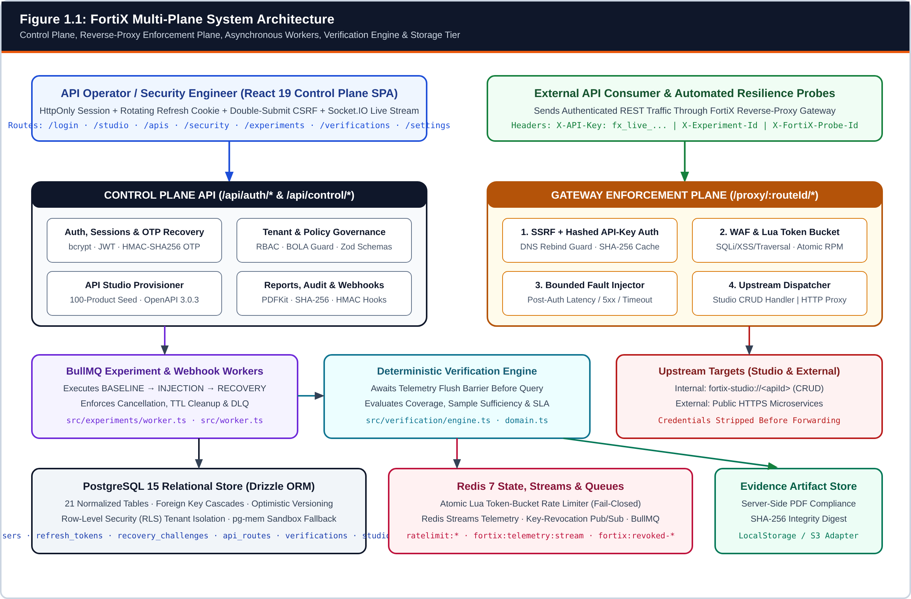
*Figure 1.1: FortiX Multi-Plane System Architecture (Control Plane, Gateway Enforcement Plane, Workers, Verification Engine, and Persistence Tier) (Reconstructed directly from server.ts, src/api/index.ts, src/gateway/index.ts, src/experiments/worker.ts, and src/verification/engine.ts.)*

**Table 1.2: Repository-Verified Feature Evidence Matrix**

| Capability / Module | Status | Primary Source Files | DB Tables & Redis Keys | Automated Test Evidence |
| --- | --- | --- | --- | --- |
| Operator Auth, Remember-Me & OTP Recovery (FTX-AUTH-001) | Implemented and verified | src/api/auth.ts, src/auth/sessions.ts, src/auth/recovery.ts, src/components/Login.tsx, src/pages/PasswordRecovery.tsx | users, refresh_tokens, recovery_challenges, auth_action_tokens | tests/unit/ftx-auth-001.test.ts, tests/e2e/auth-recovery.spec.ts |
| Multi-Tenant RBAC, BOLA Guards & PostgreSQL RLS | Implemented and verified | src/lib/rbac.ts, src/db/index.ts, drizzle/postgres_rls_policies.sql | organizations, projects, project_settings, audit_logs | tests/security/all.spec.ts, tests/integration/tenant-isolation.test.ts |
| Reverse-Proxy Gateway, SSRF Guard & WAF | Implemented and verified | src/gateway/index.ts, src/gateway/key-cache.ts, src/security/waf.ts, src/lib/ssrf.ts | api_routes, api_keys, security_policies, security_events | tests/security/auth.spec.ts, tests/unit/waf.test.ts, tests/unit/ssrf.test.ts |
| Atomic Redis Lua Token-Bucket Rate Limiter | Implemented and verified | src/rate-limit/redis.ts | Redis: ratelimit:{projectId}:{routeId}:{key} | tests/unit/rate-limit.test.ts, tests/e2e/golden-demo.spec.ts |
| FortiX API Studio & 100-Product Catalog Engine | Implemented and verified | src/api/studio.ts, src/studio/target-handler.ts, src/studio/datasets.ts, src/pages/ApiStudio.tsx | studio_apis, studio_resources, studio_records | tests/unit/api-studio.test.ts, tests/e2e/api-studio.spec.ts |
| 3-Phase Chaos Worker & Deterministic Verification | Implemented and verified | src/experiments/worker.ts, src/verification/engine.ts, src/telemetry/index.ts | experiments, metric_logs, verifications, fortix:telemetry:stream | tests/unit/verification-defects.test.ts, tests/failure/worker.spec.ts |
| SHA-256 PDF Evidence Reports & Signed Webhooks | Implemented and verified | src/reports/generator.ts, src/storage/index.ts, src/webhooks/dispatcher.ts | webhooks, webhook_deliveries, storage/artifacts/*.pdf | tests/reports/report.spec.ts, tests/unit/webhooks.test.ts |
| Production SMTP / SMS External Transport | Partially implemented | src/auth/providers.ts | Env: AUTH_EMAIL_WEBHOOK_URL, AUTH_SMS_WEBHOOK_URL | Webhook HTTP 2xx verified in ftx-auth-001.test.ts; live carrier depends on env secrets |

## 1.2 Requirement Specifications (Product/System Tasks)

System requirements in FortiX are partitioned into verifiable Functional Requirements (FR), Non-Functional Requirements (NFR), Hardware/Software System Requirements, Role-Based User Permissions, and formal Use-Case Specifications.

**Table 1.3: Functional Requirements Specification Matrix (FR-01 to FR-16)**

| Req ID | Functional Capability | Implemented Behavior & Acceptance Rule | Primary Endpoint / Module |
| --- | --- | --- | --- |
| FR-01 | Account Registration & Workspace Provisioning | Registers operator with bcrypt (cost 10) password hash, creates default Organization and Project transactionally, and issues email verification token. | POST /api/auth/register |
| FR-02 | Dual-Identifier Login & Remember-Me | Authenticates via normalized email or verified E.164 phone; sets HttpOnly fortix_session plus 12h (standard) or 30d (Remember Me) rotating fortix_refresh cookie. | POST /api/auth/login |
| FR-03 | Silent Refresh Rotation & Reuse Detection | Rotates refresh token within family_id; if a rotated token is replayed, revokes the entire session family and invalidates associated JWT sid claims. | POST /api/auth/refresh |
| FR-04 | OTP Password Recovery | Issues 6-digit CSPRNG OTP stored as keyed HMAC-SHA256 (10m TTL, 60s resend cooldown, max 5 attempts), exchanges for single-use resetAuthorization, and revokes all sessions on password update. | POST /api/auth/forgot-password, /verify-reset-otp, /reset-password |
| FR-05 | Active Session & Phone Management | Lists active refresh session families for revocation and enrolls E.164 phone numbers via 6-digit SMS OTP verification. | GET/DELETE /api/control/account/sessions, /phone/* |
| FR-06 | Project & Route Registration | Registers protected routes mapping pathPattern to external HTTPS targets (validated against SSRF) or internal fortix-studio://<apiId> targets. | GET/POST /api/control/routes |
| FR-07 | Scoped API-Key Lifecycle | Generates fx_live_<id>_<secret> keys, stores only bcrypt secretHash, enforces scope/expiry checks, and broadcasts instant cache eviction over Redis Pub/Sub. | POST/DELETE /api/control/keys |
| FR-08 | Security Policy Configuration | Configures per-route rateLimitRpm, authRequired, enableWaf, enableSsrf, maxLatencySlaMs, and maxErrorRatePercent. | POST/PUT /api/control/policies |
| FR-09 | Gateway Proxy & Header Sanitization | Proxies /proxy/:routeId/* requests after auth, WAF, and rate-limit checks while stripping X-API-Key and fx_* bearer credentials before upstream dispatch. | ALL /proxy/:routeId/* |
| FR-10 | Atomic Token-Bucket Rate Limiting | Enforces RPM quotas atomically in Redis via Lua script; returns HTTP 429 Too Many Requests when bucket tokens are exhausted. | src/rate-limit/redis.ts |
| FR-11 | WAF & SSRF Threat Prevention | Blocks URI-decoded SQLi, XSS, and path traversal payloads with HTTP 403 and records structured rows in security_events. | src/security/waf.ts, src/lib/ssrf.ts |
| FR-12 | FortiX API Studio & 100-Product Seed | Creates self-contained multi-resource REST APIs, seeds 100 realistic INR e-commerce Product records, serves filtered/paginated CRUD, and exports OpenAPI 3.0.3. | POST /api/control/studio/apis |
| FR-13 | Bounded Chaos Experiment Execution | Queues latency, error_5xx, timeout, and burst experiments in BullMQ; runs 5 BASELINE probes, active INJECTION probes (<=60s), and 5 RECOVERY probes. | POST /api/control/experiments |
| FR-14 | Telemetry Stream & Live Socket Push | Appends gateway metrics to Redis Stream fortix:telemetry:stream, batch-flushes to metric_logs, and pushes tenant-scoped updates via Socket.IO. | src/telemetry/index.ts, src/socket.ts |
| FR-15 | Deterministic SLA Verification | Synchronizes via flushTelemetryBarrier(), verifies >=80% probe coverage, and computes non-vacuous PASS, FAIL, or INCONCLUSIVE verdicts. | src/verification/engine.ts |
| FR-16 | Evidence PDF Export & Signed Webhooks | Generates PDFKit verification reports with SHA-256 digests and dispatches HMAC-SHA256 signed event payloads to registered webhooks. | GET /api/control/reports/:id/pdf |

**Table 1.4: Non-Functional Requirements (NFR) and Architectural Realization**

| Quality Attribute | Engineering Requirement | Implemented Mechanism in FortiX |
| --- | --- | --- |
| Security | Zero plaintext secret storage, CSRF protection on cookie sessions, strict tenant isolation, and secret-free logs. | bcrypt (passwords & API keys), SHA-256 (refresh/action tokens), keyed HMAC-SHA256 (OTPs), double-submit CSRF, BOLA + Postgres RLS, Pino redact paths. |
| Reliability & Fault Safety | Chaos experiments must never persist indefinitely if a worker crashes or an operator aborts execution. | Zod max duration cap (60,000 ms), explicit cancellation polling, and try/finally cleanup deleting ephemeral fx_test_* keys and invalidating caches. |
| Availability & Fail-Closed | Distributed security state loss in production must not silently disable rate limiting. | Production mode fails closed (HTTP 503) if Redis is unreachable; development mode provides explicit bounded local fallback for offline evaluation. |
| Performance | Gateway authentication and policy lookup must avoid repeated bcrypt CPU cost on every request. | SHA-256 digest-indexed HashedApiKeyCache (30s TTL, max 5,000 keys) and 5s policy/route caches with event-driven invalidation. |
| Scalability | Decouple heavy probe orchestration and telemetry disk writes from the synchronous HTTP proxy thread. | Separate API and BullMQ Worker containers (docker-compose.yml) plus Redis Streams batch insertion into PostgreSQL. |
| Data Integrity | Prevent duplicate consumption of OTPs/reset tokens and lost updates on concurrent settings edits. | Conditional SQL UPDATE ... WHERE consumed_at IS NULL RETURNING * and optimistic concurrency version counter on project_settings. |
| Observability | Every proxied request and security block must carry traceable correlation metadata. | UUID X-Request-ID propagation, structured JSON Pino logs, P50/P95/P99 latency aggregation, and readiness endpoint /api/health/ready. |
| Portability | Run reproducibly in local student sandboxes without external cloud accounts as well as in Docker Compose. | Dual-mode DB layer (PostgreSQL Pool in production; deterministic pg-mem in-memory PostgreSQL with auto-migrations in sandbox/test). |

**Table 1.5: Development vs. Production System Requirements**

| Resource Category | Minimum Development / Viva Sandbox | Production / Multi-Container Deployment |
| --- | --- | --- |
| Processor & Memory | Dual-core x86_64 / ARM64 CPU, 4 GB RAM minimum (8 GB recommended for Playwright Chromium). | 2+ vCPU and 2–4 GB RAM split across api (1 GB), worker (1 GB), postgres, and redis containers. |
| Runtime & Compiler | Node.js >= 22.x LTS, npm 10+, TypeScript 5.8, tsx runner. | Docker Engine 24+ & Docker Compose v2 running node:22-alpine compiled CJS bundles (dist/server.cjs, dist/worker.cjs). |
| Relational Database | PostgreSQL 15+ local instance OR built-in pg-mem sandbox mode for zero-dependency startup. | Dedicated PostgreSQL 15+ with persistent volume, TLS, connection pooling, and ENABLE_POSTGRES_RLS=true. |
| State & Queue Store | Redis 7 local instance OR bounded local dev fallback when REDIS_URL is unset. | Dedicated Redis 7 (--appendonly yes) required; STRICT_PERSISTENT_DB=true enforces hard readiness checks. |
| Client Browser | Chromium, Firefox, or Safari supporting ES2022, Fetch Credentials, and WebSocket. | Modern evergreen TLS-enabled browser enforcing Secure, HttpOnly, SameSite cookie policies. |

**Table 1.6: Implemented Role-Based Access Control (RBAC) Permission Matrix (src/lib/rbac.ts)**

| Platform Operation | ADMIN | OPERATOR | DEVELOPER | VIEWER |
| --- | --- | --- | --- | --- |
| View Telemetry, Routes, Verifications & Reports | Allowed | Allowed | Allowed | Allowed |
| Create/Edit Routes, Studio APIs, Keys & Policies | Allowed | Allowed | Allowed | Denied (403) |
| Create, Execute & Cancel Chaos Experiments | Allowed | Allowed | Allowed | Denied (403) |
| Manage Own Account Sessions & Verified Phone | Allowed | Allowed | Allowed | Allowed |
| Modify User Roles & Replay Dead-Letter Queue (DLQ) | Allowed | Denied (403) | Denied (403) | Denied (403) |

**Table 1.7: Structured Use-Case Specifications for Core FortiX Workflows**

| UC ID | Use Case Name | Primary Actor | Preconditions, Main Flow, Exception Handling & Postconditions |
| --- | --- | --- | --- |
| UC-01 | Sign In with Remember-Me Session | Unauthenticated Operator | Pre: Registered account exists. Main: Submit email or verified E.164 phone + password + Remember Me; backend verifies bcrypt hash, creates 30-day refresh_tokens family, sets HttpOnly fortix_session & fortix_refresh. Exc: Unverified phone or wrong password returns generic 401 without enumeration. Post: Authenticated workspace session established without storing password in browser. |
| UC-02 | Recover Password via 6-Digit OTP | Unauthenticated Operator | Pre: User forgot password. Main: Submit identifier on /forgot-password -> receive masked destination & challengeId -> submit 6-digit OTP on /verify-reset -> receive single-use resetAuthorization -> submit new + confirm password on /reset-password. Exc: >5 bad OTPs locks challenge; 60s resend cooldown enforced; provider failure invalidates challenge. Post: Password updated and all existing refresh_tokens + JWT sids revoked. |
| UC-03 | Provision 100-Product API in Studio | API Operator (DEVELOPER+) | Pre: Authenticated project selected. Main: Choose Store Products (100) template in /studio -> backend creates gateway route (fortix-studio://<id>), attaches WAF/SSRF/RPM policy, seeds 100 INR products, and mints scoped API key. Exc: Duplicate basePath or invalid field schema rejected with HTTP 400 Zod error. Post: Live CRUD endpoints immediately callable through /proxy/:routeId/*. |
| UC-04 | Proxy Request Under Policy & Rate Limit | External API Consumer | Pre: Active route and security policy exist. Main: Client sends GET/POST to /proxy/:routeId/* with X-API-Key; gateway validates key hash, checks WAF/SSRF, executes Redis Lua token bucket, dispatches upstream, and logs metric. Exc: Missing/revoked key -> 401; SQLi/XSS -> 403; exhausted tokens -> 429; hung upstream -> 504. Post: Response returned with X-Request-ID and telemetry persisted. |
| UC-05 | Execute 3-Phase Experiment & Verify SLA | API Operator / BullMQ Worker | Pre: Target route belongs to operator project. Main: Enqueue latency/5xx/burst experiment -> worker runs 5 BASELINE probes, activates fault for INJECTION probes, runs 5 RECOVERY probes -> awaits flushTelemetryBarrier() -> Verification Engine computes verdict & PDF report. Exc: Insufficient probe coverage (<80%) yields INCONCLUSIVE rather than false PASS. Post: Immutable verification record and SHA-256 PDF stored. |

## 1.3 Tools and Technology Used

Every dependency documented in this section has been verified directly against package.json, Dockerfile, docker-compose.yml, and active TypeScript imports in the FortiX repository.

**Table 1.8: Verified FortiX Technology Stack Inventory**

| Technology | Version | Architectural Layer | Verified Role in FortiX Codebase |
| --- | --- | --- | --- |
| Node.js | 22.x LTS | Server & Worker Runtime | Executes Express control/gateway server (server.ts) and BullMQ workers (src/worker.ts) using non-blocking I/O and native crypto. |
| TypeScript | 5.8.2 | Language & Type System | Enforces static contracts across shared schemas, Drizzle ORM models, API DTOs, verification rules, and React 19 components. |
| Express | 4.21.2 | HTTP Control & Proxy Server | Mounts /api/auth, /api/control, /proxy/:routeId/*, health probes, security headers, and CSRF/CORS middleware. |
| React & Vite | 19.0 / 6.2 | Frontend SPA & Bundler | Renders operator dashboard, API Studio, policy editors, OTP recovery screens, and Recharts visualizations. |
| PostgreSQL | 15-alpine | Primary Relational Database | Stores all 21 normalized tables with foreign-key cascades, transactional updates, and Row-Level Security (RLS) policies. |
| Drizzle ORM | 0.45.1 | SQL Query Builder & Migrations | Defines typed schema (src/db/schema.ts) and versioned SQL migrations (drizzle/0000 through 0006) with parameterized queries. |
| Redis (ioredis) | 7-alpine / 5.10 | Atomic State, Streams & Pub/Sub | Runs Lua token-bucket rate limiting, fortix:telemetry:stream ingestion, key-revocation Pub/Sub, and BullMQ backing store. |
| BullMQ | 6.3.1 | Distributed Job Queue | Schedules and retries asynchronous chaos experiments and webhook deliveries with exponential backoff and DLQ retention. |
| Socket.IO | 4.8.3 | Real-Time Event Transport | Streams tenant-isolated telemetry, security alerts, and experiment state transitions to authenticated browsers. |
| Zod | 4.5.6 | Runtime Schema Validation | Validates every REST body/query payload, E.164 phone format, Studio field schema, and environment configuration. |
| Pino | 10.3.1 | Structured JSON Logger | Outputs high-throughput structured logs with automatic redaction of authorization headers, cookies, OTPs, and secrets. |
| PDFKit | 0.20.2 | Compliance Evidence Generator | Synthesizes downloadable server-side verification PDF reports hashed with SHA-256 digests. |
| Vitest & Playwright | 5.0 / 1.63 | Automated Verification Suite | Executes 34 unit/integration test suites (261 tests) and 12 end-to-end browser/API security specifications. |
| Docker & Compose | 24+ / v2 | Containerization & Orchestration | Multi-stage Alpine image running as unprivileged user fortix across api, worker, postgres, and redis services. |

### 1.3.1 Six-Dimensional Engineering Evaluation of Core Technologies

- Node.js 22 & TypeScript 5.8 — (1) Intro: Event-driven JavaScript runtime paired with structural static typing. (2) Purpose: Powers HTTP reverse proxying, cryptographic hashing/HMAC, probe generation, and verification logic. (3) Why Selected: High concurrency for I/O-bound gateway proxying and single-language sharing of domain types between backend and React UI. (4) Integration: Compiles via esbuild into dist/server.cjs and dist/worker.cjs. (5) Benefits: Fast startup, native WebCrypto/Node crypto, unified codebase. (6) Limitations: Single-threaded CPU loop requires offloading bcrypt caching and running workers in a separate process.
- Express 4.21 — (1) Intro: Minimalist HTTP routing and middleware framework. (2) Purpose: Hosts /api/auth/*, /api/control/*, and wildcard /proxy/:routeId/* pipelines. (3) Why Selected: Deterministic middleware ordering—vital for ensuring authentication and WAF execute strictly before fault injection. (4) Integration: Co-hosted on the same HTTP server as Socket.IO and http-proxy. (5) Benefits: Mature ecosystem (helmet, cookie-parser, cors). (6) Limitations: Requires explicit async error wrapping to avoid unhandled rejections.
- React 19, Vite 6.2 & Tailwind CSS 4 — (1) Intro: Component-based declarative UI library with modern ESM build tooling. (2) Purpose: Implements Login, 3-step OTP Recovery, Command Dashboard, API Studio, Security Policies, Experiments, Verifications, and Settings. (3) Why Selected: Instant state transitions, clean hook composition, and zero-runtime CSS overhead. (4) Integration: Communicates via src/lib/api.ts with credentials: "include", X-CSRF-Token injection, and silent /api/auth/refresh retry. (5) Benefits: Responsive operator workflow and Recharts latency visualization. (6) Limitations: Client-side SPA requires strict backend authorization because browser code is untrusted.
- PostgreSQL 15 & Drizzle ORM 0.45 — (1) Intro: ACID-compliant open-source RDBMS paired with a SQL-centric TypeScript ORM. (2) Purpose: Authoritative system of record for all 21 tables. (3) Why Selected: Native JSONB support for flexible verification evidence/Studio records, atomic UPDATE ... RETURNING for single-use tokens, and engine-level Row-Level Security (RLS). (4) Integration: Managed via src/db/index.ts with automatic pg-mem fallback for isolated unit tests. (5) Benefits: Zero SQL injection via bound parameters and transparent migration SQL files. (6) Limitations: High-frequency telemetry writes require Redis Stream batching to prevent connection pool saturation.
- Redis 7 & BullMQ 6.3 — (1) Intro: In-memory data structure server and Redis-backed distributed job queue. (2) Purpose: Executes atomic Lua token-bucket rate limiting, buffers telemetry streams, broadcasts revoked API keys, and orchestrates multi-phase chaos jobs. (3) Why Selected: Server-side Lua scripts execute atomically without lock contention across multiple gateway replicas. (4) Integration: Connected via ioredis in src/lib/redis.ts, src/rate-limit/redis.ts, and src/experiments/worker.ts. (5) Benefits: Sub-millisecond rate-limit decisions and durable job retries with DLQ inspection. (6) Limitations: Ephemeral memory footprint requires AOF persistence (--appendonly yes) and explicit TTL hygiene.
- Zod 4.5, Pino 10.3, PDFKit 0.20, Vitest 5.0 & Playwright 1.63 — (1) Intro: Validation, observability, reporting, and testing toolchain. (2) Purpose: Enforces strict DTO contracts at trust boundaries, emits redacted JSON logs, renders tamper-evident PDFs, and continuously verifies security/verification invariants. (3) Why Selected: Eliminates runtime type coercion bugs and proves end-to-end browser + proxy behavior. (4) Integration: Wired into Express routes, verification artifacts, and CI npm scripts. (5) Benefits: High defect detection (caught all four historical verification engine defects). (6) Limitations: Headless browser E2E suites require Chromium binaries in the test container.

---

# 2. SYSTEM DESIGN USING UML

## 2.1 Data Flow Diagrams (Level 0, Level 1, and Level 2)

To model how credentials, policy configurations, proxied API payloads, fault probes, and telemetry observations move across trust boundaries, FortiX is decomposed into three balanced Data Flow Diagram (DFD) levels following structured systems analysis conventions.

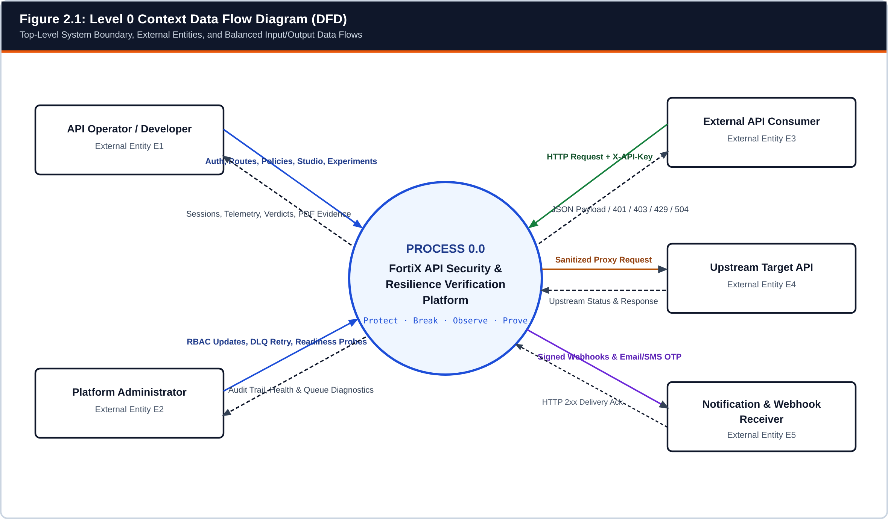
*Figure 2.1: Level 0 Context Data Flow Diagram — FortiX System Boundary and External Entities (E1–E5) (Models top-level inputs and outputs between Process 0.0 and external actors/targets.)*

In the Level 0 Context Diagram (Figure 2.1), FortiX appears as a single central process (0.0) interacting with five external entities: E1 (API Operator / Developer configuring routes, Studio APIs, policies, and experiments), E2 (Platform Administrator governing RBAC roles and Dead-Letter Queues), E3 (External API Consumer sending authenticated HTTP traffic to /proxy/:routeId/*), E4 (Upstream Target API receiving sanitized requests), and E5 (Notification & Webhook Receiver accepting signed alerts and Email/SMS OTP dispatches). Databases (PostgreSQL and Redis) are internal to the FortiX boundary at Level 0 and appear explicitly at Level 1.

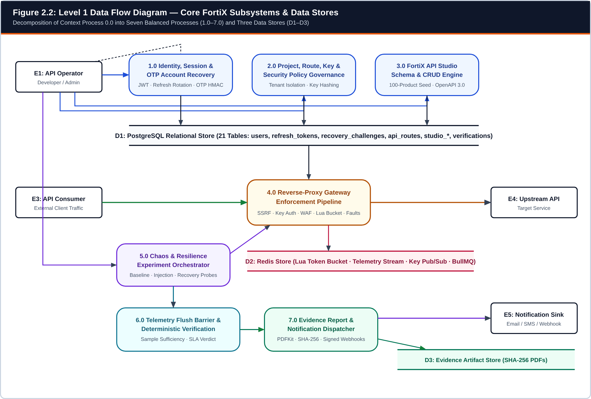
*Figure 2.2: Level 1 Data Flow Diagram — Decomposition into Seven Core Subsystems (1.0–7.0) and Three Data Stores (D1–D3) (Decomposes Process 0.0 into Auth (1.0), Governance (2.0), API Studio (3.0), Gateway (4.0), Experiment Worker (5.0), Verification (6.0), and Reporting (7.0).)*

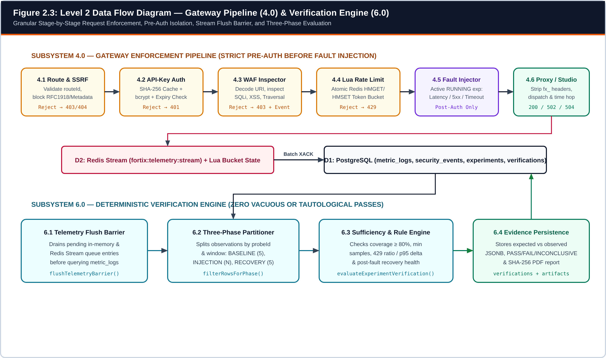
*Figure 2.3: Level 2 Data Flow Diagram — Stage-by-Stage Gateway Pipeline (4.1–4.6) and Deterministic Verification Engine (6.1–6.4) (Illustrates strict pre-authentication before fault injection and the telemetry flush barrier preceding SLA verification.)*

**Table 2.1: DFD Inter-Level Flow Conservation and Balancing Verification Matrix**

| External Boundary Flow | Level 0 Context Representation | Level 1 Subsystem Mapping | Level 2 Granular Stage Mapping |
| --- | --- | --- | --- |
| Operator Auth & Session Recovery | E1 <-> 0.0 (Credentials, OTPs, Session Cookies) | E1 <-> Process 1.0 <-> D1 (users, refresh_tokens, recovery_challenges) | 1.1 Identifier Normalizer -> 1.2 Bcrypt/Session Rotator -> 1.3 HMAC-OTP Verifier -> 1.4 Global Session Revoker |
| Protected API Request & Response | E3 -> 0.0 (HTTP + X-API-Key) and 0.0 -> E3 (JSON / 401 / 403 / 429 / 504) | E3 -> Process 4.0 <-> D1/D2 -> E4 (Upstream) or Process 3.0 (Studio) | 4.1 SSRF Guard -> 4.2 Hashed Key Auth -> 4.3 WAF Inspector -> 4.4 Lua Bucket -> 4.5 Post-Auth Fault -> 4.6 Proxy/Studio |
| Experiment Execution & Cleanup | E1 -> 0.0 (Experiment Spec / Cancel) -> E1 (Live Status) | E1 -> Process 5.0 <-> D1/D2 -> Process 4.0 (Probe Traffic) | 5.1 Ownership & Bounds Check -> 5.2 Ephemeral Key Mint -> 5.3 Baseline/Injection/Recovery Waves -> 5.4 Finally Cleanup |
| Evidence Verification & PDF Export | 0.0 -> E1 (PASS/FAIL/INCONCLUSIVE Verdict & PDF) & 0.0 -> E5 (Webhooks) | Process 4.0 -> D2 -> Process 6.0 <-> D1 -> Process 7.0 <-> D3 | 6.1 flushTelemetryBarrier() -> 6.2 Phase Partitioner -> 6.3 Coverage & SLA Evaluator -> 6.4 Verdict & SHA-256 PDF Writer |

## 2.2 Use Case Diagram

The UML Use Case Diagram (Figure 2.4) models the exact actors implemented in FortiX without introducing hypothetical personas. Four human/external actors and one autonomous background actor interact across the system boundary: Unauthenticated Operator, Authenticated API Operator (DEVELOPER / OPERATOR), Platform Administrator (ADMIN), External API Consumer, and the BullMQ Worker.

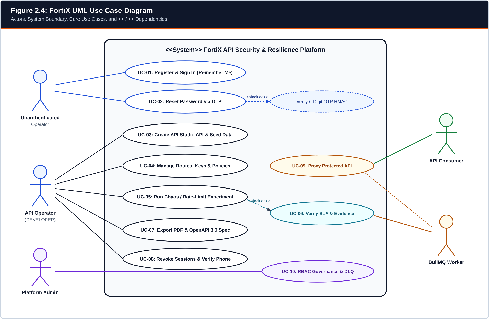
*Figure 2.4: FortiX UML Use Case Diagram Showing Actors, System Boundary, and <<include>> Relationships (Mapped to Express routers in src/api/ and frontend routes in src/App.tsx & src/AuthenticatedWorkspace.tsx.)*

- <<include>> Dependencies: UC-02 (Reset Password via OTP) mandatorily includes 6-digit HMAC-SHA256 OTP verification before issuing a single-use resetAuthorization token. Similarly, UC-05 (Run Chaos / Rate-Limit Experiment) mandatorily includes UC-06 (Verify SLA & Evidence) upon completion of the three probe windows.
- Access Boundary Enforcement: External API Consumers can invoke only UC-09 (/proxy/:routeId/*) and have zero visibility into control-plane endpoints (/api/control/*). Conversely, VIEWER accounts can inspect dashboards and reports but are blocked by requireRole() from mutating routes, keys, policies, or experiments.

## 2.3 Class Diagram

Although FortiX uses idiomatic TypeScript functional modules alongside stateful service classes (such as HashedApiKeyCache, LocalStorageProvider, and BullMQ Worker instances), its domain entities and service boundaries form a cohesive object model. Figure 2.5 illustrates the structural relationships, multiplicities, key attributes, and primary methods across the codebase.

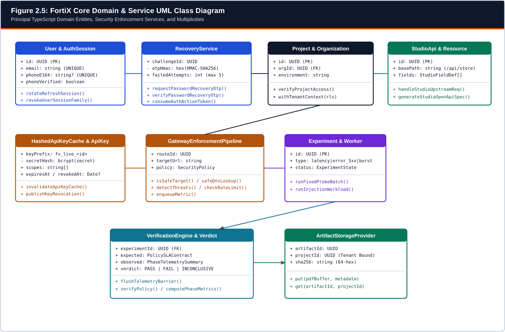
*Figure 2.5: FortiX Core Domain Entities and Security/Verification Service UML Class Diagram (Derived from src/db/schema.ts, src/auth/*, src/gateway/*, src/studio/*, src/verification/*, and src/storage/index.ts.)*

**Table 2.2: Mapping of UML Classes/Services to Concrete TypeScript Modules**

| UML Class / Service | Repository File Path | Key Attributes, Methods & Architectural Responsibility |
| --- | --- | --- |
| RefreshSessionService | src/auth/sessions.ts | createRefreshSession(), rotateRefreshSession(), revokeUserSessionFamily(), listUserActiveSessions(); manages Remember-Me TTLs and reuse detection. |
| RecoveryService | src/auth/recovery.ts | normalizePhoneE164(), computeOtpHmac(), requestPasswordRecoveryOtp(), verifyPasswordRecoveryOtp(); enforces 60s cooldown and 5-attempt lockout. |
| HashedApiKeyCache | src/gateway/key-cache.ts | Bounded Map indexed by SHA-256(rawKey); strips secretHash before memory storage; evicts immediately via Redis Pub/Sub events. |
| GatewayEnforcementPipeline | src/gateway/index.ts | Coordinates SSRF check, key validation, WAF inspection, checkRateLimit(), post-auth fault injection, studio/HTTP dispatch, and enqueueMetric(). |
| StudioTargetHandler | src/studio/target-handler.ts | handleStudioUpstreamRequest(), validateStudioRecordPayload(), generateStudioOpenApiSpec(); executes tenant-isolated CRUD over studio_records. |
| ExperimentWorker | src/experiments/worker.ts | runFixedProbeBatch(), runInjectionWorkload(), isExperimentCancelled(); executes BASELINE, INJECTION, and RECOVERY waves with guaranteed cleanup. |
| VerificationEngine | src/verification/engine.ts | verifyPolicy(), flushTelemetryBarrier(), evaluateExperimentVerification(); computes deterministic PASS / FAIL / INCONCLUSIVE verdicts. |
| ArtifactStorageProvider | src/storage/index.ts | put(), get(); stores verification PDFs with projectId ownership binding and SHA-256 integrity verification on read. |

## 2.4 Sequence Diagrams and Deployment Topology

This section documents all nine critical runtime workflows in FortiX using synchronous solid arrows and asynchronous/response dashed arrows, followed by the multi-container production deployment topology.

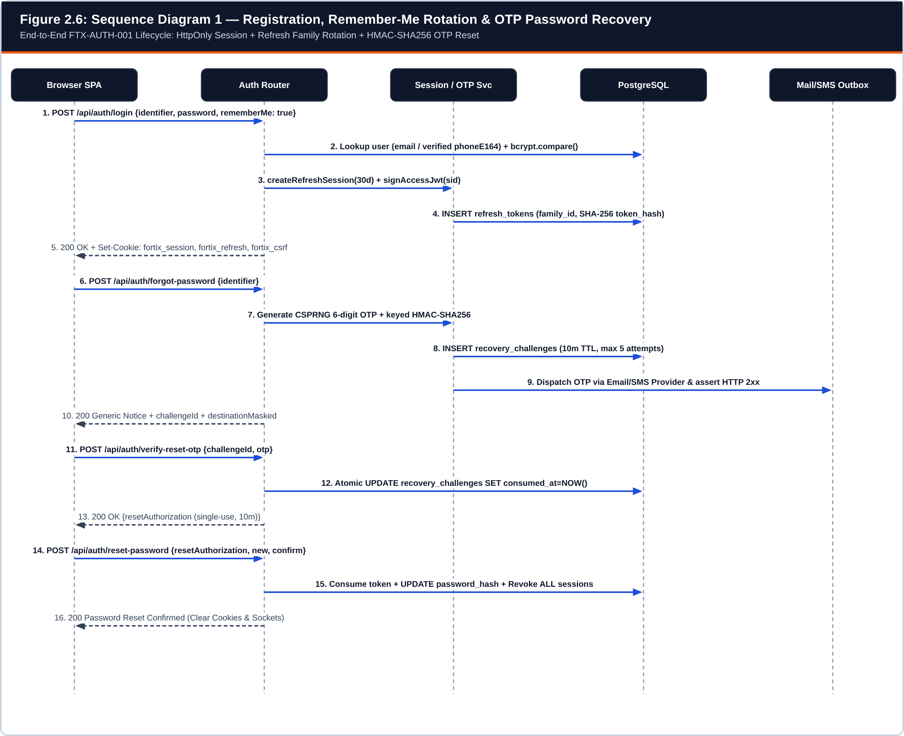
*Figure 2.6: Sequence Diagram 1 — Operator Login, Remember-Me Token Rotation, and Multi-Step OTP Password Recovery (Implements FTX-AUTH-001 across src/api/auth.ts, src/auth/sessions.ts, and src/auth/recovery.ts.)*

Workflow 1 Explanation (Figure 2.6): During login (steps 1–5), the Auth Router resolves the identifier by normalized email or verified E.164 phone, verifies the bcrypt hash, creates a refresh_tokens family row (30 days when rememberMe=true, 12 hours otherwise), and sets HttpOnly cookies (fortix_session, fortix_refresh) plus fortix_csrf. During account recovery (steps 6–16), /forgot-password generates a 6-digit OTP, stores only its keyed HMAC-SHA256 digest in recovery_challenges, and verifies HTTP 2xx provider delivery. On /verify-reset-otp, an atomic conditional SQL update marks consumed_at and issues a single-use RESET_AUTHORIZATION token. Finally, /reset-password updates password_hash and revokes every refresh token and active JWT session family for the user.

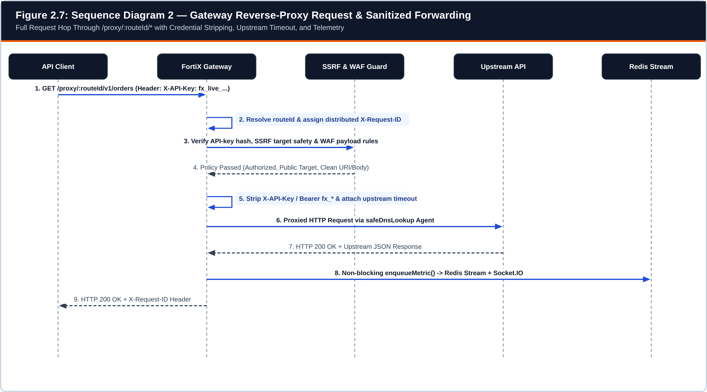
*Figure 2.7: Sequence Diagram 2 — Gateway Reverse-Proxy Request Processing and Credential Sanitization (Implements /proxy/:routeId/* in src/gateway/index.ts.)*

Workflow 2 Explanation (Figure 2.7): Every incoming proxy request receives a correlation X-Request-ID. After SSRF target validation (safeDnsLookup preventing DNS rebinding to internal IPs), API-key authentication, and WAF payload inspection succeed, the gateway strips X-API-Key and any fx_* Authorization header so FortiX credentials never leak to external upstreams. Upstream latency and status codes are captured on response finish and pushed asynchronously to Redis Streams.

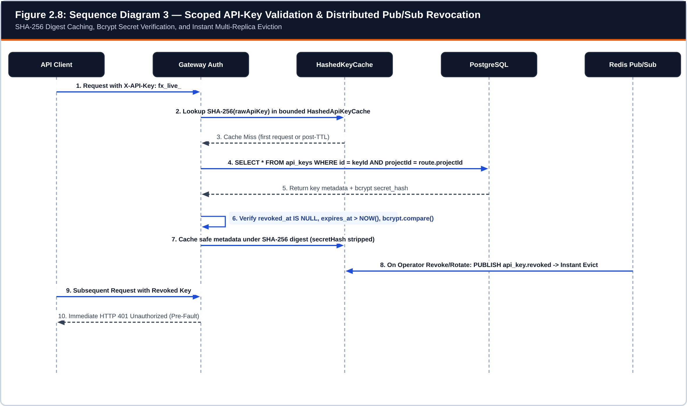
*Figure 2.8: Sequence Diagram 3 — Scoped API-Key Validation, SHA-256 Digest Caching, and Pub/Sub Revocation (Implements src/gateway/key-cache.ts and src/lib/key-revocation.ts.)*

Workflow 3 Explanation (Figure 2.8): On a cache miss, the gateway extracts keyId from fx_live_<keyId>_<secret>, loads the project-scoped row from api_keys, verifies non-revocation, expiration, required route scopes, and bcrypt.compare(secret, secretHash), and caches non-sensitive metadata keyed by SHA-256(rawKey). When an operator revokes or rotates a key, publishKeyRevocation() broadcasts over Redis Pub/Sub so all gateway replicas evict the cached digest immediately.

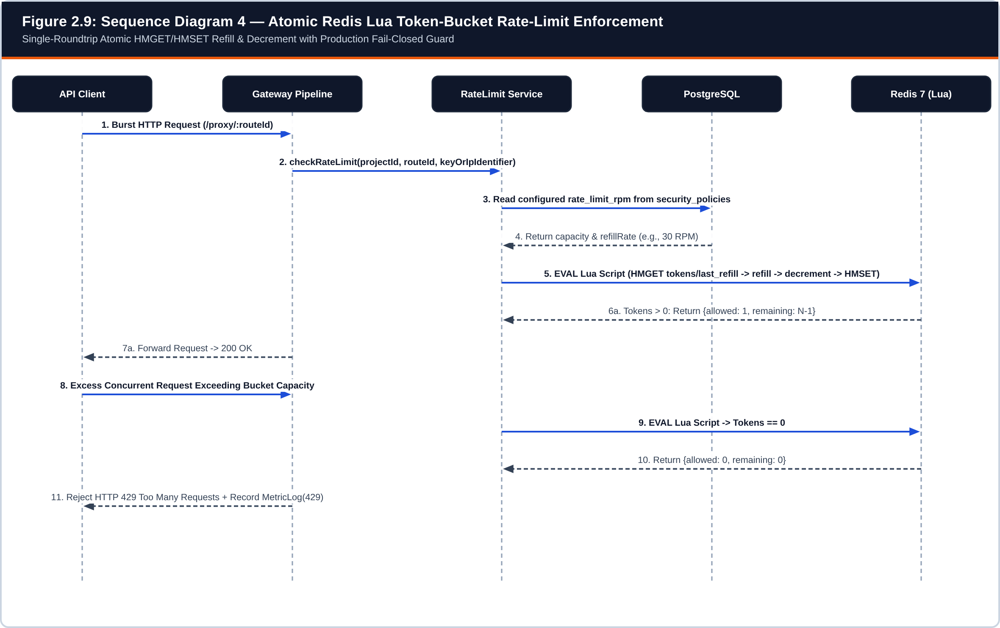
*Figure 2.9: Sequence Diagram 4 — Atomic Redis Lua Token-Bucket Rate-Limit Enforcement (Implements checkRateLimit() in src/rate-limit/redis.ts.)*

Workflow 4 Explanation (Figure 2.9): To prevent race conditions under concurrent burst traffic, checkRateLimit() evaluates an embedded Lua script inside Redis using EVAL. Within a single atomic Redis execution step, the script reads tokens and last_refill via HMGET, calculates elapsed token replenishment capped at route rate_limit_rpm, decrements 1 token if available, updates state with HMSET and PEXPIRE, and returns {allowed, remaining}. Exhausted buckets immediately return HTTP 429 and log a throttled telemetry observation.

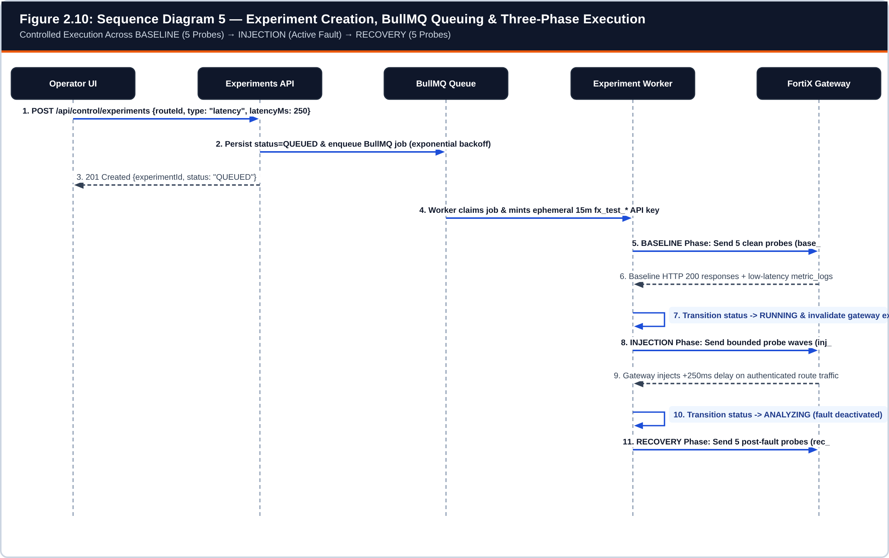
*Figure 2.10: Sequence Diagram 5 — Experiment Creation, BullMQ Queuing, and Three-Phase Execution (Implements src/api/experiments.ts and src/experiments/worker.ts.)*

Workflow 5 Explanation (Figure 2.10): Creating an experiment validates route ownership and bounded parameters (durationMs <= 60,000 ms), persists status=QUEUED, and enqueues a BullMQ job. The worker mints a 15-minute ephemeral fx_test_* API key, executes 5 clean BASELINE probes while fault injection is inactive, transitions status to RUNNING (activating gateway fault injection on that route) while sending tagged INJECTION probe waves, and finally transitions to ANALYZING to record 5 post-fault RECOVERY probes.

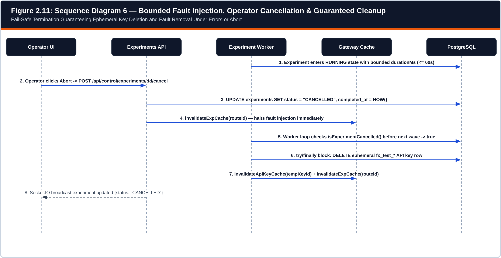
*Figure 2.11: Sequence Diagram 6 — Bounded Fault Injection, Operator Abort, and Guaranteed Cleanup (Illustrates fail-safe try/finally cleanup in src/experiments/worker.ts.)*

Workflow 6 Explanation (Figure 2.11): If an operator triggers POST /api/control/experiments/:id/cancel or an unexpected exception occurs mid-run, the API immediately sets status=CANCELLED and invalidates the gateway experiment cache. Before each probe wave, the worker checks isExperimentCancelled(), exits cleanly, and executes its finally block—unconditionally deleting the temporary fx_test_* API key row and clearing any cached fault state.

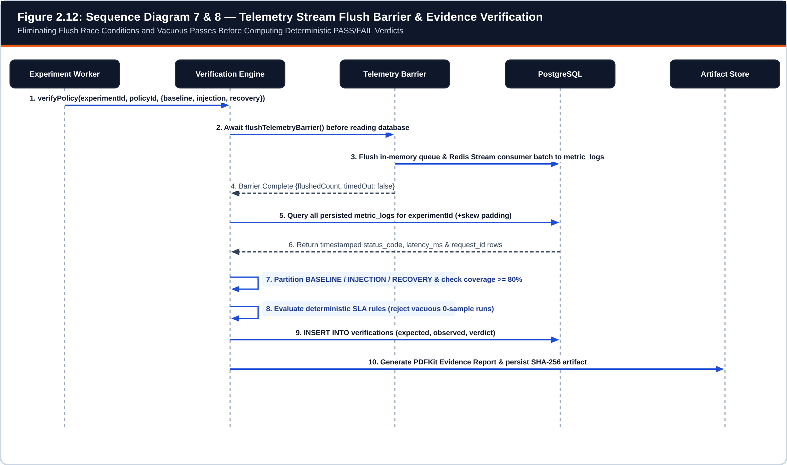
*Figure 2.12: Sequence Diagram 7 & 8 — Telemetry Stream Flush Barrier and Evidence-Based Verification (Implements flushTelemetryBarrier() and verifyPolicy() in src/verification/engine.ts.)*

Workflow 7 & 8 Explanation (Figure 2.12): Immediately after probe execution completes, VerificationEngine invokes flushTelemetryBarrier() so buffered Redis Stream entries are committed to metric_logs before SQL evaluation begins—eliminating the classic async telemetry race condition. Observations are partitioned into BASELINE, INJECTION, and RECOVERY windows using exact probe request IDs and timestamp bounds. If expected probe coverage falls below 80% or zero samples exist, the engine refuses to emit a vacuous PASS and instead records INCONCLUSIVE; otherwise it evaluates deterministic policy thresholds to persist PASS or FAIL alongside a SHA-256 PDF report.

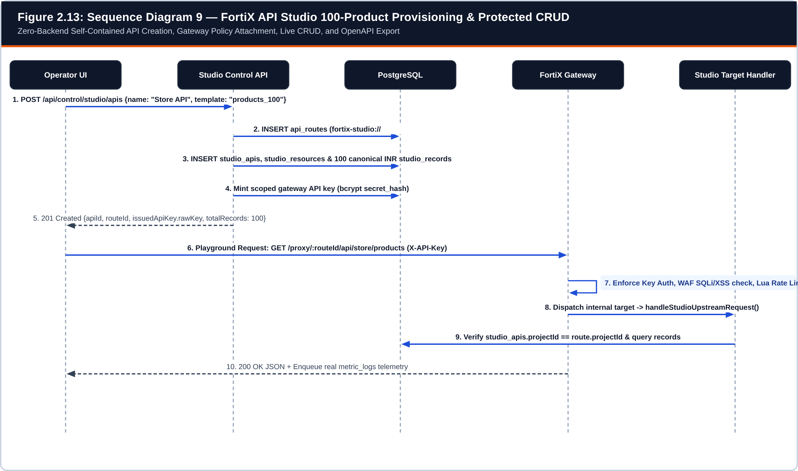
*Figure 2.13: Sequence Diagram 9 — FortiX API Studio 100-Product Provisioning and Protected Gateway CRUD (Implements src/api/studio.ts and src/studio/target-handler.ts.)*

Workflow 9 Explanation (Figure 2.13): Selecting the Store Products (100) template in API Studio creates an internal route (targetUrl = fortix-studio://<apiId>), attaches WAF/SSRF/rate-limit policies, seeds 100 deterministic Indian e-commerce products into studio_records, and issues a ready-to-use scoped API key. Subsequent GET/POST/PATCH/DELETE calls traverse the exact same /proxy/:routeId/* enforcement pipeline before reaching handleStudioUpstreamRequest(), allowing complete security and chaos verification with zero external services.

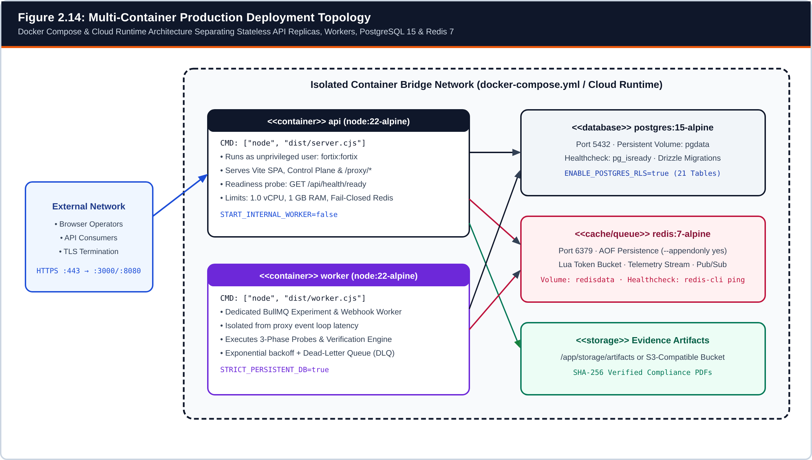
*Figure 2.14: FortiX Multi-Container Production Deployment Topology (Docker Compose & Cloud Runtime) (Reconstructed directly from Dockerfile and docker-compose.yml.)*

---

# 3. DATA DICTIONARY

## 3.1 Database Tables SQL/NoSQL (PostgreSQL 15 Relational Schema & Redis 7 Keyspace)

FortiX employs a polyglot persistence architecture with strict separation of responsibilities: PostgreSQL 15 serves as the authoritative ACID relational database storing all 21 application tables defined in src/db/schema.ts and versioned through Drizzle ORM migrations (drizzle/0000 through drizzle/0006), whereas Redis 7 is used strictly for atomic Lua token-bucket state, high-throughput telemetry stream buffering, multi-replica Pub/Sub invalidation, and BullMQ job queues—never as a substitute for durable relational records.

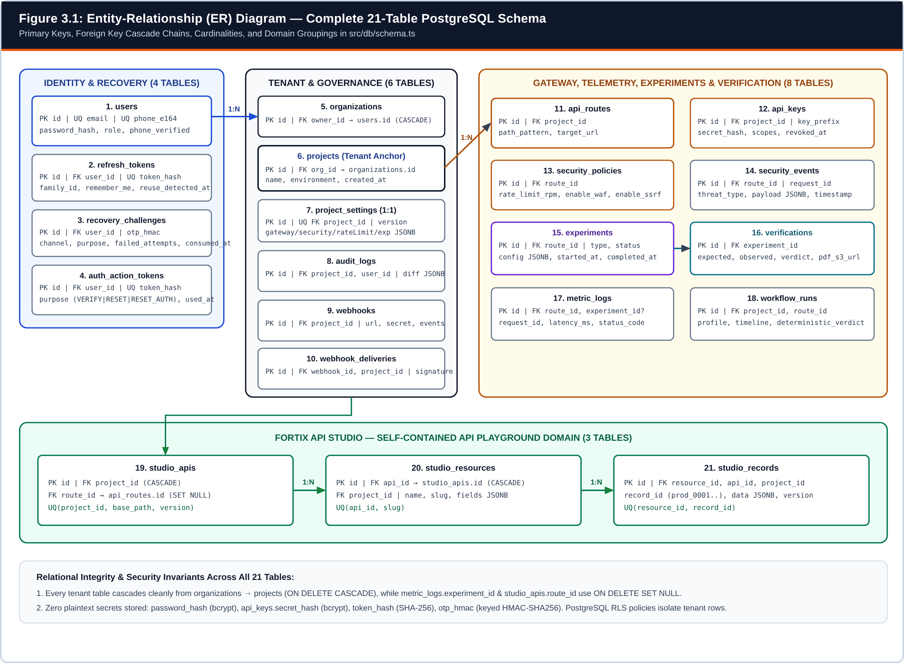
*Figure 3.1: Entity-Relationship (ER) Diagram of the Complete 21-Table PostgreSQL Schema Grouped by Domain (Generated directly from src/db/schema.ts and migrations 0000_ambitious_rhino.sql through 0006_auth_sessions_and_recovery.sql.)*

**Table 3.1: Master Inventory of the 21 PostgreSQL Tables in FortiX**

| # | Table Name | Domain Subsystem | Primary / Foreign Keys | Row-Level Security (RLS) Scope |
| --- | --- | --- | --- | --- |
| 1 | users | Identity & Auth | PK: id | Self-scoped (id = app.current_user_id) |
| 2 | auth_action_tokens | Identity & Auth | PK: id; FK: user_id -> users | Owner-scoped via user_id |
| 3 | refresh_tokens | Session Rotation | PK: id; FK: user_id -> users | Owner-scoped via user_id |
| 4 | recovery_challenges | OTP Account Recovery | PK: id; FK: user_id -> users | Owner-scoped via user_id |
| 5 | organizations | Tenant Hierarchy | PK: id; FK: owner_id -> users | Owner-scoped (owner_id = current_user_id) |
| 6 | projects | Tenant Anchor | PK: id; FK: org_id -> organizations | Scoped via organizations.owner_id |
| 7 | project_settings | Governance | PK: id; UQ FK: project_id -> projects | Tenant-scoped via project_id |
| 8 | audit_logs | Compliance Audit | PK: id; FK: project_id, user_id | Tenant-scoped via project_id |
| 9 | api_routes | Gateway Routing | PK: id; FK: project_id -> projects | Tenant-scoped via project_id |
| 10 | api_keys | Gateway Auth | PK: id; FK: project_id -> projects | Tenant-scoped via project_id |
| 11 | security_policies | Policy Enforcement | PK: id; FK: route_id -> api_routes | Route -> Project ownership chain |
| 12 | experiments | Chaos Engine | PK: id; FK: route_id -> api_routes | Route -> Project ownership chain |
| 13 | verifications | Verification Engine | PK: id; FK: experiment_id -> experiments | Experiment -> Route -> Project chain |
| 14 | metric_logs | Observability | PK: id; FK: route_id, experiment_id | Route -> Project ownership chain |
| 15 | security_events | WAF & Threat Log | PK: id; FK: route_id -> api_routes | Route -> Project ownership chain |
| 16 | webhooks | Outbound Integrations | PK: id; FK: project_id -> projects | Tenant-scoped via project_id |
| 17 | webhook_deliveries | Webhook Audit | PK: id; FK: webhook_id, project_id | Tenant-scoped via project_id |
| 18 | workflow_runs | Autonomous Workflows | PK: id; FK: project_id, route_id | Tenant-scoped via project_id |
| 19 | studio_apis | API Studio | PK: id; FK: project_id, route_id | Tenant-scoped via project_id |
| 20 | studio_resources | API Studio | PK: id; FK: api_id, project_id | Tenant-scoped via project_id |
| 21 | studio_records | API Studio Dataset | PK: id; FK: resource_id, api_id, project_id | Tenant-scoped via project_id |

Table Purpose (users): Stores operator credentials, RBAC role assignments, normalized E.164 phone numbers, and verification flags. Indexes & Relationships: Unique constraints on email and phone_e164 (nullable PostgreSQL UNIQUE allows multiple NULL rows); referenced by organizations, refresh_tokens, recovery_challenges, and auth_action_tokens.

**Table 3.2: PostgreSQL Data Dictionary — users**

| Column Name | SQL Type | PK / FK / Constraints | Default | Synthetic Example / Notes |
| --- | --- | --- | --- | --- |
| id | TEXT (UUID) | PRIMARY KEY, NOT NULL | None | "550e8400-e29b-41d4-a716-446655440000" |
| email | TEXT | UNIQUE, NOT NULL | None | "operator@example.edu" (lowercased) |
| phone_e164 | TEXT | UNIQUE, NULLABLE | NULL | "+919876543210" (normalized E.164) |
| phone_verified | BOOLEAN | NOT NULL | false | true (required before SMS OTP recovery) |
| password_hash | TEXT | NOT NULL | None | "$2b$10$N9qo8uLOickgx2ZMRZoMye..." |
| role | TEXT | NOT NULL | 'DEVELOPER' | 'DEVELOPER' \| 'ADMIN' \| 'OPERATOR' \| 'VIEWER' |
| email_verified | BOOLEAN | NOT NULL | false | true |
| created_at | TIMESTAMP | NOT NULL | now() | "2026-11-03 10:15:00" |

Table Purpose (auth_action_tokens): Stores SHA-256 digests of single-use email verification, password reset, and OTP-issued RESET_AUTHORIZATION tokens. Indexes & Relationships: FK user_id -> users.id ON DELETE CASCADE; UNIQUE(token_hash); composite index auth_action_tokens_user_purpose_idx(user_id, purpose).

**Table 3.3: PostgreSQL Data Dictionary — auth_action_tokens**

| Column Name | SQL Type | PK / FK / Constraints | Default | Synthetic Example / Notes |
| --- | --- | --- | --- | --- |
| id | TEXT (UUID) | PRIMARY KEY, NOT NULL | None | "6d9c1f10-31c2-4a0e-9e21-88a120001122" |
| user_id | TEXT (UUID) | FK -> users.id (CASCADE), NOT NULL | None | "550e8400-e29b-41d4-a716-446655440000" |
| purpose | TEXT | NOT NULL | None | 'RESET_AUTHORIZATION' \| 'EMAIL_VERIFICATION' |
| token_hash | TEXT (64-hex) | UNIQUE, NOT NULL | None | "9f86d081884c7d659a2feaa0c55ad015..." |
| expires_at | TIMESTAMP | NOT NULL | None | "2026-11-03 10:25:00" (10m TTL for reset auth) |
| used_at | TIMESTAMP | NULLABLE | NULL | "2026-11-03 10:18:14" (atomic single-use mark) |
| created_at | TIMESTAMP | NOT NULL | now() | "2026-11-03 10:15:00" |

Table Purpose (refresh_tokens): Tracks rotating Remember-Me (30d) and standard (12h) refresh session families, device metadata hashes, and token reuse detection. Indexes & Relationships: FK user_id -> users.id ON DELETE CASCADE; UNIQUE(token_hash); indexes refresh_tokens_family_idx(family_id) and refresh_tokens_user_idx(user_id).

**Table 3.4: PostgreSQL Data Dictionary — refresh_tokens**

| Column Name | SQL Type | PK / FK / Constraints | Default | Synthetic Example / Notes |
| --- | --- | --- | --- | --- |
| id | TEXT (UUID) | PRIMARY KEY, NOT NULL | None | "8b11e240-90a1-4b51-a111-223344556677" |
| user_id | TEXT (UUID) | FK -> users.id (CASCADE), NOT NULL | None | "550e8400-e29b-41d4-a716-446655440000" |
| token_hash | TEXT (64-hex) | UNIQUE, NOT NULL | None | "e3b0c44298fc1c149afbf4c8996fb924..." |
| family_id | TEXT (UUID) | NULLABLE (Indexed) | NULL | "fam-91a4b2c8-1122-4333-8444-556677889900" |
| replaced_by_id | TEXT (UUID) | NULLABLE | NULL | "9c22f351-a1b2-4c62-b222-334455667788" |
| remember_me | BOOLEAN | NOT NULL | false | true (30-day persistent cookie policy) |
| expires_at | TIMESTAMP | NOT NULL | None | "2026-12-03 10:15:00" |
| absolute_expires_at | TIMESTAMP | NULLABLE | NULL | "2026-12-03 10:15:00" (hard family cap) |
| last_used_at | TIMESTAMP | NULLABLE | NULL | "2026-11-03 11:02:19" |
| revoked_at | TIMESTAMP | NULLABLE | NULL | NULL (active) or revocation timestamp |
| reuse_detected_at | TIMESTAMP | NULLABLE | NULL | Populated if rotated token is replayed |
| user_agent_hash | TEXT | NULLABLE | NULL | "a41c92e1b8d03f77" (privacy-preserving digest) |
| ip_hash | TEXT | NULLABLE | NULL | "7c89f012e4b1192a" |
| created_at | TIMESTAMP | NOT NULL | now() | "2026-11-03 10:15:00" |

Table Purpose (recovery_challenges): Stores time-limited 6-digit OTP verification challenges using keyed HMAC-SHA256 digests, attempt counters, and resend cooldown timestamps. Indexes & Relationships: FK user_id -> users.id ON DELETE CASCADE; composite index recovery_challenges_user_purpose_idx(user_id, purpose, created_at).

**Table 3.5: PostgreSQL Data Dictionary — recovery_challenges**

| Column Name | SQL Type | PK / FK / Constraints | Default | Synthetic Example / Notes |
| --- | --- | --- | --- | --- |
| id | TEXT (UUID) | PRIMARY KEY, NOT NULL | None | "ch-71f0a211-44d2-48b9-9f01-aa22bb33cc44" |
| user_id | TEXT (UUID) | FK -> users.id (CASCADE), NOT NULL | None | "550e8400-e29b-41d4-a716-446655440000" |
| channel | TEXT | NOT NULL | None | 'EMAIL' \| 'SMS' |
| purpose | TEXT | NOT NULL | None | 'PASSWORD_RESET' \| 'PHONE_VERIFICATION' |
| destination_masked | TEXT | NOT NULL | None | "op***@example.edu" or "+91******3210" |
| otp_hmac | TEXT (64-hex) | NOT NULL | None | HMAC-SHA256(secret, challengeId:userId:purpose:otp) |
| expires_at | TIMESTAMP | NOT NULL | None | "2026-11-03 10:25:00" (10-minute window) |
| failed_attempts | INTEGER | NOT NULL | 0 | 0..5 (locked when failed_attempts >= max_attempts) |
| max_attempts | INTEGER | NOT NULL | 5 | 5 |
| resend_count | INTEGER | NOT NULL | 0 | 1 (max 5 resends per challenge) |
| last_sent_at | TIMESTAMP | NOT NULL | now() | "2026-11-03 10:15:00" |
| resend_available_at | TIMESTAMP | NOT NULL | None | "2026-11-03 10:16:00" (60s cooldown) |
| consumed_at | TIMESTAMP | NULLABLE | NULL | Timestamp when valid OTP consumed challenge |
| invalidated_at | TIMESTAMP | NULLABLE | NULL | Set on lockout, supersede, or provider 5xx |
| invalidation_reason | TEXT | NULLABLE | NULL | 'MAX_ATTEMPTS_EXCEEDED' \| 'DELIVERY_FAILED' |
| created_at | TIMESTAMP | NOT NULL | now() | "2026-11-03 10:15:00" |

Table Purpose (organizations): Top-level tenant container owned by an operator account. Indexes & Relationships: FK owner_id -> users.id ON DELETE CASCADE; 1:N parent of projects.

**Table 3.6: PostgreSQL Data Dictionary — organizations**

| Column Name | SQL Type | PK / FK / Constraints | Default | Synthetic Example / Notes |
| --- | --- | --- | --- | --- |
| id | TEXT (UUID) | PRIMARY KEY, NOT NULL | None | "org-10293847-56a1-4b2c-9d3e-0f1e2d3c4b5a" |
| name | TEXT | NOT NULL | None | "Academic Evaluation Org" |
| owner_id | TEXT (UUID) | FK -> users.id (CASCADE), NOT NULL | None | "550e8400-e29b-41d4-a716-446655440000" |
| created_at | TIMESTAMP | NOT NULL | now() | "2026-11-03 10:15:00" |

Table Purpose (projects): Primary operational isolation boundary scoping routes, API keys, Studio APIs, experiments, webhooks, and settings. Indexes & Relationships: FK org_id -> organizations.id ON DELETE CASCADE; 1:N parent of api_routes, api_keys, studio_apis, webhooks, audit_logs, workflow_runs.

**Table 3.7: PostgreSQL Data Dictionary — projects**

| Column Name | SQL Type | PK / FK / Constraints | Default | Synthetic Example / Notes |
| --- | --- | --- | --- | --- |
| id | TEXT (UUID) | PRIMARY KEY, NOT NULL | None | "proj-dd7b1eb5-6d4d-4a4b-b313-8646128537b1" |
| org_id | TEXT (UUID) | FK -> organizations.id (CASCADE), NOT NULL | None | "org-10293847-56a1-4b2c-9d3e-0f1e2d3c4b5a" |
| name | TEXT | NOT NULL | None | "Default Project" |
| environment | TEXT | NOT NULL | 'development' | 'development' \| 'staging' \| 'production' |
| created_at | TIMESTAMP | NOT NULL | now() | "2026-11-03 10:15:00" |

Table Purpose (api_routes): Maps external gateway path patterns (/proxy/:routeId/*) to external HTTPS targets or internal FortiX API Studio targets. Indexes & Relationships: FK project_id -> projects.id ON DELETE CASCADE; 1:N parent of security_policies, experiments, metric_logs, security_events.

**Table 3.8: PostgreSQL Data Dictionary — api_routes**

| Column Name | SQL Type | PK / FK / Constraints | Default | Synthetic Example / Notes |
| --- | --- | --- | --- | --- |
| id | TEXT (UUID) | PRIMARY KEY, NOT NULL | None | "rt-7a88c112-3f44-4d91-8122-9900aabbccdd" |
| project_id | TEXT (UUID) | FK -> projects.id (CASCADE), NOT NULL | None | "proj-dd7b1eb5-6d4d-4a4b-b313-8646128537b1" |
| path_pattern | TEXT | NOT NULL | None | "/api/store/*" |
| target_url | TEXT | NOT NULL | None | "fortix-studio://91c0..." or "https://api.example.org" |
| created_at | TIMESTAMP | NOT NULL | now() | "2026-11-03 10:16:00" |

Table Purpose (api_keys): Stores hashed gateway client credentials, visible lookup prefixes, route scopes, expiration timestamps, and revocation markers. Indexes & Relationships: FK project_id -> projects.id ON DELETE CASCADE; secret_hash stores bcrypt digest only—raw key is returned once at creation.

**Table 3.9: PostgreSQL Data Dictionary — api_keys**

| Column Name | SQL Type | PK / FK / Constraints | Default | Synthetic Example / Notes |
| --- | --- | --- | --- | --- |
| id | TEXT (16-hex) | PRIMARY KEY, NOT NULL | None | "410b67148f2d5e53" |
| project_id | TEXT (UUID) | FK -> projects.id (CASCADE), NOT NULL | None | "proj-dd7b1eb5-6d4d-4a4b-b313-8646128537b1" |
| key_prefix | TEXT | NOT NULL | None | "fx_live_410b67148f2d5e53" |
| secret_hash | TEXT | NOT NULL | None | "$2b$10$w8Q9zP3xV1..." (bcrypt hash of secret) |
| name | TEXT | NOT NULL | None | "Store API Gateway Key" |
| purpose | TEXT | NULLABLE | NULL | "FortiX API Studio Key" |
| scopes | JSONB | NULLABLE | NULL | ["gateway:proxy"] |
| expires_at | TIMESTAMP | NULLABLE | NULL | NULL or 15m TTL for ephemeral worker keys |
| revoked_at | TIMESTAMP | NULLABLE | NULL | NULL (active) or revocation timestamp |
| created_at | TIMESTAMP | NOT NULL | now() | "2026-11-03 10:16:02" |

Table Purpose (security_policies): Defines per-route rate-limiting RPM ceilings and boolean toggles for WAF payload inspection and SSRF enforcement. Indexes & Relationships: FK route_id -> api_routes.id ON DELETE CASCADE.

**Table 3.10: PostgreSQL Data Dictionary — security_policies**

| Column Name | SQL Type | PK / FK / Constraints | Default | Synthetic Example / Notes |
| --- | --- | --- | --- | --- |
| id | TEXT (UUID) | PRIMARY KEY, NOT NULL | None | "pol-31b9e442-11c0-4a88-9e10-112233445566" |
| route_id | TEXT (UUID) | FK -> api_routes.id (CASCADE), NOT NULL | None | "rt-7a88c112-3f44-4d91-8122-9900aabbccdd" |
| rate_limit_rpm | INTEGER | NULLABLE | NULL | 30 (tokens replenished per minute) |
| enable_waf | BOOLEAN | NOT NULL | false | true (blocks SQLi, XSS, path traversal) |
| enable_ssrf | BOOLEAN | NOT NULL | false | true (blocks RFC1918, loopback, metadata IPs) |
| created_at | TIMESTAMP | NOT NULL | now() | "2026-11-03 10:16:02" |

Table Purpose (experiments): Stores controlled chaos and resilience experiment definitions, lifecycle states, and bounded fault parameters. Indexes & Relationships: FK route_id -> api_routes.id ON DELETE CASCADE; 1:N parent of verifications and optional FK target of metric_logs.

**Table 3.11: PostgreSQL Data Dictionary — experiments**

| Column Name | SQL Type | PK / FK / Constraints | Default | Synthetic Example / Notes |
| --- | --- | --- | --- | --- |
| id | TEXT (UUID) | PRIMARY KEY, NOT NULL | None | "exp-99c1d220-77a4-4e11-b009-445566778899" |
| route_id | TEXT (UUID) | FK -> api_routes.id (CASCADE), NOT NULL | None | "rt-7a88c112-3f44-4d91-8122-9900aabbccdd" |
| type | TEXT | NOT NULL | None | 'latency' \| 'error_5xx' \| 'timeout' \| 'rate_limit_burst' |
| status | TEXT | NOT NULL | None | 'QUEUED' \| 'OBSERVING' \| 'RUNNING' \| 'ANALYZING' \| 'COMPLETED' \| 'CANCELLED' |
| config | JSONB | NOT NULL | None | {"latencyMs": 200, "durationMs": 2000} |
| scheduled_for | TIMESTAMP | NULLABLE | NULL | NULL (immediate) or scheduled UTC time |
| started_at | TIMESTAMP | NULLABLE | NULL | "2026-11-03 10:17:00" |
| completed_at | TIMESTAMP | NULLABLE | NULL | "2026-11-03 10:17:04" |
| created_at | TIMESTAMP | NOT NULL | now() | "2026-11-03 10:16:59" |

Table Purpose (verifications): Stores deterministic SLA evaluation contracts, three-phase observed telemetry summaries, PASS/FAIL/INCONCLUSIVE verdicts, and PDF artifact URIs. Indexes & Relationships: FK experiment_id -> experiments.id ON DELETE CASCADE.

**Table 3.12: PostgreSQL Data Dictionary — verifications**

| Column Name | SQL Type | PK / FK / Constraints | Default | Synthetic Example / Notes |
| --- | --- | --- | --- | --- |
| id | TEXT (UUID) | PRIMARY KEY, NOT NULL | None | "ver-51d2e330-88b5-4f22-a110-556677889900" |
| experiment_id | TEXT (UUID) | FK -> experiments.id (CASCADE), NOT NULL | None | "exp-99c1d220-77a4-4e11-b009-445566778899" |
| expected | JSONB | NOT NULL | None | {"minBaselineSamples":5,"expectedInjectedLatencyMs":200} |
| observed | JSONB | NOT NULL | None | {"baseline":{"count":5,"p95Ms":8},"injection":{"count":12,"p95Ms":211},"recovery":{"count":5,"errorRate":0}} |
| verdict | TEXT | NOT NULL | None | 'PASS' \| 'FAIL' \| 'INCONCLUSIVE' |
| pdf_s3_url | TEXT | NULLABLE | NULL | "artifact://proj-dd7b.../ver-51d2....pdf" |
| created_at | TIMESTAMP | NOT NULL | now() | "2026-11-03 10:17:05" |

Table Purpose (metric_logs): Time-series request telemetry capturing per-request latency, HTTP status code, correlation request_id, and optional experiment association. Indexes & Relationships: FK route_id -> api_routes.id (CASCADE); FK experiment_id -> experiments.id (SET NULL); composite index route_time_idx(route_id, timestamp).

**Table 3.13: PostgreSQL Data Dictionary — metric_logs**

| Column Name | SQL Type | PK / FK / Constraints | Default | Synthetic Example / Notes |
| --- | --- | --- | --- | --- |
| id | TEXT (UUID) | PRIMARY KEY, NOT NULL | None | "met-10a2b3c4-d5e6-4f78-9012-3456789abcde" |
| route_id | TEXT (UUID) | FK -> api_routes.id (CASCADE), NOT NULL | None | "rt-7a88c112-3f44-4d91-8122-9900aabbccdd" |
| experiment_id | TEXT (UUID) | FK -> experiments.id (SET NULL), NULLABLE | NULL | "exp-99c1d220-77a4-4e11-b009-445566778899" |
| request_id | TEXT | NULLABLE | NULL | "inj_exp-99c1d220_4" (probe correlation tag) |
| latency_ms | INTEGER | NOT NULL | None | 209 |
| status_code | INTEGER | NOT NULL | None | 200 (or 401, 403, 429, 503, 504) |
| timestamp | TIMESTAMP | NOT NULL | now() | "2026-11-03 10:17:02" |

Table Purpose (security_events): Immutable log of blocked WAF attacks (SQLi, XSS, path traversal) and SSRF violations. Indexes & Relationships: FK route_id -> api_routes.id ON DELETE CASCADE; composite index threat_route_time_idx(route_id, timestamp).

**Table 3.14: PostgreSQL Data Dictionary — security_events**

| Column Name | SQL Type | PK / FK / Constraints | Default | Synthetic Example / Notes |
| --- | --- | --- | --- | --- |
| id | TEXT (UUID) | PRIMARY KEY, NOT NULL | None | "sec-77e8f901-23a4-4b56-8c7d-9e0f1a2b3c4d" |
| route_id | TEXT (UUID) | FK -> api_routes.id (CASCADE), NOT NULL | None | "rt-7a88c112-3f44-4d91-8122-9900aabbccdd" |
| request_id | TEXT | NULLABLE | NULL | "req-88112233-4455-4666-8777-889900aabbcc" |
| threat_type | TEXT | NOT NULL | None | 'SQL_INJECTION' \| 'XSS' \| 'PATH_TRAVERSAL' \| 'SSRF' |
| payload | JSONB | NULLABLE | NULL | {"method":"GET","matchedRule":"SQLI_UNION_OR"} |
| timestamp | TIMESTAMP | NOT NULL | now() | "2026-11-03 10:16:40" |

Table Purpose (webhooks): Stores tenant-registered outbound HTTP webhook endpoints, HMAC signing secrets, and subscribed event types. Indexes & Relationships: FK project_id -> projects.id ON DELETE CASCADE; 1:N parent of webhook_deliveries.

**Table 3.15: PostgreSQL Data Dictionary — webhooks**

| Column Name | SQL Type | PK / FK / Constraints | Default | Synthetic Example / Notes |
| --- | --- | --- | --- | --- |
| id | TEXT (UUID) | PRIMARY KEY, NOT NULL | None | "wh-12345678-90ab-4cde-8f01-234567890abc" |
| project_id | TEXT (UUID) | FK -> projects.id (CASCADE), NOT NULL | None | "proj-dd7b1eb5-6d4d-4a4b-b313-8646128537b1" |
| name | TEXT | NOT NULL | None | "SecOps Incident Receiver" |
| url | TEXT | NOT NULL | None | "https://hooks.example.org/fortix-events" |
| secret | TEXT | NULLABLE | NULL | "[REDACTED_WEBHOOK_SIGNING_SECRET]" |
| events | JSONB | NOT NULL | None | ["verification.completed","security.threat_blocked"] |
| is_active | BOOLEAN | NOT NULL | true | true |
| created_at | TIMESTAMP | NOT NULL | now() | "2026-11-03 10:18:00" |

Table Purpose (webhook_deliveries): Records every outbound webhook delivery attempt, HTTP status, latency, failure reason, and X-FortiX-Signature digest. Indexes & Relationships: FK webhook_id -> webhooks.id (CASCADE), FK project_id -> projects.id (CASCADE); indexes on (webhook_id, created_at) and (project_id, created_at).

**Table 3.16: PostgreSQL Data Dictionary — webhook_deliveries**

| Column Name | SQL Type | PK / FK / Constraints | Default | Synthetic Example / Notes |
| --- | --- | --- | --- | --- |
| id | TEXT (UUID) | PRIMARY KEY, NOT NULL | None | "whd-90ab12cd-34ef-4567-8901-abcdef123456" |
| webhook_id | TEXT (UUID) | FK -> webhooks.id (CASCADE), NOT NULL | None | "wh-12345678-90ab-4cde-8f01-234567890abc" |
| project_id | TEXT (UUID) | FK -> projects.id (CASCADE), NOT NULL | None | "proj-dd7b1eb5-6d4d-4a4b-b313-8646128537b1" |
| event_type | TEXT | NOT NULL | None | "verification.completed" |
| payload | JSONB | NOT NULL | None | {"verdict":"PASS","experimentId":"exp-99c1..."} |
| attempt_number | INTEGER | NOT NULL | None | 1 |
| max_attempts | INTEGER | NOT NULL | 5 | 5 |
| status_code | INTEGER | NULLABLE | NULL | 200 |
| response_body | TEXT | NULLABLE | NULL | {"ok":true} |
| error_message | TEXT | NULLABLE | NULL | NULL |
| latency_ms | INTEGER | NULLABLE | NULL | 84 |
| success | BOOLEAN | NOT NULL | None | true |
| signature | TEXT | NULLABLE | NULL | "sha256=6f4e2a9c..." |
| created_at | TIMESTAMP | NOT NULL | now() | "2026-11-03 10:18:02" |

Table Purpose (project_settings): 1:1 versioned configuration document per project governing default gateway timeouts, WAF sensitivity, rate-limit defaults, and telemetry retention. Indexes & Relationships: UNIQUE FK project_id -> projects.id (CASCADE); FK updated_by -> users.id (SET NULL); optimistic locking via version integer.

**Table 3.17: PostgreSQL Data Dictionary — project_settings**

| Column Name | SQL Type | PK / FK / Constraints | Default | Synthetic Example / Notes |
| --- | --- | --- | --- | --- |
| id | TEXT (UUID) | PRIMARY KEY, NOT NULL | None | "ps-22334455-6677-4888-9999-aabbccddeeff" |
| project_id | TEXT (UUID) | UQ FK -> projects.id (CASCADE), NOT NULL | None | "proj-dd7b1eb5-6d4d-4a4b-b313-8646128537b1" |
| version | INTEGER | NOT NULL | 1 | 2 (incremented atomically on update) |
| gateway_config | JSONB | NOT NULL | None | {"upstreamTimeoutMs":5000,"stripAuthHeaders":true} |
| security_config | JSONB | NOT NULL | None | {"defaultEnableWaf":true,"defaultEnableSsrf":true} |
| rate_limit_config | JSONB | NOT NULL | None | {"defaultRpm":60,"burstMultiplier":1} |
| experiment_config | JSONB | NOT NULL | None | {"maxDurationMs":60000,"requireCleanup":true} |
| telemetry_config | JSONB | NOT NULL | None | {"retentionDays":30,"realtimePush":true} |
| updated_by | TEXT (UUID) | FK -> users.id (SET NULL), NULLABLE | NULL | "550e8400-e29b-41d4-a716-446655440000" |
| created_at | TIMESTAMP | NOT NULL | now() | "2026-11-03 10:15:00" |
| updated_at | TIMESTAMP | NOT NULL | now() | "2026-11-03 10:19:00" |

Table Purpose (audit_logs): Append-only governance log recording before/after configuration diffs, version transitions, and operator attribution. Indexes & Relationships: FK project_id -> projects.id (CASCADE), FK user_id -> users.id (SET NULL); composite index audit_project_time_idx(project_id, timestamp).

**Table 3.18: PostgreSQL Data Dictionary — audit_logs**

| Column Name | SQL Type | PK / FK / Constraints | Default | Synthetic Example / Notes |
| --- | --- | --- | --- | --- |
| id | TEXT (UUID) | PRIMARY KEY, NOT NULL | None | "aud-66778899-aabb-4ccd-8eef-001122334455" |
| project_id | TEXT (UUID) | FK -> projects.id (CASCADE), NOT NULL | None | "proj-dd7b1eb5-6d4d-4a4b-b313-8646128537b1" |
| user_id | TEXT (UUID) | FK -> users.id (SET NULL), NULLABLE | NULL | "550e8400-e29b-41d4-a716-446655440000" |
| action | TEXT | NOT NULL | None | 'SETTINGS_UPDATED' \| 'SETTINGS_RESET' |
| domain | TEXT | NOT NULL | None | 'security' \| 'gateway' \| 'rateLimit' |
| previous_version | INTEGER | NOT NULL | None | 1 |
| new_version | INTEGER | NOT NULL | None | 2 |
| diff | JSONB | NOT NULL | None | {"defaultRpm":{"from":60,"to":30}} |
| metadata | JSONB | NULLABLE | NULL | {"requestId":"req-991a..."} |
| timestamp | TIMESTAMP | NOT NULL | now() | "2026-11-03 10:19:00" |

Table Purpose (workflow_runs): Tracks orchestrated multi-step verification workflow runs, execution timelines, deterministic verdicts, and cleanup status. Indexes & Relationships: FK project_id -> projects.id (CASCADE), FK route_id -> api_routes.id (CASCADE); index workflow_run_project_idx(project_id, created_at).

**Table 3.19: PostgreSQL Data Dictionary — workflow_runs**

| Column Name | SQL Type | PK / FK / Constraints | Default | Synthetic Example / Notes |
| --- | --- | --- | --- | --- |
| id | TEXT (UUID) | PRIMARY KEY, NOT NULL | None | "wfr-44556677-8899-4aab-bccd-ddeeff001122" |
| project_id | TEXT (UUID) | FK -> projects.id (CASCADE), NOT NULL | None | "proj-dd7b1eb5-6d4d-4a4b-b313-8646128537b1" |
| route_id | TEXT (UUID) | FK -> api_routes.id (CASCADE), NOT NULL | None | "rt-7a88c112-3f44-4d91-8122-9900aabbccdd" |
| profile | TEXT | NOT NULL | None | 'rate_limit_verification' \| 'latency_resilience' |
| status | TEXT | NOT NULL | None | 'COMPLETED' \| 'FAILED' \| 'CANCELLED' |
| params | JSONB | NOT NULL | None | {"targetRpm":30,"burstCount":45} |
| timeline | JSONB | NOT NULL | None | [{"step":"BASELINE","status":"DONE"}] |
| deterministic_verdict | JSONB | NULLABLE | NULL | {"verdict":"PASS","throttledCount":15} |
| ai_analysis | JSONB | NULLABLE | NULL | NULL (AI advisory deferred by scope governance) |
| evidence_summary | JSONB | NULLABLE | NULL | {"coverage":1.0,"sampleCount":45} |
| cleanup_status | TEXT | NOT NULL | 'NOT_REQUIRED' | 'COMPLETED' \| 'NOT_REQUIRED' |
| error_message | TEXT | NULLABLE | NULL | NULL |
| started_at | TIMESTAMP | NULLABLE | NULL | "2026-11-03 10:20:00" |
| completed_at | TIMESTAMP | NULLABLE | NULL | "2026-11-03 10:20:06" |
| created_at | TIMESTAMP | NOT NULL | now() | "2026-11-03 10:20:00" |
| updated_at | TIMESTAMP | NOT NULL | now() | "2026-11-03 10:20:06" |

Table Purpose (studio_apis): Defines user-created APIs inside FortiX API Studio, binding base paths and versions to gateway api_routes. Indexes & Relationships: FK project_id -> projects.id (CASCADE), FK route_id -> api_routes.id (SET NULL); unique index (project_id, base_path, version).

**Table 3.20: PostgreSQL Data Dictionary — studio_apis**

| Column Name | SQL Type | PK / FK / Constraints | Default | Synthetic Example / Notes |
| --- | --- | --- | --- | --- |
| id | TEXT (UUID) | PRIMARY KEY, NOT NULL | None | "sapi-91c0d2e3-f4a5-4678-9012-abcdef987654" |
| project_id | TEXT (UUID) | FK -> projects.id (CASCADE), NOT NULL | None | "proj-dd7b1eb5-6d4d-4a4b-b313-8646128537b1" |
| route_id | TEXT (UUID) | FK -> api_routes.id (SET NULL), NULLABLE | NULL | "rt-7a88c112-3f44-4d91-8122-9900aabbccdd" |
| name | TEXT | NOT NULL | None | "Store Products API" |
| description | TEXT | NOT NULL | '' | "Self-contained e-commerce catalog API" |
| base_path | TEXT | NOT NULL | None | "/api/store" |
| version | TEXT | NOT NULL | 'v1' | 'v1' |
| created_at | TIMESTAMP | NOT NULL | now() | "2026-11-03 10:16:00" |
| updated_at | TIMESTAMP | NOT NULL | now() | "2026-11-03 10:16:00" |

Table Purpose (studio_resources): Defines typed REST collections (e.g., products, customers, orders) and field validation rules within a Studio API. Indexes & Relationships: FK api_id -> studio_apis.id (CASCADE), FK project_id -> projects.id (CASCADE); unique index (api_id, slug).

**Table 3.21: PostgreSQL Data Dictionary — studio_resources**

| Column Name | SQL Type | PK / FK / Constraints | Default | Synthetic Example / Notes |
| --- | --- | --- | --- | --- |
| id | TEXT (UUID) | PRIMARY KEY, NOT NULL | None | "sres-33445566-7788-4999-aaaa-bbbbccccdddd" |
| api_id | TEXT (UUID) | FK -> studio_apis.id (CASCADE), NOT NULL | None | "sapi-91c0d2e3-f4a5-4678-9012-abcdef987654" |
| project_id | TEXT (UUID) | FK -> projects.id (CASCADE), NOT NULL | None | "proj-dd7b1eb5-6d4d-4a4b-b313-8646128537b1" |
| name | TEXT | NOT NULL | None | "Products" |
| slug | TEXT | NOT NULL | None | "products" (mounted at /api/store/products) |
| fields | JSONB | NOT NULL | None | [{"name":"sku","type":"string","required":true},{"name":"price","type":"number"}] |
| created_at | TIMESTAMP | NOT NULL | now() | "2026-11-03 10:16:00" |

Table Purpose (studio_records): Stores individual JSONB entity rows (such as prod_0001..prod_0100) served by FortiX API Studio CRUD endpoints. Indexes & Relationships: FK resource_id -> studio_resources.id (CASCADE), FK api_id -> studio_apis.id (CASCADE), FK project_id -> projects.id (CASCADE); unique index (resource_id, record_id).

**Table 3.22: PostgreSQL Data Dictionary — studio_records**

| Column Name | SQL Type | PK / FK / Constraints | Default | Synthetic Example / Notes |
| --- | --- | --- | --- | --- |
| id | TEXT (UUID) | PRIMARY KEY, NOT NULL | None | "srec-77889900-1122-4333-8444-5566778899aa" |
| resource_id | TEXT (UUID) | FK -> studio_resources.id (CASCADE), NOT NULL | None | "sres-33445566-7788-4999-aaaa-bbbbccccdddd" |
| api_id | TEXT (UUID) | FK -> studio_apis.id (CASCADE), NOT NULL | None | "sapi-91c0d2e3-f4a5-4678-9012-abcdef987654" |
| project_id | TEXT (UUID) | FK -> projects.id (CASCADE), NOT NULL | None | "proj-dd7b1eb5-6d4d-4a4b-b313-8646128537b1" |
| record_id | TEXT | NOT NULL | None | "prod_0001" |
| data | JSONB | NOT NULL | None | {"id":"prod_0001","sku":"ELEC-1001","name":"Wireless ANC Headphones","price":4999,"currency":"INR","stock":42} |
| version | INTEGER | NOT NULL | 1 | 1 (incremented on PATCH) |
| created_at | TIMESTAMP | NOT NULL | now() | "2026-11-03 10:16:01" |
| updated_at | TIMESTAMP | NOT NULL | now() | "2026-11-03 10:16:01" |

### 3.1.1 Normalization, JSONB Trade-Offs, Indexing, Transactions, and Row-Level Security (RLS)

- First, Second, and Third Normal Form (1NF–3NF): Core relational entities—users, organizations, projects, api_routes, api_keys, security_policies, experiments, verifications, refresh_tokens, and recovery_challenges—satisfy 3NF. Every non-key attribute depends solely on the table UUID primary key without transitive dependencies between non-key attributes. Controlled denormalization of project_id onto studio_resources, studio_records, and webhook_deliveries is deliberately employed so PostgreSQL Row-Level Security (RLS) policies and B-tree indexes can filter tenant rows in O(log N) without three-table joins on every request.
- Justified JSONB Columns: PostgreSQL JSONB is used strictly where schemas are inherently polymorphic or user-defined: Studio dynamic resource payloads (studio_records.data), experiment fault configurations (experiments.config), verification phase histograms (verifications.observed), and audit diffs (audit_logs.diff). All JSONB writes are validated beforehand by Zod schemas or validateStudioRecordPayload().
- Composite B-Tree Indexing Strategy: Hot read paths use targeted composite indexes—route_time_idx(route_id, timestamp) for time-windowed verification queries, threat_route_time_idx(route_id, timestamp) for WAF dashboards, refresh_tokens_family_idx(family_id) for instant token-family revocation, recovery_challenges_user_purpose_idx(user_id, purpose, created_at) for OTP cooldown checks, and studio_records_resource_record_id_idx(resource_id, record_id) for O(log N) CRUD lookups.
- Referential Integrity & Atomic Transactions: Deleting a project cascades cleanly across routes, keys, policies, Studio APIs, experiments, and logs, whereas deleting an experiment sets metric_logs.experiment_id to NULL (ON DELETE SET NULL) so historical route traffic metrics remain intact. Single-use token consumption (consumeAuthActionToken and verifyPasswordRecoveryOtp) uses atomic conditional UPDATE ... WHERE consumed_at IS NULL RETURNING * statements to prevent race conditions under concurrent requests.
- Engine-Level Tenant Isolation (PostgreSQL RLS): In drizzle/postgres_rls_policies.sql and withTenantContext() (src/db/index.ts), FortiX binds set_config('app.current_user_id', userId, true) inside transactions and enforces ENABLE ROW LEVEL SECURITY + FORCE ROW LEVEL SECURITY across all 21 tables as defense-in-depth behind application-level verifyProjectAccess() guards.

**Representative SQL Migration Excerpt — Auth Sessions & OTP Recovery** (`drizzle/0006_auth_sessions_and_recovery.sql`)

```sql
ALTER TABLE "users" ADD COLUMN IF NOT EXISTS "phone_e164" text;
ALTER TABLE "users" ADD COLUMN IF NOT EXISTS "phone_verified" boolean DEFAULT false NOT NULL;
CREATE UNIQUE INDEX IF NOT EXISTS "users_phone_e164_unique" ON "users" ("phone_e164");

ALTER TABLE "refresh_tokens" ADD COLUMN IF NOT EXISTS "family_id" text;
ALTER TABLE "refresh_tokens" ADD COLUMN IF NOT EXISTS "replaced_by_id" text;
ALTER TABLE "refresh_tokens" ADD COLUMN IF NOT EXISTS "remember_me" boolean DEFAULT false NOT NULL;
ALTER TABLE "refresh_tokens" ADD COLUMN IF NOT EXISTS "absolute_expires_at" timestamp;
ALTER TABLE "refresh_tokens" ADD COLUMN IF NOT EXISTS "reuse_detected_at" timestamp;
CREATE INDEX IF NOT EXISTS "refresh_tokens_family_idx" ON "refresh_tokens" ("family_id");

CREATE TABLE IF NOT EXISTS "recovery_challenges" (
  "id" text PRIMARY KEY NOT NULL,
  "user_id" text NOT NULL REFERENCES "users"("id") ON DELETE cascade,
  "channel" text NOT NULL,
  "purpose" text NOT NULL,
  "destination_masked" text NOT NULL,
  "otp_hmac" text NOT NULL,
  "expires_at" timestamp NOT NULL,
  "failed_attempts" integer DEFAULT 0 NOT NULL,
  "max_attempts" integer DEFAULT 5 NOT NULL,
  "resend_count" integer DEFAULT 0 NOT NULL,
  "resend_available_at" timestamp NOT NULL,
  "consumed_at" timestamp,
  "invalidated_at" timestamp,
  "created_at" timestamp DEFAULT now() NOT NULL
);
```

**Table 3.23: Redis 7 Operational Keyspace, Data Structures, and TTL Lifecycle**

| Redis Key / Channel Pattern | Redis Type | TTL / Retention | Operational Role & Lifecycle |
| --- | --- | --- | --- |
| ratelimit:{projectId}:{routeId}:{client} | HASH | PEXPIRE ~120s idle | Stores tokens and last_refill mutated atomically by the Lua token-bucket script in src/rate-limit/redis.ts. |
| fortix:telemetry:stream | STREAM | MAXLEN ~100,000 | Buffers high-frequency gateway metric observations via XADD and drains via consumer group XREADGROUP + XACK into metric_logs. |
| fortix:revoked-jwt:{jtiOrHash} | STRING | Remaining JWT exp | Distributed revocation denylist checked on control-plane JWT authentication across API replicas. |
| fortix:revoked-sid:{familyId} | STRING | 30 days max | Invalidates active access JWTs immediately when a refresh session family is revoked or reuse is detected. |
| fortix:events:key-revocation | PUB/SUB | Transient broadcast | Broadcasts api_key.revoked events so every gateway replica evicts HashedApiKeyCache entries immediately. |
| bull:experiments:* / bull:webhooks:* | LIST / ZSET / HASH | Removed on completion; DLQ retained | BullMQ job queues, active locks, retry schedules, and failed job metadata for background workers. |

---

# 4. IMPLEMENTATION

## 4.1 Screen Layouts with Validations

All user interface screenshots in this chapter were captured programmatically via Playwright Chromium from the live running FortiX application on port 3000 (scripts/report/capture-assets.ts) after redacting raw API keys, session tokens, OTP digits, and personal email addresses. Table 4.1 summarizes all operator screens, input validations, error/success states, and backend API integrations.

**Table 4.1: Screen Inventory, Client/Server Validation Rules, and Backend Endpoint Bindings**

| Screen / Route | React Component | Input Validations & Error/Success States | Backend API Endpoints |
| --- | --- | --- | --- |
| Sign In & Register (/login) | src/components/Login.tsx | Validates non-empty email or E.164 phone, password >= 8 chars on register, Remember-Me toggle; shows generic 401 anti-enumeration banner on invalid credentials; zero password persistence in browser storage. | POST /api/auth/login, POST /api/auth/register |
| Forgot Password (/forgot-password) | src/pages/PasswordRecovery.tsx | Accepts email or E.164 phone (max 254 chars); always displays neutral confirmation notice regardless of account existence to prevent user enumeration. | POST /api/auth/forgot-password |
| Verify Reset OTP (/verify-reset) | src/pages/PasswordRecovery.tsx | Strips non-digits, enforces exact 6-digit numeric OTP (/^\d{6}$/), displays remaining attempts (max 5) and 60s resend countdown timer. | POST /api/auth/verify-reset-otp, POST /api/auth/resend-reset-otp |
| New Password (/reset-password) | src/pages/PasswordRecovery.tsx | Requires 8–128 chars and exact newPassword === confirmPassword match; revokes all sessions on success and redirects to /login. | POST /api/auth/reset-password |
| Command Dashboard (/) | src/pages/Dashboard.tsx | Displays project-scoped request volume, P50/P95/P99 latency charts, error ratios, active routes, and live Socket.IO event feed. | GET /api/control/telemetry, Socket.IO subscribe:project |
| FortiX API Studio (/studio) | src/pages/ApiStudio.tsx | Validates basePath (/^\/[a-zA-Z0-9/_-]+$/), resource slug, typed field rules; supports 100-Product seed, live CRUD playground, and OpenAPI 3.0.3 JSON export. | GET/POST /api/control/studio/apis, ALL /proxy/:routeId/* |
| Protected APIs (/apis) | src/pages/ProtectedApis.tsx | Validates route pathPattern and HTTPS/Studio targetUrl (rejects SSRF private/loopback/metadata IPs with 400/403); issues one-time fx_live_* keys. | GET/POST/DELETE /api/control/routes, /api/control/keys |
| Security Policies (/security) | src/pages/SecurityPolicies.tsx | Validates positive integer rateLimitRpm and boolean enableWaf / enableSsrf toggles per route; persists immediately to gateway policy cache. | GET/POST/PUT /api/control/policies, /api/control/threats |
| Chaos Experiments (/experiments) | src/pages/Experiments.tsx | Enforces Zod caps (latencyMs 1–10,000 ms, durationMs 500–60,000 ms); supports live status badges (QUEUED -> OBSERVING -> RUNNING -> COMPLETED) and Abort action. | GET/POST /api/control/experiments, POST /:id/cancel |
| Verifications & PDF (/verifications) | src/pages/Verifications.tsx | Renders PASS / FAIL / INCONCLUSIVE badges, Baseline vs Injection vs Recovery metrics, and one-click SHA-256 PDF compliance report download. | GET /api/control/verifications, GET /api/control/reports/:id/pdf |
| Account & Governance (/settings) | src/pages/Settings.tsx | Validates E.164 phone enrollment + 6-digit SMS OTP, lists active refresh session families with Revoke buttons, and enforces optimistic version locking on project settings. | GET/DELETE /api/control/account/sessions, /phone/*, /settings |

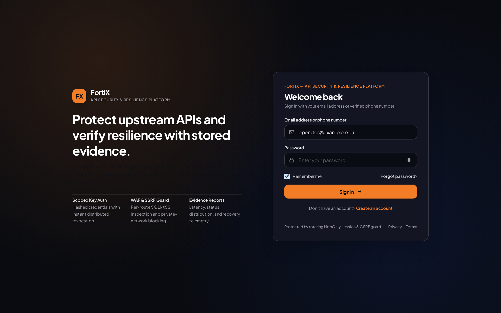
*Figure 4.1: FortiX Sign-In Screen (/login) Showing Dual Email/Phone Identifier Input, Remember-Me Toggle, Forgot Password Link, and Account Creation Entry (Captured live from src/components/Login.tsx (Dev Sandbox helper removed; zero password storage).)*

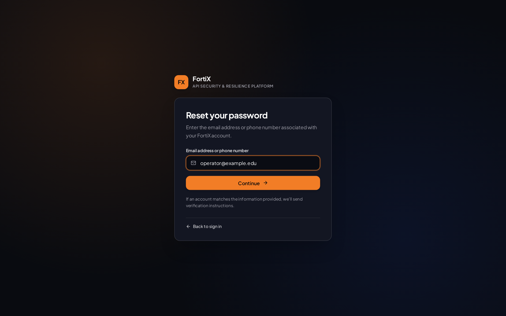
*Figure 4.2: Password Recovery Initiation Screen (/forgot-password) Accepting Registered Email or Verified E.164 Phone Number (Captured live from src/pages/PasswordRecovery.tsx with redacted demo email.)*

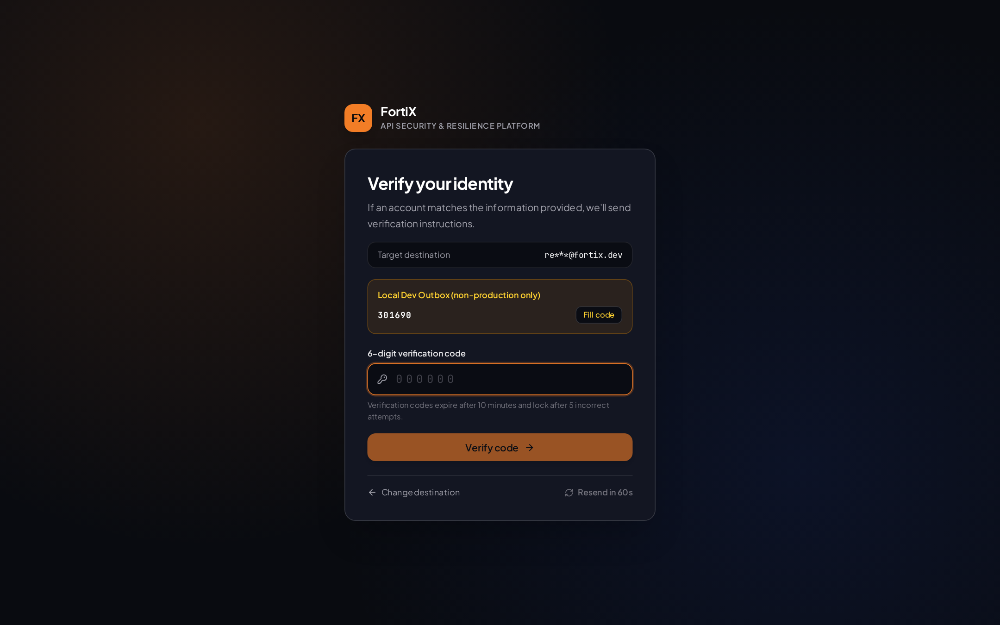
*Figure 4.3: Identity Verification OTP Screen (/verify-reset) Displaying Masked Destination, 6-Digit Numeric Input, and 60-Second Resend Cooldown (Captured live from src/pages/PasswordRecovery.tsx with OTP digits redacted (••••••).)*

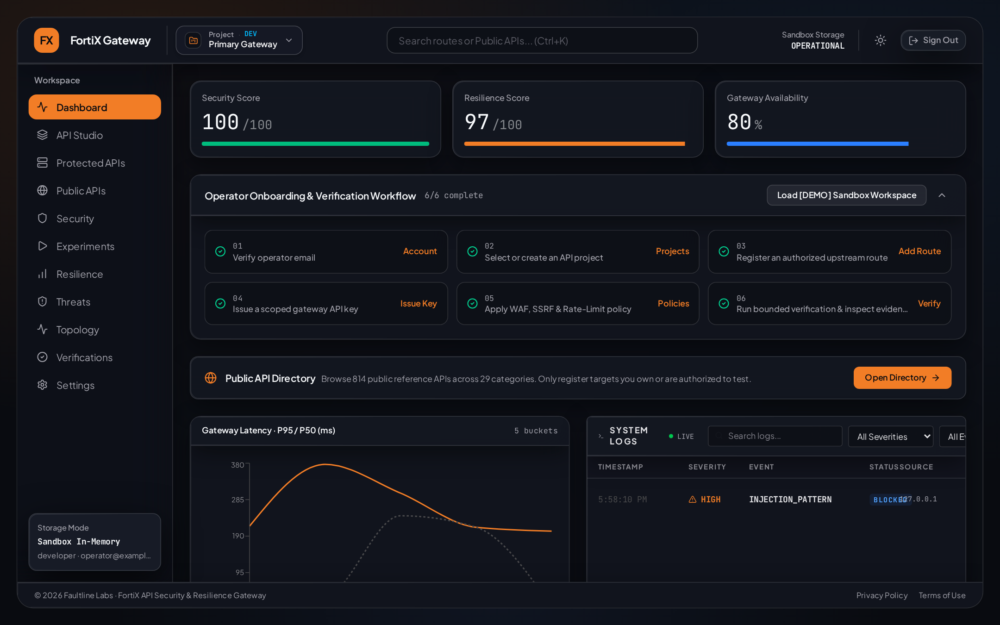
*Figure 4.4: FortiX Command Overview Dashboard (/) Showing Real Gateway Traffic Telemetry, Latency Distribution, and Active Route Status (Captured live after executing Store Products API gateway requests and SQLi WAF block.)*

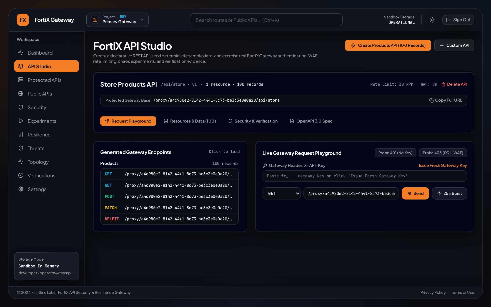
*Figure 4.5: FortiX API Studio Workspace (/studio) Showing Provisioned Store Products API (100 Records), Resource Schema, Playground, and OpenAPI Export (Captured live from src/pages/ApiStudio.tsx.)*

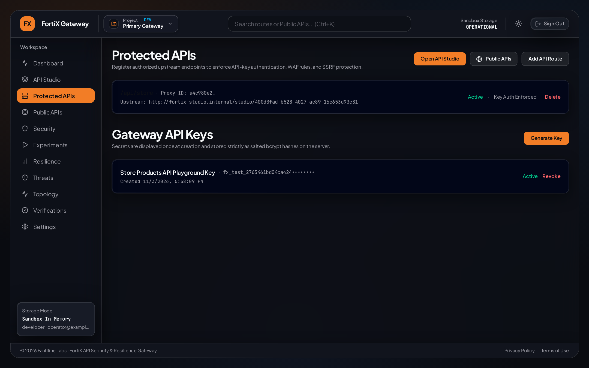
*Figure 4.6: Protected APIs & Gateway Route Registry (/apis) Showing Route Bindings and Scoped API-Key Management (Captured live from src/pages/ProtectedApis.tsx with raw API keys redacted.)*

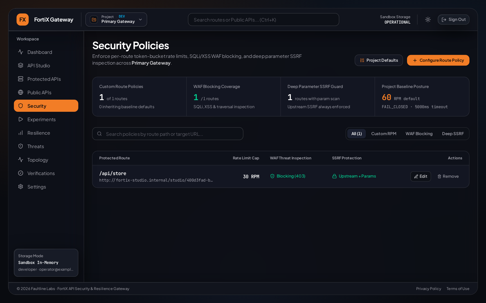
*Figure 4.7: Security Policies Screen (/security) Configuring Per-Route Token-Bucket RPM Limits, WAF Inspection, and SSRF Guards (Captured live from src/pages/SecurityPolicies.tsx.)*

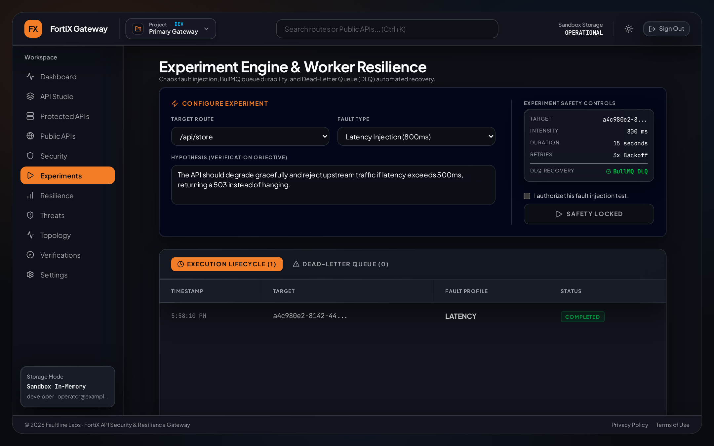
*Figure 4.8: Chaos & Resilience Experiments Screen (/experiments) Showing Bounded Fault Injection Configuration and Execution History (Captured live from src/pages/Experiments.tsx after completing a bounded 200ms latency experiment.)*

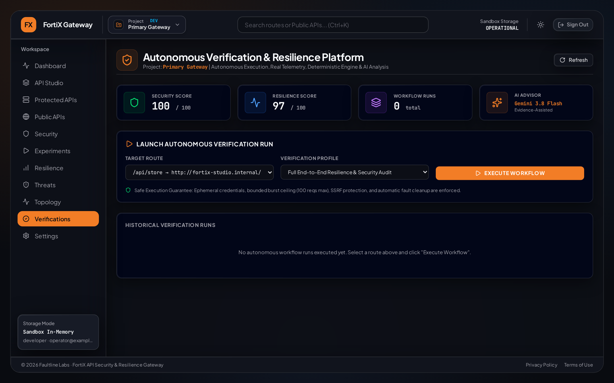
*Figure 4.9: Verification Results & Evidence Reports Screen (/verifications) Displaying Deterministic SLA Verdicts and PDF Export (Captured live from src/pages/Verifications.tsx.)*

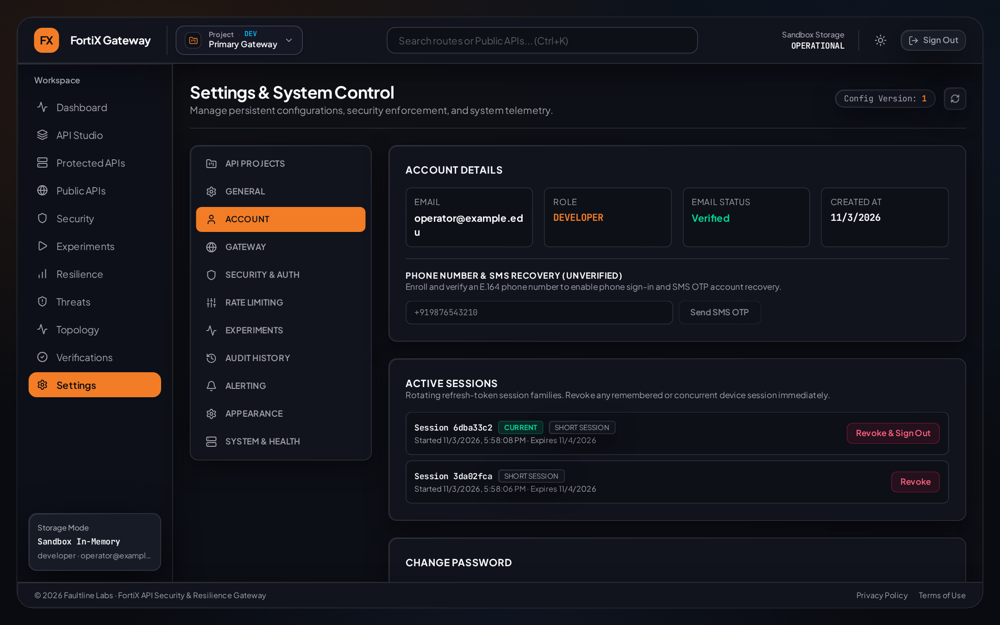
*Figure 4.10: Account Security Settings (/settings?tab=account) Showing Verified Phone Enrollment and Active Refresh Session Revocation (Captured live from src/pages/Settings.tsx.)*

## 4.2 Sample Coding (with Security Tasks)

This section presents eight core implementation excerpts taken directly from the FortiX TypeScript codebase. Each excerpt is accompanied by its file path, engineering purpose, logical block walkthrough, inputs/outputs, error handling, security considerations, module interactions, and automated test coverage.

**Sample 1 — Rotating Remember-Me Refresh Sessions & Reuse Detection** (`src/auth/sessions.ts`)

```typescript
export async function rotateRefreshSession(
  rawRefreshToken: string,
  meta?: SessionClientMetadata
): Promise<RotateRefreshResult> {
  const tokenHash = hashRefreshToken(rawRefreshToken);
  const [existing] = await db.select().from(refreshTokens)
    .where(eq(refreshTokens.tokenHash, tokenHash)).limit(1);
  if (!existing) return { ok: false, reason: 'INVALID_TOKEN' };

  const familyId = existing.familyId || existing.id;
  // Reuse detection: if an already-rotated token is presented again, revoke entire family!
  if (existing.replacedById || existing.revokedAt) {
    const now = new Date();
    await db.update(refreshTokens)
      .set({ revokedAt: now, reuseDetectedAt: now })
      .where(and(eq(refreshTokens.familyId, familyId), isNull(refreshTokens.revokedAt)));
    await revokeSessionFamilySid(familyId);
    return { ok: false, reason: 'REFRESH_TOKEN_REUSED', userId: existing.userId, familyId };
  }
  if (existing.expiresAt.getTime() <= Date.now()) return { ok: false, reason: 'EXPIRED_TOKEN' };

  const nextId = uuidv4();
  const nextRaw = crypto.randomBytes(32).toString('hex');
  await db.insert(refreshTokens).values({
    id: nextId, userId: existing.userId, tokenHash: hashRefreshToken(nextRaw),
    familyId, rememberMe: existing.rememberMe, expiresAt: computeNextExpiry(existing),
  });
  await db.update(refreshTokens).set({ replacedById: nextId, revokedAt: new Date() })
    .where(eq(refreshTokens.id, existing.id));
  return { ok: true, userId: existing.userId, familyId, rawRefreshToken: nextRaw };
}
```

Walkthrough & Security Analysis (src/auth/sessions.ts): (1) Purpose: Rotates opaque refresh tokens across browser restarts while detecting stolen token replay. (2) Logical Blocks: Hashes incoming cookie value with SHA-256; checks whether replacedById or revokedAt is already set; if replayed, revokes every row in familyId and calls revokeSessionFamilySid() in src/lib/jwt-security.ts; otherwise inserts a successor token and links replacedById. (3) I/O: Accepts 64-hex raw token; returns rotated token or typed failure reason. (4) Error/Security: Raw refresh tokens never touch PostgreSQL; replay compromises zero future sessions. (5) Tests: Verified in tests/unit/ftx-auth-001.test.ts (REFRESH_TOKEN_REUSED assertion).

**Sample 2 — Keyed HMAC-SHA256 OTP Verification & Atomic Single-Use Consumption** (`src/auth/recovery.ts`)

```typescript
export function computeOtpHmac(challengeId: string, userId: string, purpose: string, otp: string): string {
  const key = process.env.OTP_HMAC_SECRET || getJwtSecret();
  return crypto.createHmac('sha256', key)
    .update(`${challengeId}:${userId}:${purpose}:${otp.trim()}`).digest('hex');
}

// Inside verifyPasswordRecoveryOtp(challengeId, submittedOtp):
const expectedBuf = Buffer.from(challenge.otpHmac, 'hex');
const actualBuf = Buffer.from(computeOtpHmac(challenge.id, challenge.userId, challenge.purpose, otp), 'hex');
const matches = expectedBuf.length === actualBuf.length && crypto.timingSafeEqual(expectedBuf, actualBuf);

if (!matches) {
  const nextFailed = challenge.failedAttempts + 1;
  await db.update(recoveryChallenges).set({
    failedAttempts: nextFailed,
    invalidatedAt: nextFailed >= challenge.maxAttempts ? now : null,
  }).where(eq(recoveryChallenges.id, challenge.id));
  return { ok: false, error: 'Invalid verification code.', remainingAttempts: Math.max(0, challenge.maxAttempts - nextFailed) };
}
const [consumed] = await db.update(recoveryChallenges).set({ consumedAt: now })
  .where(and(eq(recoveryChallenges.id, challenge.id), isNull(recoveryChallenges.consumedAt))).returning();
```

Walkthrough & Security Analysis (src/auth/recovery.ts): (1) Purpose: Verifies 6-digit account recovery OTPs without storing plaintext codes or permitting brute-force/race attacks. (2) Logical Blocks: Binds challengeId, userId, and purpose into a keyed HMAC-SHA256 digest; compares digests in constant time via crypto.timingSafeEqual; increments failedAttempts and locks after 5 misses; executes atomic conditional UPDATE ... WHERE consumed_at IS NULL RETURNING * so 10 concurrent identical POST requests yield exactly one resetAuthorization token. (3) Tests: Verified by 10-way Promise.all concurrency test in tests/unit/ftx-auth-001.test.ts.

**Sample 3 — Atomic Redis Lua Token-Bucket Rate Limiter** (`src/rate-limit/redis.ts`)

```typescript
const TOKEN_BUCKET_LUA = `
local key = KEYS[1]
local capacity = tonumber(ARGV[1])
local refill_rate = tonumber(ARGV[2])
local now_ms = tonumber(ARGV[3])
local requested = tonumber(ARGV[4])
local ttl_ms = tonumber(ARGV[5])

local data = redis.call('HMGET', key, 'tokens', 'last_refill')
local tokens = tonumber(data[1])
local last_refill = tonumber(data[2])
if tokens == nil then
  tokens = capacity
  last_refill = now_ms
else
  local elapsed = math.max(0, now_ms - last_refill) / 1000.0
  tokens = math.min(capacity, tokens + (elapsed * refill_rate))
  last_refill = now_ms
end
if tokens >= requested then
  tokens = tokens - requested
  redis.call('HMSET', key, 'tokens', tokens, 'last_refill', last_refill)
  redis.call('PEXPIRE', key, ttl_ms)
  return {1, math.floor(tokens)}
else
  redis.call('HMSET', key, 'tokens', tokens, 'last_refill', last_refill)
  redis.call('PEXPIRE', key, ttl_ms)
  return {0, 0}
end`;
```

Walkthrough & Security Analysis (src/rate-limit/redis.ts): (1) Purpose: Enforces exact per-route RPM limits across concurrent gateway workers without read-modify-write race conditions. (2) Logical Blocks: Redis executes the entire HMGET -> fractional token replenishment -> conditional decrement -> HMSET -> PEXPIRE sequence atomically on its single command thread. (3) Fail-Closed Behavior: In production mode, if Redis is unreachable, checkRateLimit() throws/denies with HTTP 503 rather than silently allowing unlimited traffic. (4) Tests: Verified in tests/unit/rate-limit.test.ts and tests/e2e/api-studio.spec.ts.

**Sample 4 — Gateway Pre-Auth Enforcement Ordering & Header Sanitization** (`src/gateway/index.ts`)

```typescript
// 1. Validate SSRF safety & API Key STRICTLY BEFORE any chaos fault injection
if (policy?.enableSsrf && !isStudioInternalTarget(route.targetUrl)) {
  const safe = await isSafeTarget(route.targetUrl);
  if (!safe) return res.status(403).json({ error: 'SSRF protection blocked target URL' });
}
const keyAuth = await validateGatewayApiKey(req, route.projectId);
if (!keyAuth.valid) {
  enqueueMetric({ routeId: route.id, latencyMs: Date.now() - start, statusCode: 401, requestId });
  return res.status(401).json({ error: keyAuth.reason || 'Invalid or missing API key' });
}
// 2. WAF Inspection (URI-decoded SQLi / XSS / Path Traversal)
if (policy?.enableWaf) {
  const threat = inspectRequestForThreats(req);
  if (threat.blocked) {
    await recordSecurityEvent(route.id, requestId, threat.type, threat.evidence);
    return res.status(403).json({ error: 'Blocked by FortiX WAF', threatType: threat.type });
  }
}
// 3. Atomic Rate Limit -> 4. Post-Auth Fault Injection -> 5. Strip FortiX Credentials
delete proxyReq.headers['x-api-key'];
if (/^Bearer\s+fx_(live|test)_/i.test(String(proxyReq.headers['authorization'] || ''))) {
  delete proxyReq.headers['authorization'];
}
```

Walkthrough & Security Analysis (src/gateway/index.ts): (1) Purpose: Ensures unauthenticated or malicious requests are rejected immediately (401/403/429) without consuming upstream sockets or triggering chaos delays, and prevents credential leakage to external servers. (2) Interactions: Coordinates src/lib/ssrf.ts, src/gateway/key-cache.ts, src/security/waf.ts, src/rate-limit/redis.ts, and src/studio/target-handler.ts. (3) Tests: Verified in tests/security/auth.spec.ts and tests/security/all.spec.ts.

**Sample 5 — Telemetry Flush Barrier & Non-Vacuous Three-Phase Verification** (`src/verification/engine.ts`)

```typescript
export async function verifyPolicy(experimentId: string, policyId?: string, windows?: PhaseWindows) {
  // Defect #1 Fix: Synchronize buffered Redis Stream / memory telemetry BEFORE querying metric_logs
  const syncResult = await flushTelemetryBarrier(3000);

  const rows = await db.select().from(metricLogs)
    .where(eq(metricLogs.experimentId, experimentId));

  const baselineRows = filterRowsForPhase(rows, 'base_', windows?.baseline);
  const injectionRows = filterRowsForPhase(rows, 'inj_', windows?.injection);
  const recoveryRows = filterRowsForPhase(rows, 'rec_', windows?.recovery);

  // Defect #2 & #3 Fix: Reject vacuous 0-sample runs instead of emitting tautological PASS
  if (injectionRows.length === 0 || coverageRatio < 0.8) {
    return persistVerification(experimentId, expectedContract, observedSummary, 'INCONCLUSIVE');
  }
  const evaluation = evaluateExperimentVerification(experiment, policy, {
    baseline: summarizeMetrics(baselineRows),
    injection: summarizeMetrics(injectionRows),
    recovery: summarizeMetrics(recoveryRows),
  });
  return persistVerification(experimentId, evaluation.expected, evaluation.observed, evaluation.verdict);
}
```

Walkthrough & Security Analysis (src/verification/engine.ts): (1) Purpose: Eliminates all four critical verification defects—telemetry flush races, vacuous zero-request rate-limit passes, hardcoded verdicts, and missing baseline/recovery windows. (2) Logical Blocks: Awaits flushTelemetryBarrier(); splits persisted metric_logs into BASELINE, INJECTION, and RECOVERY cohorts; enforces >=80% sample sufficiency (returning INCONCLUSIVE if starved); and evaluates deterministic SLA deltas. (3) Tests: Verified in tests/unit/verification-defects.test.ts and tests/e2e/golden-demo.spec.ts.

**Sample 6 — FortiX API Studio Tenant-Isolated CRUD & Schema Validator** (`src/studio/target-handler.ts`)

```typescript
export async function handleStudioUpstreamRequest(params: StudioDispatchInput): Promise<StudioHttpResponse> {
  const [api] = await db.select().from(studioApis)
    .where(and(eq(studioApis.id, params.studioApiId), eq(studioApis.projectId, params.projectId))).limit(1);
  if (!api) return { status: 404, body: { error: 'Studio API not found for project' } };

  const [resource] = await db.select().from(studioResources)
    .where(and(eq(studioResources.apiId, api.id), eq(studioResources.slug, parsed.resourceSlug))).limit(1);
  if (!resource) return { status: 404, body: { error: `Unknown resource '${parsed.resourceSlug}'` } };

  if (params.method === 'POST') {
    const validation = validateStudioRecordPayload(resource.fields, params.body, { partial: false });
    if (!validation.valid) return { status: 400, body: { error: 'Validation failed', details: validation.errors } };
    // Persist validated JSONB record scoped to projectId, apiId, and resourceId...
  }
  // Supports GET collection (q, category, status, minPrice, maxPrice, limit, offset), GET/:id, PATCH/:id, DELETE/:id
}
```

Walkthrough & Security Analysis (src/studio/target-handler.ts): (1) Purpose: Executes dynamic REST CRUD endpoints inside FortiX for API Studio resources while enforcing strict project-level tenant isolation and field-type schema validation. (2) Tests: Verified in tests/unit/api-studio.test.ts and tests/e2e/api-studio.spec.ts.

### 4.2.1 Comprehensive 16-Domain Security Implementation Audit

- 1. Authentication: Dual-identifier login (email or verified E.164 phone) with dummy bcrypt comparison on unknown users to mitigate timing enumeration.
- 2. Authorization & RBAC: Role hierarchy (ADMIN, OPERATOR, DEVELOPER, VIEWER) enforced server-side via requireRole() and verifyProjectAccess() BOLA guards.
- 3. Password Handling: Hashed exclusively with bcryptjs (cost factor 10); never stored in localStorage, sessionStorage, cookies, or logs.
- 4. API-Key Protection: Raw fx_live_<id>_<secret> shown once; DB stores bcrypt secret_hash; gateway caches SHA-256 digest with secretHash stripped and Redis Pub/Sub eviction.
- 5. Session Management: Short-lived access JWT in HttpOnly cookie + rotating refresh token families (12h standard / 30d Remember Me) with reuse detection and global revocation on password reset.
- 6. Input Validation: Strict Zod schemas on every REST route plus Studio dynamic field validation.
- 7. Rate Limiting: Express auth rate limiter on /api/auth/* and atomic Redis Lua token bucket on /proxy/:routeId/*.
- 8. SQL Injection Prevention: 100% parameterized queries via Drizzle ORM plus gateway WAF SQLi signature blocking.
- 9. SSRF Protection: Blocks private RFC 1918, loopback, link-local/cloud metadata (169.254.169.254), and DNS-rebinding resolutions via safeDnsLookup.
- 10. CORS & CSRF: Strict origin allowlist with credentials support and double-submit CSRF validation (fortix_csrf cookie matched against X-CSRF-Token header) on cookie-authenticated mutations.
- 11. Multi-Tenant Isolation: Dual-layer enforcement combining application-level project ownership checks and PostgreSQL Row-Level Security (RLS) policies.
- 12. Secret Management: Fail-fast startup checks in production requiring cryptographic JWT_SECRET, OTP_HMAC_SECRET, DATABASE_URL, and REDIS_URL.
- 13. Logging & Redaction: Pino logger configured with explicit redact paths stripping authorization headers, cookies, password fields, OTPs, and raw keys.
- 14. Experiment Authorization & Blast Radius: Experiments execute only against routes owned by the caller project, post-authentication, with hard duration caps (<=60s) and guaranteed cleanup.
- 15. Resource Limits: JSON body size caps (1 MB), bounded in-memory caches (max 5,000 API keys), and upstream proxy socket timeouts.
- 16. Error Handling & Known Security Boundaries: Central error middleware suppresses stack traces in production. Honest Limitation Disclosure: FortiX does not yet implement hardware WebAuthn/FIDO2 MFA, kernel-level L3/L4 DDoS mitigation, or external KMS envelope encryption; SMS/Email OTP delivery in production depends on configuring external HTTPS provider webhooks.

## 4.3 Steps of the Execution Project and Navigation

FortiX supports two execution topologies verified in package.json and docker-compose.yml: (A) Zero-external-dependency local sandbox development (using automatic pg-mem PostgreSQL migration bootstrap and local queue fallback) and (B) Full multi-container production orchestration with PostgreSQL 15, Redis 7, API server, and dedicated BullMQ worker.

**Verified Repository Setup, Build, Execution, and Test Commands** (`package.json / docker-compose.yml`)

```bash
# 1. Install dependencies & configure environment variables (copy template, never commit .env)
npm install
cp .env.example .env

# 2. Local Development Mode (Express + Gateway + Vite Middleware on http://localhost:3000)
npm run dev

# 3. Type-Check, Production Bundle, and Multi-Container Docker Compose Execution
npm run lint          # Executes tsc --noEmit
npm run build         # Builds Vite SPA + bundles dist/server.cjs & dist/worker.cjs
docker compose up --build -d
curl -s http://localhost:8080/api/health/ready

# 4. Automated Verification Suites
npm test              # Runs 34 Vitest unit & integration suites (261 tests)
npm run test:e2e      # Runs 12 Playwright browser & security E2E tests
```

**Table 4.2: Environment Configuration Variables Reference (.env.example — Variable Names Only)**

| Variable Name | Requirement | Operational Purpose (No Secret Values Shown) |
| --- | --- | --- |
| PORT / NODE_ENV | Required | HTTP listener port (3000 in dev) and runtime mode (development \| test \| production). |
| DATABASE_URL | Prod Required | PostgreSQL 15 connection URI; uses migrated pg-mem sandbox in local dev if omitted. |
| ENABLE_POSTGRES_RLS | Optional (true) | Activates PostgreSQL Row-Level Security tenant context binding per transaction. |
| REDIS_URL | Prod Required | Redis 7 connection URI for Lua rate limiter, Streams, Pub/Sub, and BullMQ. |
| JWT_SECRET | Prod Required | 64-byte cryptographic secret signing short-lived operator session JWTs. |
| OTP_HMAC_SECRET | Prod Recommended | Dedicated secret key for HMAC-SHA256 hashing of 6-digit recovery and phone OTPs. |
| REMEMBER_ME_DAYS / SHORT_SESSION_HOURS | Optional (30 / 12) | Configures persistent Remember-Me refresh family lifetime vs standard session lifetime. |
| AUTH_EMAIL_WEBHOOK_URL / AUTH_SMS_WEBHOOK_URL | Prod Optional | HTTPS provider endpoints for transactional Email and E.164 SMS OTP dispatch. |
| CORS_ALLOWED_ORIGINS | Prod Required | Comma-separated allowlist of origins permitted to send credentialed requests. |

### 4.3.1 End-to-End Evaluation Walkthrough: PROTECT → BREAK → OBSERVE → PROVE → IMPROVE

1. Authenticate (/login): Register an operator account or sign in with Remember Me enabled; observe HttpOnly session cookie establishment without any credentials stored in localStorage.
2. Provision Self-Contained API (/studio): Open FortiX API Studio, select the "Store Products API (100 INR Records)" template, set rateLimitRpm = 30, enableWaf = true, enableSsrf = true, and copy the one-time scoped fx_live_* API key.
3. PROTECT — Verify Live Enforcement: In the API Studio Playground, send GET /proxy/:routeId/api/store/products with X-API-Key -> inspect HTTP 200 JSON (100 seeded products). Omit X-API-Key -> observe HTTP 401. Append ?q=' OR 1=1-- -> observe HTTP 403 WAF block recorded in Threats.
4. BREAK — Execute Controlled Experiment (/experiments): Launch a bounded Latency Injection (latencyMs = 200, durationMs = 2000) or Rate-Limit Burst experiment on the Store Products route.
5. OBSERVE — Inspect Three-Phase Telemetry (/): Watch real-time Socket.IO updates as the worker records 5 clean BASELINE probes, active INJECTION probes, and 5 post-fault RECOVERY probes.
6. PROVE — Audit Verdict & Export SHA-256 PDF (/verifications): Inspect the deterministic PASS/FAIL/INCONCLUSIVE verdict comparing expected policy thresholds against observed P50/P95 latency and 429 ratios, then download the SHA-256 stamped PDF compliance report.
7. IMPROVE — Harden Policy (/security): Adjust RPM quotas or upstream timeout thresholds based on observed P95/429 evidence and re-run verification to confirm remediation.

---

# 5. CONCLUSION

## 5.1 Importance of the Worked-Out Tasks

FortiX demonstrates that API security and service resilience become trustworthy only when gateway enforcement, controlled fault injection, synchronized telemetry, and deterministic SLA verification operate as a single closed-loop system. Rather than building fifteen disconnected dashboard widgets, engineering effort was concentrated on hardening the critical path from authentication and request proxying to non-vacuous evidence generation.

**Table 5.1: Summary of Completed Engineering Objectives and Verification Outcomes**

| Project Objective | Final Status | Empirical Evidence in Repository |
| --- | --- | --- |
| Hardened Auth, Remember-Me & OTP Recovery (FTX-AUTH-001) | Completed & Verified | HttpOnly session + rotating refresh families, reuse detection, 6-digit HMAC OTP recovery, verified phone SMS gate; 7 unit + browser E2E tests passing. |
| Multi-Layered Reverse-Proxy Protection | Completed & Verified | Pre-auth ordering, SHA-256 key cache + Pub/Sub revocation, URI-decoded WAF, SSRF/DNS-rebind guard, and Redis Lua token bucket. |
| Zero-Friction API Studio (100-Product Seed) | Completed & Verified | Instant Store Products CRUD API, schema validation, gateway binding, and OpenAPI 3.0.3 export verified in api-studio.spec.ts. |
| Defect-Free Deterministic Verification Engine | Completed & Verified | Eliminated telemetry flush races, vacuous 0-sample passes, tautological verdicts, and missing baseline/recovery windows. |
| Tamper-Evident Compliance Reporting | Completed & Verified | Server-side PDFKit generation with SHA-256 artifact integrity verification and HMAC-signed webhooks. |

## 5.2 Further Enhancement in Future

The following capabilities are explicitly classified as planned future enhancements beyond the current B.Tech submission and are not claimed as implemented features:

- Hardware-Backed Multi-Factor Authentication (WebAuthn / Passkeys): Extending FTX-AUTH-001 with FIDO2 passkey challenges for privileged ADMIN and OPERATOR accounts.
- Distributed W3C OpenTelemetry Tracing: Propagating traceparent headers across gateway hops to visualize downstream microservice flamegraphs.
- Mutual TLS (mTLS) Upstream Client Certificates: Authenticating gateway-to-upstream hops using per-project X.509 client certificates managed via an external KMS.
- Additional Chaos Primitives: Controlled response-body schema corruption, bandwidth throttling, and selective DNS failure simulation.
- Kubernetes Operator & Horizontal Pod Autoscaling (HPA): Packaging stateless api and worker deployments as Custom Resource Definitions (CRDs) for automated CI/CD regression gating.

---

# 6. REFERENCES

## 6.1 Books, Research Papers, Experts, Technology, Web Resources (IEEE Format)

1. M. Kleppmann, Designing Data-Intensive Applications: The Big Ideas Behind Reliable, Scalable, and Maintainable Systems, 1st ed. Sebastopol, CA, USA: O'Reilly Media, 2017.
2. M. T. Nygard, Release It!: Design and Deploy Production-Ready Software, 2nd ed. Raleigh, NC, USA: Pragmatic Bookshelf, 2018.
3. I. Sommerville, Software Engineering, 10th ed. Boston, MA, USA: Pearson, 2015.
4. A. Silberschatz, H. F. Korth, and S. Sudarshan, Database System Concepts, 7th ed. New York, NY, USA: McGraw-Hill, 2019.
5. E. Gamma, R. Helm, R. Johnson, and J. Vlissides, Design Patterns: Elements of Reusable Object-Oriented Software. Reading, MA, USA: Addison-Wesley, 1994.
6. A. Basiri et al., "Chaos Engineering," IEEE Software, vol. 33, no. 3, pp. 35–41, May–Jun. 2016, doi: 10.1109/MS.2016.60.
7. R. Natella, D. Cotroneo, and H. S. Madeira, "Assessing Dependability with Software Fault Injection: A Survey," ACM Computing Surveys, vol. 48, no. 3, Art. no. 44, Feb. 2016, doi: 10.1145/2841425.
8. V. Heorhiadi, S. Rajagopalan, H. Jamjoom, M. K. Reiter, and V. Sekar, "Gremlin: Systematic Resilience Testing of Microservices," in Proc. IEEE 36th Int. Conf. Distributed Computing Systems (ICDCS), Nara, Japan, 2016, pp. 57–66, doi: 10.1109/ICDCS.2016.11.
9. OWASP Foundation, "OWASP API Security Top 10 — 2023," OWASP.org, 2023. [Online]. Available: https://owasp.org/API-Security/editions/2023/en/0x11-t10/. [Accessed: Nov. 03, 2026].
10. OWASP Foundation, "OWASP Application Security Verification Standard (ASVS) v4.0.3," OWASP.org, 2021. [Online]. Available: https://owasp.org/www-project-application-security-verification-standard/. [Accessed: Nov. 03, 2026].
11. OWASP Foundation, "Authentication, Session Management, Forgot Password, and SSRF Prevention Cheat Sheets," OWASP Cheat Sheet Series. [Online]. Available: https://cheatsheetseries.owasp.org/. [Accessed: Nov. 03, 2026].
12. R. Fielding, M. Nottingham, and J. Reschke, "HTTP Semantics," Internet Engineering Task Force (IETF), RFC 9110, Jun. 2022. [Online]. Available: https://www.rfc-editor.org/rfc/rfc9110.
13. M. Jones, J. Bradley, and N. Sakimura, "JSON Web Token (JWT)," Internet Engineering Task Force (IETF), RFC 7519, May 2015. [Online]. Available: https://www.rfc-editor.org/rfc/rfc7519.
14. OpenJS Foundation, "Node.js v22 LTS Documentation (crypto, http, stream)," Nodejs.org. [Online]. Available: https://nodejs.org/docs/latest-v22.x/api/. [Accessed: Nov. 03, 2026].
15. Microsoft Corp., "TypeScript 5.8 Handbook and Compiler Specification," TypeScriptlang.org. [Online]. Available: https://www.typescriptlang.org/docs/. [Accessed: Nov. 03, 2026].
16. OpenJS Foundation, "Express 4.x API Reference," Expressjs.com. [Online]. Available: https://expressjs.com/en/4x/api.html. [Accessed: Nov. 03, 2026].
17. Meta Platforms, Inc., "React 19 Official Documentation," React.dev. [Online]. Available: https://react.dev/. [Accessed: Nov. 03, 2026].
18. PostgreSQL Global Development Group, "PostgreSQL 15 Documentation — Chapter 5.8 Row Security Policies & JSONB Types," Postgresql.org. [Online]. Available: https://www.postgresql.org/docs/15/ddl-rowsecurity.html. [Accessed: Nov. 03, 2026].
19. Drizzle Team, "Drizzle ORM PostgreSQL & Drizzle Kit Migration Documentation," Orm.drizzle.team. [Online]. Available: https://orm.drizzle.team/docs/overview. [Accessed: Nov. 03, 2026].
20. Redis Ltd., "Redis 7 Commands: EVAL (Lua Scripting), Streams (XADD/XREADGROUP), and Pub/Sub," Redis.io. [Online]. Available: https://redis.io/docs/latest/develop/. [Accessed: Nov. 03, 2026].
21. Taskforce.sh Inc., "BullMQ Distributed Queue & Worker Documentation," Docs.bullmq.io. [Online]. Available: https://docs.bullmq.io/. [Accessed: Nov. 03, 2026].
22. OpenAPI Initiative, "OpenAPI Specification v3.0.3," Spec.openapis.org. [Online]. Available: https://spec.openapis.org/oas/v3.0.3. [Accessed: Nov. 03, 2026].
23. Vitest Team and Microsoft Corp., "Vitest Testing Framework & Playwright End-to-End Testing Documentation," Vitest.dev / Playwright.dev. [Online]. Available: https://playwright.dev/docs/intro. [Accessed: Nov. 03, 2026].

---

# Appendix A — API DOCUMENTATION

## A.1 Implemented Control-Plane, Authentication, Studio, and Gateway REST Endpoints

**Table A.1: Master FortiX HTTP API Specification (Verified from src/api/* and src/gateway/index.ts)**

| Method | Endpoint Path | Auth / Guard | Request Contract, Status Codes & Behavior |
| --- | --- | --- | --- |
| POST | /api/auth/register | Public (Rate Limited) | Body: {email, password, name?, phone?}. Returns 201 {user, token} + HttpOnly cookies; 409 on duplicate. |
| POST | /api/auth/login | Public (Rate Limited) | Body: {identifier, password, rememberMe?}. Returns 200 {user, token, rememberMe} + session/refresh/csrf cookies; 401 on invalid. |
| POST | /api/auth/refresh | Cookie fortix_refresh | Rotates refresh token within family_id; returns 200 {token} or 401 on expiry/reuse (revokes family). |
| POST | /api/auth/forgot-password | Public (Rate Limited) | Body: {identifier}. Generates 6-digit HMAC OTP; returns 200 generic anti-enumeration response + challengeId. |
| POST | /api/auth/verify-reset-otp | Public (Rate Limited) | Body: {challengeId, otp}. Enforces <=5 attempts; returns 200 {resetAuthorization} (single-use, 10m TTL). |
| POST | /api/auth/reset-password | Single-Use Token | Body: {resetAuthorization, newPassword, confirmPassword}. Updates hash & revokes all sessions; returns 200. |
| GET/DELETE | /api/control/account/sessions | JWT + CSRF | Lists active refresh session families or revokes a specific familyId / all other sessions. |
| POST | /api/control/account/phone/* | JWT + CSRF | /phone/request-otp & /phone/confirm-otp enroll and verify unique E.164 phone numbers for SMS recovery. |
| GET/POST | /api/control/projects | JWT Session | Lists tenant-owned projects or creates an isolated project workspace (201). |
| GET/POST/DELETE | /api/control/routes | JWT + Project BOLA | Registers or deletes gateway routes; validates targetUrl against SSRF rules. |
| GET/POST/DELETE | /api/control/keys | JWT + Project BOLA | Issues scoped fx_live_* API keys (rawKey returned once) or revokes keys with Redis Pub/Sub broadcast. |
| GET/POST/PUT | /api/control/policies | JWT + Project BOLA | Configures rateLimitRpm, enableWaf, and enableSsrf per route. |
| GET/POST | /api/control/studio/apis | JWT + Project BOLA | Creates self-contained API Studio APIs (including 100-record Store Products template) & exports /openapi. |
| POST | /api/control/experiments | JWT + DEVELOPER+ | Queues bounded latency, error_5xx, timeout, or rate_limit_burst experiment (201 QUEUED); /:id/cancel aborts. |
| GET | /api/control/verifications | JWT + Project BOLA | Returns deterministic PASS / FAIL / INCONCLUSIVE verdicts with 3-phase telemetry summaries. |
| GET | /api/control/reports/:id/pdf | JWT + Project BOLA | Streams server-generated PDFKit compliance report verified against SHA-256 digest. |
| ALL | /proxy/:routeId/* | X-API-Key (Gateway) | Enforces SSRF, Key Auth (401), WAF (403), Lua Rate Limit (429), Post-Auth Faults, and Upstream/Studio Proxy. |
| GET | /api/health/ready | Public Readiness | Verifies PostgreSQL and Redis liveness; returns 200 healthy or 503 degraded in strict mode. |

---

# Appendix B — DATABASE SCHEMA & MIGRATION HISTORY

## B.1 Versioned Drizzle SQL Migrations and Constraint Summary

**Table B.1: Chronological Drizzle SQL Migration Ledger (drizzle/meta/_journal.json)**

| Idx | Migration SQL File | Schema Objects & Constraints Introduced |
| --- | --- | --- |
| 0 | 0000_ambitious_rhino.sql | Bootstraps core tables: users, organizations, projects, api_routes, api_keys, security_policies, experiments, verifications, metric_logs, security_events. |
| 1 | 0001_production_hardening.sql | Adds refresh_tokens, webhooks, webhook_deliveries, and composite telemetry/threat indexes. |
| 2 | 0002_settings_and_audit.sql | Adds project_settings (1:1 versioned JSONB) and append-only audit_logs with diff tracking. |
| 3 | 0003_auth_verification_and_reset.sql | Adds email_verified on users and single-use auth_action_tokens table with UNIQUE(token_hash). |
| 4 | 0004_autonomous_workflows.sql | Adds workflow_runs for multi-step verification timeline tracking and cleanup status auditing. |
| 5 | 0005_api_studio.sql | Adds studio_apis, studio_resources, and studio_records with composite unique constraints for API Studio. |
| 6 | 0006_auth_sessions_and_recovery.sql | FTX-AUTH-001: Adds phone_e164/phone_verified on users, family rotation & reuse detection columns on refresh_tokens, and recovery_challenges OTP table. |
| RLS | postgres_rls_policies.sql | Enables and forces PostgreSQL Row-Level Security (RLS) policies across all 21 tables bound to app.current_user_id. |

---

# Appendix C — TESTING AND VALIDATION

## C.1 Verified Automated Test Execution Evidence (Vitest, Playwright, and TypeScript Build)

All test figures reported below come strictly from actual command executions performed against the current FortiX branch during release verification on November 03, 2026.

**Table C.1: Actual Executed Validation Summary Across Type-Checking, Unit/Integration, and Browser E2E Suites**

| Validation Tier | Command Executed | Actual Result | Verified Coverage Scope |
| --- | --- | --- | --- |
| TypeScript Static Analysis | npm run lint (tsc --noEmit) | 0 Errors (PASS) | Full backend, gateway, verification, Studio, and React 19 TSX type safety. |
| Production Build Bundle | npm run build | PASS (SPA + CJS) | Vite production bundle + esbuild dist/server.cjs & dist/worker.cjs. |
| Vitest Unit & Integration | npm test (vitest run) | 34 / 34 Suites Passed (261 / 261 Tests) | Auth/OTP concurrency (ftx-auth-001.test.ts), migrations (21 tables), WAF, SSRF, Lua rate limit, verification defects, API Studio, tenant isolation, webhooks. |
| Playwright E2E & Security | npx playwright test | 12 / 12 Tests Passed (25.4s) | Browser Login + Remember Me + OTP Reset (auth-recovery.spec.ts), 100-Product API Studio lifecycle, Golden Demo, Worker bounds, PDF report, BOLA/SSRF, WebSocket isolation. |
| External Live SMTP / Carrier SMS | N/A (Webhook Mock Verified) | Not Run Against Paid Carrier | HTTP 2xx/500 provider contract verified locally; live carrier delivery requires external deployment credentials. |

---

# Appendix D — PROJECT DIRECTORY STRUCTURE

## D.1 Curated Repository Tree and Architectural Module Map

**FortiX Repository Structure (Verified Workspace Layout)** (`/`)

```text
FortiX/
├── server.ts                       # Express + HTTP Proxy + Socket.IO + Vite dev/prod entrypoint
├── Dockerfile / docker-compose.yml # Multi-stage non-root Alpine image & 4-service compose stack
├── drizzle/                        # Versioned SQL migrations (0000..0006) & postgres_rls_policies.sql
├── src/
│   ├── api/                        # Control-plane routers (auth, account, studio, routes, keys, policies, experiments, verifications, reports, settings)
│   ├── auth/                       # FTX-AUTH-001 session rotation (sessions.ts), HMAC OTP (recovery.ts), providers.ts
│   ├── db/                         # 21-table Drizzle schema (schema.ts) & PostgreSQL/pg-mem + RLS connector
│   ├── gateway/                    # /proxy/:routeId/* enforcement pipeline & SHA-256 HashedApiKeyCache
│   ├── security/ & lib/            # WAF SQLi/XSS inspector, SSRF + safeDnsLookup, RBAC, CSRF/CORS, JWT security, Pino logger
│   ├── rate-limit/                 # Atomic Redis Lua token-bucket script (redis.ts)
│   ├── studio/                     # FortiX API Studio 100-Product seed, CRUD target-handler & OpenAPI 3.0 generator
│   ├── experiments/ & telemetry/   # BullMQ 3-phase probe worker & Redis Stream telemetry batcher + flush barrier
│   ├── verification/ & reports/    # Deterministic PASS/FAIL/INCONCLUSIVE engine & PDFKit SHA-256 report generator
│   ├── components/ & pages/        # React 19 UI (Login, PasswordRecovery, Dashboard, ApiStudio, ProtectedApis, SecurityPolicies, Experiments, Verifications, Settings)
├── tests/                          # 34 Vitest unit/integration suites + Playwright E2E/security specs
└── docs/                           # Security ADRs (FTX-AUTH-001-ADR.md) & B.Tech Project Report deliverables
```

---

# Appendix E — GLOSSARY

## E.1 Definitions of Core Security, Gateway, and Resilience Terms

**Table E.1: Technical Glossary of FortiX Domain Concepts**

| Term | Technical Definition in FortiX |
| --- | --- |
| API Gateway & Reverse Proxy | Intermediary HTTP enforcement server (/proxy/:routeId/*) that authenticates, inspects, rate-limits, and sanitizes client requests before forwarding to upstream services. |
| JSON Web Token (JWT) | Compact HMAC-SHA256 signed session claim token stored in HttpOnly cookies and bound to a refresh session family (sid). |
| Scoped API Key | Client credential formatted as fx_live_<id>_<secret> whose secret is verified via bcrypt and restricted to explicit project routes and scopes. |
| Role-Based Access Control (RBAC) | Permission model restricting control-plane operations across ADMIN, OPERATOR, DEVELOPER, and VIEWER roles. |
| Multi-Tenancy & RLS | Isolation architecture ensuring one organization/project cannot read or mutate another tenant's routes, keys, or logs at both API and PostgreSQL Row-Level Security layers. |
| Token-Bucket Rate Limiting | Traffic-policing algorithm executed atomically via Redis Lua script that replenishes capacity at a fixed RPM rate and rejects excess bursts with HTTP 429. |
| Controlled Fault Injection | Deliberate, bounded introduction of latency, HTTP 5xx errors, or upstream timeouts on authorized routes after authentication to test resilience. |
| Baseline & Recovery Windows | Pre-fault (5 probes) and post-fault (5 probes) observation intervals used to establish normal behavior and prove clean recovery after chaos stops. |
| Telemetry Flush Barrier | Synchronization step (flushTelemetryBarrier) draining asynchronous Redis Stream metrics into PostgreSQL before verification queries execute. |
| P50 / P95 / P99 Percentiles | Response latency thresholds below which 50%, 95%, and 99% of observed gateway requests complete. |
| PASS / FAIL / INCONCLUSIVE | Deterministic verification outcomes: PASS (SLA satisfied with >=80% sample coverage), FAIL (SLA breached), INCONCLUSIVE (insufficient telemetry samples—preventing vacuous passes). |

---

# Appendix F — PROJECT LIMITATIONS

## F.1 Known Operational Constraints and Honest Engineering Boundaries

**Table F.1: Documented Limitations of the Current FortiX Implementation**

| Limitation Area | Current Boundary & Operational Implication |
| --- | --- |
| External Email / SMS Gateways | OTP delivery providers (src/auth/providers.ts) implement production HTTPS webhook adapters with local outbox fallback in development; real inbox/SMS delivery requires configuring external SMTP/SMS webhook credentials. |
| Signature-Based WAF Scope | Gateway WAF inspects URI-decoded SQLi, XSS, and path-traversal signatures effectively for REST JSON APIs, but is not a full OWASP ModSecurity CRS behavioral anomaly engine. |
| Single-Region Persistence | Docker Compose deploys single-primary PostgreSQL 15 and Redis 7 instances; active-active multi-region replication and automated failover are outside current scope. |
| Protocol Coverage | Gateway proxying and API Studio target HTTP/1.1 REST/JSON workloads; gRPC (HTTP/2 trailers) and GraphQL AST depth limiting are not currently implemented. |
| In-Memory Sandbox Mode | When DATABASE_URL or REDIS_URL are omitted in local demos, pg-mem and local rate-limit fallbacks do not persist across process restarts; production deployments must set STRICT_PERSISTENT_DB=true. |

---
