# FORTIX — API Security & Resilience Verification Platform (Revised & Authenticity-Audited Edition)
**Core Principle:** `PROTECT → BREAK → OBSERVE → PROVE → IMPROVE`  
**Degree Program:** Bachelor of Technology (B.Tech.) in Information Technology  
**Department:** Department of Information Technology, [Name of Institute / Engineering College]  
**Affiliating University:** [Name of Affiliating University] (Academic Year 2025–2026)  
**Repository & Audited Commit:** https://github.com/mr-vdnt/FortiX (`main @ a97c14fb53d0bd3c915016cfdfafe4524c288517 (Source & Sandbox Audited)`)

---

## PRELIMINARY PAGES

### Certificate

This is to certify that the B.Tech. Final Year Major Project Report entitled "FORTIX — API Security & Resilience Verification Platform" submitted by [Team Member 1 Name] ([Enrollment / Roll No. 1]), [Team Member 2 Name] ([Enrollment / Roll No. 2]), and [Team Member 3 Name] ([Enrollment / Roll No. 3]) in partial fulfillment of the requirements for the award of the degree of Bachelor of Technology in Information Technology at [Name of Institute / Engineering College], affiliated to [Name of Affiliating University], during the [Academic Year 2025–2026], is a bona fide record of software engineering design, implementation, and empirical verification carried out under our supervision.

The software artifacts, database schema, security controls, automated verification workflows, and test results documented in this report reflect actual engineering work implemented in the project repository and have not been submitted elsewhere for the award of any other degree or diploma.

### Candidate Declaration

We hereby declare that the project report entitled "FORTIX — API Security & Resilience Verification Platform" submitted in partial fulfillment of the degree of Bachelor of Technology in Information Technology is our original work carried out during the [Academic Year 2025–2026].

Every architectural diagram, database table specification, verbatim source code slice, UI screenshot, and automated test figure in this revised document is anchored to commit a97c14fb53d0bd3c915016cfdfafe4524c288517 of the FortiX repository. Throughout this report we strictly distinguish between SOURCE-CONFIRMED implementations (verified in repository TypeScript/SQL/Docker files), RUNTIME-VERIFIED behaviors (executed and logged in the Node.js 22 + Chromium test sandbox backed by pg-mem and local/in-memory Redis fallbacks), and INFRASTRUCTURE-BLOCKED or STUB capabilities (live multi-container Docker Compose, live PostgreSQL 15 NOBYPASSRLS enforcement, external Redis 7 Lua/Streams/BullMQ execution, S3 cloud storage SDK calls, and live SMTP/SMS carrier delivery).

### Acknowledgement

We express our sincere gratitude to our project supervisor, [Name of Project Guide, Designation], Department of Information Technology, [Name of Institute / Engineering College], for providing critical architectural guidance, encouraging rigorous scope discipline, and insisting on evidence-backed verification rather than superficial feature breadth.

We extend our appreciation to [Name of Head of Department, Department of IT] and the faculty members of the Department of Information Technology for providing the academic environment, technical review sessions, and evaluation feedback that shaped FortiX from an initial gateway prototype into a cohesive API security and resilience verification platform.

Finally, we acknowledge the maintainers of the open-source ecosystems—Node.js, TypeScript, Express, React, PostgreSQL, Drizzle ORM, Redis, BullMQ, Vitest, and Playwright—whose engineering foundations enabled deterministic testing and production-grade security practices throughout this project.

### Abstract

Modern cloud-native and microservice applications expose core business logic and sensitive multi-tenant data through HTTP Application Programming Interfaces (APIs). Organizations routinely configure defensive controls—such as API-key authentication, rate limiting, request payload filters, Server-Side Request Forgery (SSRF) guards, and upstream timeouts—under the assumption that configuration alone guarantees runtime protection. In practice, concurrency race conditions in rate limiters, middleware ordering defects, upstream dependency latency spikes, and cross-tenant authorization oversights frequently invalidate those assumptions under real traffic.

FortiX is an integrated API Security and Resilience Verification Platform built around a closed-loop engineering lifecycle: PROTECT → BREAK → OBSERVE → PROVE → IMPROVE. Rather than treating gateway protection, fault injection, and compliance reporting as disconnected tools, FortiX unifies (1) an HTTP reverse-proxy enforcement plane (/proxy/:routeId/*) implementing SHA-256/bcrypt scoped API-key validation, SSRF/DNS-rebinding defenses, a 13-pattern multi-decoded SQLi/XSS/path-traversal regex inspector, and token-bucket rate limiting; (2) FortiX API Studio, a self-contained zero-backend API builder seeded with a canonical 100-record e-commerce Products dataset and OpenAPI 3.0.3 export; (3) an asynchronous experiment engine executing bounded latency, HTTP 5xx, timeout, and traffic-burst workloads across three observation windows (BASELINE, INJECTION, and RECOVERY); (4) a deterministic Verification Engine synchronized via flushTelemetryBarrier() that produces non-vacuous PASS, FAIL, or INCONCLUSIVE verdicts and server-side PDFKit compliance reports stamped with SHA-256 content checksums (X-FortiX-Artifact-SHA256); and (5) an integrated In-App Video Learning Center (FTX-LEARN-001) mounted at /api/learning/*.

The platform is implemented in TypeScript 5.8 on Node.js 22 (Express 4.21 backend, React 19 + Vite 6 control-plane SPA) over a normalized 23-table relational schema managed with Drizzle ORM 0.45 (migrations 0000–0007). Source-confirmed production artifacts include PostgreSQL 15 Row-Level Security (RLS) DDL across 17 tables (drizzle/postgres_rls_policies.sql), an embedded Redis 7 Lua token-bucket script (src/rate-limit/redis.ts), Redis Streams telemetry pipelines (fortix:stream:metrics and fortix:stream:security), Pub/Sub key-revocation broadcasts (fortix:api-key:revoked:v1), and BullMQ job queues, paired with deterministic in-memory fallbacks (pg-mem and ioredis-mock / local runners) when external daemons are absent. Operator authentication (FTX-AUTH-001) provides HttpOnly session cookies, rotating Remember-Me refresh token families with reuse detection, double-submit CSRF protection, and 6-digit HMAC-SHA256 OTP account recovery.

Empirical validation executed on commit a97c14fb53d0bd3c915016cfdfafe4524c288517 in the Node.js 22 + Headless Chromium sandbox confirms 0 TypeScript lint/build errors, 35/35 passing Vitest unit and integration suites (269/269 passing assertions in 122.2s), and 13/13 passing Playwright end-to-end and security specifications (48.2s). External multi-container Docker Compose, live PostgreSQL 15 RLS role enforcement, external Redis 7 execution, cloud S3 SDK integration (currently a local-delegating stub), and paid SMTP/SMS carrier delivery are explicitly documented as source-confirmed or infrastructure-blocked rather than overstated as sandbox-executed.

**Keywords:** API Security Gateway, Resilience Engineering, Controlled Fault Injection, Atomic Token-Bucket Rate Limiting, Deterministic Verification Engine, Multi-Tenant Isolation, OTP Account Recovery, OpenAPI 3.0

### List of Abbreviations

| Abbreviation | Full Term | Operational Context in FortiX |
|---|---|---|
| **API** | Application Programming Interface | Protected HTTP/REST endpoints managed by FortiX |
| **ASVS** | Application Security Verification Standard | OWASP verification baseline for authentication and session security |
| **BOLA** | Broken Object Level Authorization | OWASP API1:2023 cross-tenant object access vulnerability prevented by project guards |
| **CRUD** | Create, Read, Update, Delete | Generated REST resource operations in FortiX API Studio |
| **CSPRNG** | Cryptographically Secure Pseudo-Random Number Generator | Node.js crypto.randomInt / randomBytes used for OTPs and tokens |
| **CSRF** | Cross-Site Request Forgery | Mitigated via double-submit cookie (fortix_csrf + X-CSRF-Token) on cookie mutations |
| **DDL** | Data Definition Language | SQL schema definitions and Drizzle ORM migrations (0000–0007) |
| **DFD** | Data Flow Diagram | Structured Level 0, Level 1, and Level 2 data movement models |
| **DLQ** | Dead-Letter Queue | Failed asynchronous BullMQ experiment and webhook jobs retained for inspection |
| **HMAC** | Hash-based Message Authentication Code | Keyed SHA-256 verification for recovery OTPs and outbound webhook signatures |
| **JWT** | JSON Web Token (RFC 7519) | Short-lived access session token bound to session family identifier (sid) |
| **OAS** | OpenAPI Specification (v3.0.3) | Machine-readable REST contract exported by FortiX API Studio |
| **ORM** | Object-Relational Mapping | Drizzle ORM type-safe SQL builder over PostgreSQL 15 |
| **OTP** | One-Time Password | Time-limited 6-digit verification code for password reset and phone enrollment |
| **P50 / P95 / P99** | 50th, 95th, and 99th Latency Percentiles | Statistical response-time distributions computed from gateway telemetry |
| **RBAC** | Role-Based Access Control | ADMIN, DEVELOPER, and VIEWER authorization model enforced in control plane |
| **RLS** | Row-Level Security | PostgreSQL 15 Row-Level Security DDL (drizzle/postgres_rls_policies.sql); source-confirmed, requires external PostgreSQL 15 (skipped in pg-mem sandbox) |
| **RPM** | Requests Per Minute | Configured token-bucket rate-limit threshold per protected route |
| **SLA** | Service-Level Agreement / Policy Contract | Expected security and resilience thresholds verified by the Verification Engine |
| **SQLi** | SQL Injection | Malicious query payload pattern inspected and blocked by gateway WAF rules |
| **SSRF** | Server-Side Request Forgery | Blocked private/loopback/metadata IP targets and DNS-rebinding attacks |
| **TTL** | Time To Live | Automatic key expiration in Redis token buckets, caches, and OTP challenges |
| **UML** | Unified Modeling Language | Use-case, class, sequence, component, and deployment design notation |
| **WAF** | Web Application Firewall | Gateway 13-pattern regex request inspector detecting multi-decoded SQLi, XSS, and path traversal (src/threat-detection/index.ts) |
| **XSS** | Cross-Site Scripting | Malicious script payload inspected at the gateway and neutralized in React UI |
| **SHA-256** | Secure Hash Algorithm 256-bit (FIPS 180-4) | Content digest used for HashedApiKeyCache indexing, single-use token hashing, and PDF artifact checksums (not an asymmetric signature) |

---

# 1. ABOUT THE SYSTEM

## 1.1 Problem Definition (Identification of Needs)

Contemporary software architectures—spanning financial payment processors, e-commerce catalogs, healthcare portals, and Software-as-a-Service (SaaS) platforms—rely on RESTful HTTP APIs as their primary operational boundary. Unlike monolithic web applications where internal procedure calls remained isolated inside a single process memory space, API-first architectures expose parameterized network endpoints directly to web browsers, mobile applications, partner integrations, and automated adversaries.

Engineering teams typically respond to this exposure by deploying middleware controls: authentication checks, role-based access rules, request rate limiters, payload validators, and upstream HTTP timeouts. However, operational incidents repeatedly demonstrate a fundamental engineering gap: configuring a security or resilience control in code or YAML does not prove that the control behaves deterministically under concurrent adversarial traffic or upstream degradation.

- Authentication and Authorization Drift: Endpoints intended to require scoped API keys or tenant ownership checks frequently suffer from Broken Object Level Authorization (OWASP API1:2023), unrevoked cached credentials after key rotation, or session tokens that remain usable after password resets.
- Non-Atomic Rate Limiting Under Concurrency: Naive read-modify-write rate counters in application memory or non-transactional caches allow concurrent request bursts to bypass configured Requests-Per-Minute (RPM) ceilings due to race conditions.
- Server-Side Request Forgery (SSRF) and Encoded Payloads: Reverse proxies that accept user-configured upstream URLs without validating private RFC 1918 ranges, loopback interfaces, cloud metadata IPs (169.254.169.254), and DNS-rebinding resolutions expose internal infrastructure, while single-pass string filters miss multi-encoded SQL injection (SQLi) and Cross-Site Scripting (XSS) vectors.
- Unverified Resilience and Silent Cascading Failures: Upstream microservices inevitably experience latency spikes, HTTP 502/503 errors, or hung TCP sockets. Without controlled fault injection and post-fault recovery measurement, operators cannot know whether gateway timeouts isolate the failure or whether downstream pools remain wedged.
- Telemetry Flush Races and Vacuous Verification: Even when teams run ad-hoc load scripts, asynchronous metric pipelines often lag behind verification queries—causing automated checks to evaluate zero rows or incomplete samples and emit misleading "green" pass statuses.
- Onboarding Friction in Security Tooling: Evaluating an API security gateway traditionally requires deploying a separate external microservice first and reading external documentation, creating friction during development, security testing, and academic evaluation.

> **Core Engineering Distinction Addressed by FortiX:** Configuring a control declares intent; testing sends synthetic stimuli; observing records runtime telemetry; proving evaluates complete, synchronized baseline, fault-injection, and recovery observations against explicit SLA rules to produce deterministic PASS, FAIL, or INCONCLUSIVE verdicts backed by SHA-256 content-checksummed PDF reports.

### 1.1.1 Problem Statement and Proposed FortiX Solution

Problem Statement: Organizations operating HTTP APIs lack a unified, self-contained engineering platform capable of enforcing multi-layered gateway protections, executing bounded fault-injection and rate-limit experiments against authorized routes, synchronizing asynchronous telemetry without race conditions, and deterministically proving whether security and resilience policies hold across baseline, active-fault, and post-fault recovery windows.

Proposed System (FortiX): FortiX is an integrated API Security and Resilience Verification Platform structured around five tightly coupled stages—PROTECT, BREAK, OBSERVE, PROVE, and IMPROVE—augmented by FortiX API Studio (so operators can create realistic data-backed REST APIs inside the platform itself) and an integrated In-App Video Learning Center (FTX-LEARN-001) guiding operators step-by-step.

**Table 1.1: Comparison Between Disconnected Conventional Workflows and FortiX**

| Engineering Dimension | Conventional Disconnected Approach | FortiX Integrated Platform |
| --- | --- | --- |
| Target API Setup | Requires deploying and hosting an external backend service before any gateway policy can be tested. | Includes FortiX API Studio with instant 100-record Store Products API provisioning, live CRUD, and OpenAPI 3.0.3 export alongside external upstream proxying. |
| Rate-Limit Enforcement | Often relies on per-process counters or non-atomic cache reads vulnerable to burst race conditions. | Provides an atomic Redis Lua token-bucket script (src/rate-limit/redis.ts, SOURCE-CONFIRMED) with production fail-closed policy and bounded single-process fallback in sandbox mode. |
| Credential & Session Lifecycle | Long-lived bearer tokens stored in localStorage; API keys cached in plaintext without multi-node eviction. | HttpOnly session + rotating refresh token families with reuse detection, OTP recovery, and SHA-256 API-key caching with Redis Pub/Sub eviction. |
| Chaos & Fault Safety | External chaos scripts risk impacting unauthenticated traffic or leaving zombie fault rules active on crash. | Pre-auth gateway ordering (401 before fault injection), strict project ownership checks, Zod API bounds (1–300s) + worker hard execution clamp (0.5–10s), and try/finally ephemeral key cleanup. |
| Verification Determinism | Manual log inspection or naive assertions that can pass vacuously when telemetry queues have not flushed. | Awaits flushTelemetryBarrier(), partitions BASELINE / INJECTION / RECOVERY windows, enforces >=80% sample coverage, and emits PASS / FAIL / INCONCLUSIVE. |
| Audit & Compliance Evidence | Screenshots of terminal logs without structured integrity digests or three-phase SLA comparison. | Generates structured JSONB verdicts and server-side PDFKit compliance reports stamped with SHA-256 content checksums (X-FortiX-Artifact-SHA256) on local artifact storage. |

Important Positioning Note: FortiX is engineered as a focused verification-first API security gateway and resilience testbed for academic defense, security engineering validation, and small-to-medium service environments. It does not claim to replace hyperscale commercial CDN edge networks, kernel-level L3/L4 DDoS scrubbers, or full OWASP Core Rule Set enterprise appliances.

### 1.1.2 Objectives, Scope Governance, Assumptions, and Out-of-Scope Boundaries

1. Enforce layered pre-upstream API protection (scoped API keys, SSRF/DNS-rebinding guards, a 13-pattern multi-decoded SQLi/XSS/path-traversal regex filter, and token-bucket rate limiting) with SHA-256 digest key caching.
2. Provide hardened operator authentication (FTX-AUTH-001) supporting email or verified E.164 phone sign-in, Remember-Me refresh session rotation, active session revocation, and 6-digit HMAC-SHA256 OTP password recovery.
3. Eliminate external demo dependencies via FortiX API Studio, enabling zero-code creation of multi-resource CRUD APIs pre-populated with a deterministic 100-record Store Products catalog.
4. Execute bounded, authorized resilience experiments (latency, error_5xx, timeout, and traffic_burst; worker-clamped to 500–10,000 ms) via BullMQ workers (with deterministic in-process fallback when external Redis is absent).
5. Guarantee deterministic verification by synchronizing telemetry persistence via flushTelemetryBarrier() prior to SQL evaluation and enforcing >=80% baseline, injection, and recovery sample coverage.
6. Produce downloadable SHA-256 checksummed PDF reports (via LocalStorageProvider), HMAC-SHA256 signed outbound webhooks, resilience posture scoring, and guided in-app video tutorials (/api/learning/*).

Scope Governance & Explicit Out-of-Scope Boundaries: Every retained module in FortiX maps directly to the Protect → Break → Observe → Prove → Improve lifecycle. Capabilities outside current implementation scope—specifically Kubernetes Custom Resource Definitions (CRDs) and Helm operators, kernel-level volumetric L3/L4 DDoS mitigation, gRPC/GraphQL AST depth inspection, and hardware FIDO2/WebAuthn passkeys—are explicitly excluded from current claims and documented as future work in Section 5.2.

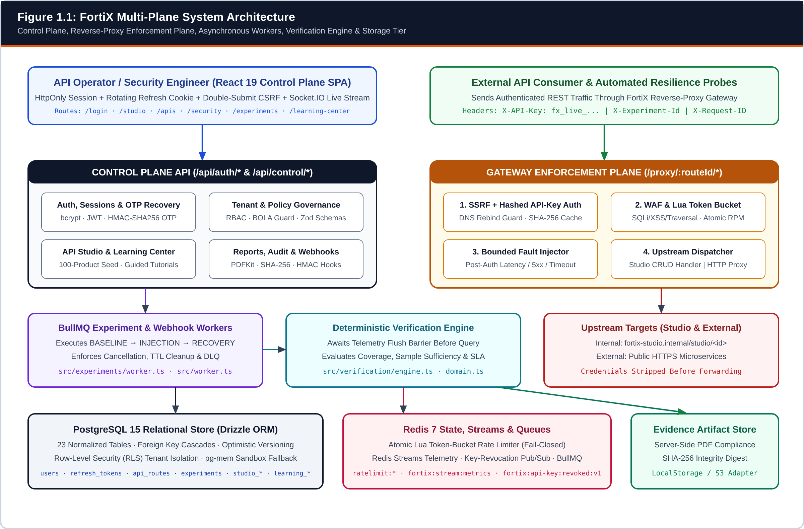
*Figure 1.1: FortiX Multi-Plane System Architecture (Control Plane, Gateway Enforcement Plane, Workers, Verification Engine, and Persistence Tier) (Reconstructed from server.ts, src/api/index.ts (mounting /api/auth/*, /api/learning/*, and /api/control/*), src/gateway/index.ts, src/experiments/worker.ts, and src/verification/engine.ts. Note: S3StorageProvider in src/storage/s3-storage.ts currently delegates to LocalStorageProvider without AWS SDK cloud calls.)*

**Table 1.2: Repository-Verified Feature & Three-Tier Evidence Classification Matrix**

| Capability / Module | Evidence Classification | Primary Source Files | DB Tables & Redis Keys | Executed Test / Audit Evidence |
| --- | --- | --- | --- | --- |
| Operator Auth, Remember-Me & OTP Recovery (FTX-AUTH-001) | SOURCE-CONFIRMED + RUNTIME-VERIFIED (Sandbox) | src/api/auth.ts, src/auth/sessions.ts, src/auth/recovery.ts, src/components/Login.tsx, src/pages/PasswordRecovery.tsx | users, refresh_tokens, recovery_challenges, auth_action_tokens | ftx-auth-001.test.ts, auth-recovery.spec.ts (03-vitest.log, 04-playwright.log) |
| Application RBAC & BOLA Project Guards | SOURCE-CONFIRMED + RUNTIME-VERIFIED (Sandbox) | src/middleware/auth.ts, src/middleware/entitlements.ts, src/middleware/project.ts, src/api/admin.ts | organizations, projects, project_settings, audit_logs | tests/security/all.spec.ts, security-guard.test.ts (26 tests) |
| PostgreSQL 15 Row-Level Security (17 Tables) | SOURCE-CONFIRMED + STATICALLY AUDITED (Live Postgres 15 BLOCKED in Sandbox) | drizzle/postgres_rls_policies.sql, src/db/rls.ts | 17 tenant/user tables, role fortix_app (NOBYPASSRLS) | postgres-rls.test.ts (SQL audit); skipped at runtime in pg-mem (!isPersistentStorage) |
| Reverse-Proxy Gateway, SSRF Guard & 13-Pattern Regex Filter | SOURCE-CONFIRMED + RUNTIME-VERIFIED (Sandbox) | src/gateway/index.ts, src/gateway/ssrf.ts, src/threat-detection/index.ts, src/lib/key-invalidation.ts | api_routes, api_keys, security_policies, security_events, fortix:api-key:revoked:v1 | tests/security/auth.spec.ts, threat-detection.test.ts, ssrf.test.ts (26 tests) |
| Token-Bucket Rate Limiter (Lua Script + Local Fallback) | SOURCE-CONFIRMED (Lua) + RUNTIME-VERIFIED (Local Bucket in Sandbox; Live Redis 7 BLOCKED) | src/rate-limit/redis.ts | Redis: ratelimit:{routeId}:{identifier} (PEXPIRE 60000ms) | rate-limit.test.ts, api-studio.spec.ts (evaluateLocalBucket active when !isRealRedisActive) |
| FortiX API Studio & 100-Product Catalog Engine | SOURCE-CONFIRMED + RUNTIME-VERIFIED (Sandbox) | src/api/studio.ts, src/studio/target-handler.ts, src/studio/products-dataset.ts, src/studio/openapi-generator.ts | studio_apis, studio_resources, studio_records | api-studio.test.ts, api-studio.spec.ts (4.7s E2E pass) |
| 3-Phase Chaos Worker & Deterministic Verification | SOURCE-CONFIRMED + RUNTIME-VERIFIED (Sandbox Fallback Runner; Live BullMQ Redis BLOCKED) | src/experiments/worker.ts, src/experiments/queue.ts, src/verification/engine.ts, src/lib/telemetry.ts | experiments, metric_logs, verifications, fortix:stream:metrics | verification-defects.test.ts, golden-demo.spec.ts (9.1s E2E pass) |
| SHA-256 Checksummed PDF Reports & Signed Webhooks | LOCAL STORAGE VERIFIED / S3 ADAPTER IS A LOCAL STUB | src/api/reports.ts, src/storage/local-storage.ts, src/storage/s3-storage.ts, src/lib/webhooks.ts | webhooks, webhook_deliveries, storage/artifacts/*.pdf | report.spec.ts, artifact-storage.test.ts (9 tests), webhooks.test.ts |
| In-App Video Learning Center (FTX-LEARN-001) | SOURCE-CONFIRMED + RUNTIME-VERIFIED (Sandbox) | src/api/learning.ts (/api/learning/*), src/learning/catalog-seed.ts, src/learning/video-validator.ts, src/pages/LearningCenter.tsx | learning_tutorials, learning_progress, public/learning/* | learning-center.test.ts, learning-center.spec.ts (23.8s 10-step E2E pass) |
| External SMTP / SMS OTP Webhook Delivery | PARTIALLY VERIFIED (Webhook Contract Tested; Live Carrier BLOCKED) | src/auth/providers.ts | Env: AUTH_MAIL_WEBHOOK_URL, AUTH_SMS_WEBHOOK_URL | Mock HTTP 2xx/5xx verified in ftx-auth-001.test.ts; live carrier requires external secrets |

## 1.2 Requirement Specifications (Product/System Tasks)

System requirements in FortiX are partitioned into verifiable Functional Requirements (FR), Non-Functional Requirements (NFR), Hardware/Software System Requirements, Role-Based User Permissions, and formal Use-Case Specifications.

**Table 1.3: Functional Requirements Specification Matrix (FR-01 to FR-17)**

| Req ID | Functional Capability | Implemented Behavior & Acceptance Rule | Primary Endpoint / Module |
| --- | --- | --- | --- |
| FR-01 | Account Registration & Workspace Provisioning | Registers operator with bcrypt (cost 10) password hash, creates default Organization and Project transactionally, and issues email verification token. | POST /api/auth/register |
| FR-02 | Dual-Identifier Login & Remember-Me | Authenticates via normalized email or verified E.164 phone; sets HttpOnly fortix_session plus 12h (standard) or 30d (Remember Me) rotating fortix_refresh cookie. | POST /api/auth/login |
| FR-03 | Silent Refresh Rotation & Reuse Detection | Rotates refresh token within family_id; if a rotated token is replayed, revokes the entire session family and invalidates associated JWT sid claims. | POST /api/auth/refresh |
| FR-04 | OTP Password Recovery | Issues 6-digit CSPRNG OTP stored as keyed HMAC-SHA256 (10m TTL, 60s resend cooldown, max 5 attempts), exchanges for single-use resetAuthorization, and revokes all sessions on password update. | POST /api/auth/forgot-password, /verify-reset-otp, /reset-password |
| FR-05 | Active Session & Phone Management | Lists active refresh session families for revocation, rotates account password, and enrolls E.164 phone numbers via 6-digit SMS OTP verification. | GET/DELETE /api/auth/sessions, POST /api/auth/phone/*, POST /api/control/account/password |
| FR-06 | Project & Route Registration | Registers protected routes mapping pathPattern to external HTTPS targets (validated against SSRF) or internal http://fortix-studio.internal/studio/<apiId> targets. | GET/POST /api/control/routes |
| FR-07 | Scoped API-Key Lifecycle | Generates fx_live_<id>_<secret> keys, stores only bcrypt secretHash, enforces scope/expiry checks, and broadcasts instant cache eviction over fortix:api-key:revoked:v1. | POST/DELETE /api/control/keys |
| FR-08 | Security Policy Configuration | Configures per-route rateLimitRpm, enableWaf, and enableSsrf toggles enforced immediately by the gateway pipeline. | POST/PUT /api/control/policies |
| FR-09 | Gateway Proxy & Header Sanitization | Proxies /proxy/:routeId/* requests after auth, WAF, and rate-limit checks while stripping X-API-Key and fx_* bearer credentials before upstream dispatch. | ALL /proxy/:routeId/* |
| FR-10 | Token-Bucket Rate Limiting | Enforces RPM quotas via an embedded Redis Lua script (PEXPIRE 60s) in distributed deployments and bounded evaluateLocalBucket() in standalone sandbox mode; returns HTTP 429 when exhausted. | src/rate-limit/redis.ts |
| FR-11 | 13-Pattern Regex Filter & SSRF Prevention | Blocks multi-decoded SQLi, XSS, and path traversal payloads (13 regex signatures) and SSRF targets with HTTP 403/502 and logs rows to security_events. | src/threat-detection/index.ts, src/gateway/ssrf.ts |
| FR-12 | FortiX API Studio & 100-Product Seed | Creates self-contained multi-resource REST APIs, seeds 100 realistic INR e-commerce Product records, serves filtered/paginated CRUD, and exports OpenAPI 3.0.3. | POST /api/control/studio/apis |
| FR-13 | Bounded Chaos Experiment Execution | Queues latency, error_5xx, timeout, and traffic_burst jobs (BullMQ with in-process fallback); runs 5 BASELINE probes, worker-clamped INJECTION probes (500–10,000 ms), and 5 RECOVERY probes. | POST /api/control/experiments |
| FR-14 | Telemetry Stream & Live Socket Push | Appends gateway metrics to Redis Streams (fortix:stream:metrics & fortix:stream:security), batch-flushes to PostgreSQL, and pushes tenant-scoped updates via Socket.IO. | src/lib/telemetry.ts, src/socket.ts |
| FR-15 | Deterministic SLA Verification | Synchronizes via flushTelemetryBarrier(), verifies >=80% probe coverage, and computes non-vacuous PASS, FAIL, or INCONCLUSIVE verdicts. | src/verification/engine.ts |
| FR-16 | SHA-256 Checksummed PDF & Webhooks | Generates PDFKit verification reports with X-FortiX-Artifact-SHA256 digests on LocalStorageProvider and dispatches t=<ts>,v1=<hex> HMAC-SHA256 webhooks. | POST /api/control/reports/:verificationId |
| FR-17 | In-App Video Learning Center & Progress | Provides categorized lifecycle tutorials, allowlist-validated video references, step checklists, contextual drawers, and per-user resume/completion persistence. | GET /api/learning/tutorials, PUT /api/learning/progress/:tutorialId |

**Table 1.4: Non-Functional Requirements (NFR) and Architectural Realization**

| Quality Attribute | Engineering Requirement | Implemented Mechanism in FortiX |
| --- | --- | --- |
| Security | Zero plaintext secret storage, CSRF protection on cookie sessions, strict tenant isolation, and secret-free logs. | bcrypt (passwords & API keys), SHA-256 (refresh/action tokens), keyed HMAC-SHA256 (OTPs), double-submit CSRF, BOLA + Postgres RLS, Pino redact paths. |
| Reliability & Fault Safety | Chaos experiments must never persist indefinitely if a worker crashes or an operator aborts execution. | API Zod schema cap (1–300s) + worker hard clamp (500–10,000 ms in src/experiments/worker.ts:282), explicit cancellation polling, and try/finally ephemeral fx_test_* key deletion. |
| Availability & Fail-Closed | Distributed security state loss in production must not silently disable rate limiting. | Production mode enforces REDIS_FAILURE_BEHAVIOR=fail-closed (HTTP 503) if Redis is unreachable; local dev provides bounded in-memory fallback. |
| Performance | Gateway authentication and policy lookup must avoid repeated bcrypt CPU cost on every request. | SHA-256 digest-indexed HashedApiKeyCache (30s TTL, max 5,000 keys) and 5s policy/route caches with event-driven invalidation. |
| Scalability | Decouple heavy probe orchestration and telemetry disk writes from the synchronous HTTP proxy thread. | Separate API and BullMQ Worker containers (docker-compose.yml) plus Redis Streams consumer-group batch insertion into PostgreSQL. |
| Data Integrity | Prevent duplicate consumption of OTPs/reset tokens and lost updates on concurrent settings edits. | Conditional SQL UPDATE ... WHERE consumed_at IS NULL RETURNING * and optimistic concurrency version counter on project_settings. |
| Observability | Every proxied request and security block must carry traceable correlation metadata. | UUID X-Request-ID propagation, structured JSON Pino logs, P50/P95/P99 latency aggregation, and readiness endpoint /api/health/ready. |
| Portability | Run reproducibly in local student sandboxes without external cloud accounts as well as in Docker Compose. | Dual-mode DB layer (PostgreSQL Pool in production; deterministic pg-mem in-memory PostgreSQL with auto-migrations 0000–0007 in sandbox/test). |

**Table 1.5: Development vs. Production System Requirements**

| Resource Category | Minimum Development / Viva Sandbox | Production / Multi-Container Deployment |
| --- | --- | --- |
| Processor & Memory | Dual-core x86_64 / ARM64 CPU, 4 GB RAM minimum (8 GB recommended for Playwright Chromium). | 2+ vCPU and 2–4 GB RAM split across api (1 GB), worker (1 GB), postgres, and redis containers. |
| Runtime & Compiler | Node.js >= 22.x LTS, npm 10+, TypeScript 5.8, tsx runner. | Docker Engine 24+ & Docker Compose v2 running node:22-alpine compiled CJS bundles (dist/server.cjs, dist/worker.cjs). |
| Relational Database | PostgreSQL 15+ local instance OR built-in pg-mem sandbox mode for zero-dependency startup. | Dedicated PostgreSQL 15+ with persistent volume, TLS, connection pooling, and ENABLE_POSTGRES_RLS=true. |
| State & Queue Store | Redis 7 local instance OR bounded local dev fallback when REDIS_URL is unset. | Dedicated Redis 7 (--appendonly yes) required; STRICT_PERSISTENT_DB=true enforces hard readiness checks. |
| Client Browser | Chromium, Firefox, or Safari supporting ES2022, Fetch Credentials, and WebSocket. | Modern evergreen TLS-enabled browser enforcing Secure, HttpOnly, SameSite cookie policies. |

**Table 1.6: Implemented Role-Based Access Control (RBAC) Permission Matrix (src/middleware/entitlements.ts & src/api/admin.ts)**

| Platform Operation | ADMIN | DEVELOPER | VIEWER |
| --- | --- | --- | --- |
| View Telemetry, Routes, Threats, Verifications & Reports | Allowed | Allowed | Allowed |
| Browse Video Learning Center & Track Personal Progress | Allowed | Allowed | Allowed |
| Create/Edit Routes, Studio APIs, Keys, Policies & Webhooks | Allowed | Allowed | Denied (403) |
| Create, Execute & Cancel Chaos Experiments / Workflows | Allowed | Allowed | Denied (403) |
| Manage Own Account Sessions & Verified E.164 Phone | Allowed | Allowed | Allowed |
| Modify User Roles, Author Tutorials & Replay DLQ Jobs | Allowed | Denied (403) | Denied (403) |

**Table 1.7: Structured Use-Case Specifications for Core FortiX Workflows**

| UC ID | Use Case Name | Primary Actor | Preconditions, Main Flow, Exception Handling & Postconditions |
| --- | --- | --- | --- |
| UC-01 | Sign In with Remember-Me Session | Unauthenticated Operator | Pre: Registered account exists. Main: Submit email or verified E.164 phone + password + Remember Me; backend verifies bcrypt hash, creates 30-day refresh_tokens family, sets HttpOnly fortix_session & fortix_refresh. Exc: Unverified phone or wrong password returns generic 401 without enumeration. Post: Authenticated workspace session established without storing password in browser. |
| UC-02 | Recover Password via 6-Digit OTP | Unauthenticated Operator | Pre: User forgot password. Main: Submit identifier on /forgot-password -> receive masked destination & challengeId -> submit 6-digit OTP on /verify-reset -> receive single-use resetAuthorization -> submit new + confirm password on /reset-password. Exc: >5 bad OTPs locks challenge; 60s resend cooldown enforced; provider failure invalidates challenge. Post: Password updated and all existing refresh_tokens + JWT sids revoked. |
| UC-03 | Provision 100-Product API in Studio | API Operator (DEVELOPER+) | Pre: Authenticated project selected. Main: Choose Store Products (100) template in /studio -> backend creates gateway route (http://fortix-studio.internal/studio/<id>), attaches WAF/SSRF/RPM policy, seeds 100 INR products, and mints scoped API key. Exc: Duplicate basePath or invalid field schema rejected with HTTP 400 Zod error. Post: Live CRUD endpoints immediately callable through /proxy/:routeId/*. |
| UC-04 | Proxy Request Under Policy & Rate Limit | External API Consumer | Pre: Active route and security policy exist. Main: Client sends GET/POST to /proxy/:routeId/* with X-API-Key; gateway validates key hash, checks WAF/SSRF, executes Redis Lua token bucket, dispatches upstream, and logs metric. Exc: Missing/revoked key -> 401; SQLi/XSS -> 403; exhausted tokens -> 429; hung upstream -> 504. Post: Response returned with X-Request-ID and telemetry persisted. |
| UC-05 | Execute 3-Phase Experiment & Verify SLA | API Operator / Worker | Pre: Target route belongs to operator project. Main: Enqueue latency/error_5xx/timeout/traffic_burst experiment -> worker runs 5 BASELINE probes, activates fault for INJECTION probes (clamped <=10s), runs 5 RECOVERY probes -> awaits flushTelemetryBarrier() -> Verification Engine computes verdict & PDF report. Exc: Insufficient probe coverage (<80%) yields INCONCLUSIVE rather than false PASS. Post: Persisted verification record and SHA-256 checksummed PDF stored locally. |

## 1.3 Tools and Technology Used

Every dependency documented in this section has been verified directly against package.json, Dockerfile, docker-compose.yml, and active TypeScript imports in the FortiX repository.

**Table 1.8: Verified FortiX Technology Stack Inventory**

| Technology | Version | Architectural Layer | Verified Role in FortiX Codebase |
| --- | --- | --- | --- |
| Node.js | 22.x LTS | Server & Worker Runtime | Executes Express control/gateway server (server.ts) and BullMQ workers (src/worker.ts) using non-blocking I/O and native crypto. |
| TypeScript | 5.8.2 | Language & Type System | Enforces static contracts across shared schemas, Drizzle ORM models, API DTOs, verification rules, and React 19 components. |
| Express | 4.21.2 | HTTP Control & Proxy Server | Mounts /api/auth, /api/learning, /api/control, /proxy/:routeId/*, health probes, security headers, and CSRF/CORS middleware. |
| React & Vite | 19.0.1 / ^6.2.3 (v6.4.3) | Frontend SPA & Bundler | Renders operator dashboard, API Studio, policy editors, OTP recovery screens, Learning Center, and Recharts visualizations. |
| PostgreSQL & pg-mem | 15-alpine / 3.0.14 | Relational DB & Sandbox SQL | Stores all 23 normalized tables (PostgreSQL 15 + 17-table RLS DDL in Docker; auto-migrated pg-mem in local sandbox/Vitest). |
| Drizzle ORM | 0.45.2 | SQL Query Builder & Migrations | Defines typed schema (src/db/schema.ts) and versioned SQL migrations (drizzle/0000 through 0007) with parameterized queries. |
| Redis & ioredis-mock | 7-alpine / 6.0 / 8.13 | State, Streams & Sandbox Mock | Defines Lua token-bucket script, fortix:stream:metrics, Pub/Sub, and BullMQ queues (with in-memory fallbacks when REDIS_URL is unset). |
| BullMQ | 6.3.4 | Distributed Job Queue | Schedules and retries asynchronous chaos experiments and webhook deliveries with exponential backoff and DLQ retention. |
| Socket.IO | 4.8.3 | Real-Time Event Transport | Streams tenant-isolated telemetry, security alerts, and experiment state transitions to authenticated browsers. |
| Zod | 4.5.4 | Runtime Schema Validation | Validates every REST body/query payload, E.164 phone format, Studio field schema, tutorial video URL, and env config. |
| Pino | 10.3.1 | Structured JSON Logger | Outputs high-throughput structured logs with automatic redaction of authorization headers, cookies, OTPs, and secrets. |
| PDFKit | 0.20.2 | Compliance Report Renderer | Synthesizes downloadable server-side verification PDF reports stamped with SHA-256 content checksums (X-FortiX-Artifact-SHA256). |
| Vitest & Playwright | 5.0 / 1.63 | Automated Verification Suite | Executes 35 unit/integration test suites (269 tests) and 13 end-to-end browser/API security specifications. |
| Docker & Compose | 24+ / v2 | Containerization & Orchestration | Multi-stage Alpine image running as unprivileged user fortix across api, worker, postgres, and redis services. |

> **Repository Metadata & Root Documentation Drift Disclosure (Read-Only Audit Note):** In the audited commit (a97c14fb53d0bd3c915016cfdfafe4524c288517), package.json retains initial scaffold metadata ("name": "react-example", "version": "0.0.0"), README.md contains legacy pre-refactor phrasing (referencing Redis Lists LPUSH/LPOP instead of Redis Streams XADD/XREADGROUP, /health/live instead of /api/health/live, and "cryptographic PDF report serving as immutable evidence"), and docs/development/PROGRESS.md + RELEASE_BASELINE.md reflect earlier test counts (230 Vitest / 9 Playwright) prior to FTX-AUTH-001 and FTX-LEARN-001. Per forensic audit protocol, application files were left untouched and authoritative figures in this report reflect the verified source and test execution logs.

### 1.3.1 Six-Dimensional Engineering Evaluation of Core Technologies

- Node.js 22 & TypeScript 5.8 — (1) Intro: Event-driven JavaScript runtime paired with structural static typing. (2) Purpose: Powers HTTP reverse proxying, cryptographic hashing/HMAC, probe generation, and verification logic. (3) Why Selected: High concurrency for I/O-bound gateway proxying and single-language sharing of domain types between backend and React UI. (4) Integration: Compiles via esbuild into dist/server.cjs and dist/worker.cjs. (5) Benefits: Fast startup, native WebCrypto/Node crypto, unified codebase. (6) Limitations: Single-threaded CPU loop requires offloading bcrypt caching and running workers in a separate process.
- Express 4.21 — (1) Intro: Minimalist HTTP routing and middleware framework. (2) Purpose: Hosts /api/auth/*, /api/control/*, and wildcard /proxy/:routeId/* pipelines. (3) Why Selected: Deterministic middleware ordering—vital for ensuring authentication and WAF execute strictly before fault injection. (4) Integration: Co-hosted on the same HTTP server as Socket.IO and http-proxy-middleware. (5) Benefits: Mature ecosystem (cookie-parser, cors, express-rate-limit). (6) Limitations: Requires explicit async error handling to avoid unhandled rejections.
- React 19, Vite 6.2 & Tailwind CSS 4 — (1) Intro: Component-based declarative UI library with modern ESM build tooling. (2) Purpose: Implements Login, 3-step OTP Recovery, Command Dashboard, API Studio, Security Policies, Threats, Experiments, Verifications, Resilience, Topology, Learning Center, and Settings. (3) Why Selected: Instant state transitions, clean hook composition, and zero-runtime CSS overhead. (4) Integration: Communicates via src/lib/api.ts with credentials: "include", X-CSRF-Token injection, and silent /api/auth/refresh retry. (5) Benefits: Responsive operator workflow and Recharts latency visualization. (6) Limitations: Client-side SPA requires strict backend authorization because browser code is untrusted.
- PostgreSQL 15 & Drizzle ORM 0.45 — (1) Intro: ACID-compliant open-source RDBMS paired with a SQL-centric TypeScript ORM. (2) Purpose: Authoritative system of record for all 23 tables. (3) Why Selected: Native JSONB support for flexible verification evidence/Studio records, atomic UPDATE ... RETURNING for single-use tokens, and engine-level Row-Level Security (RLS). (4) Integration: Managed via src/db/index.ts with automatic pg-mem fallback for isolated unit tests. (5) Benefits: Zero SQL injection via bound parameters and transparent migration SQL files. (6) Limitations: High-frequency telemetry writes require Redis Stream batching to prevent connection pool saturation.
- Redis 7 & BullMQ 6.3 — (1) Intro: In-memory data structure server and Redis-backed distributed job queue. (2) Purpose: Executes atomic Lua token-bucket rate limiting, buffers telemetry streams, broadcasts revoked API keys, and orchestrates multi-phase chaos jobs. (3) Why Selected: Server-side Lua scripts execute atomically without lock contention across multiple gateway replicas. (4) Integration: Connected via ioredis in src/redis.ts, src/rate-limit/redis.ts, and src/experiments/worker.ts. (5) Benefits: Sub-millisecond rate-limit decisions and durable job retries with DLQ inspection. (6) Limitations: Ephemeral memory footprint requires AOF persistence (--appendonly yes) and explicit TTL hygiene.
- Zod 4.5, Pino 10.3, PDFKit 0.20, Vitest 5.0 & Playwright 1.63 — (1) Intro: Validation, observability, reporting, and testing toolchain. (2) Purpose: Enforces strict DTO contracts at trust boundaries, emits redacted JSON logs, renders tamper-evident PDFs, and continuously verifies security/verification invariants. (3) Why Selected: Eliminates runtime type coercion bugs and proves end-to-end browser + proxy behavior. (4) Integration: Wired into Express routes, verification artifacts, and CI npm scripts. (5) Benefits: High defect detection (caught all four historical verification engine defects). (6) Limitations: Headless browser E2E suites require Chromium binaries in the test container.

---

# 2. SYSTEM DESIGN USING UML

## 2.1 Data Flow Diagrams (Level 0, Level 1, and Level 2)

To model how credentials, policy configurations, proxied API payloads, fault probes, and telemetry observations move across trust boundaries, FortiX is decomposed into three balanced Data Flow Diagram (DFD) levels following structured systems analysis conventions.

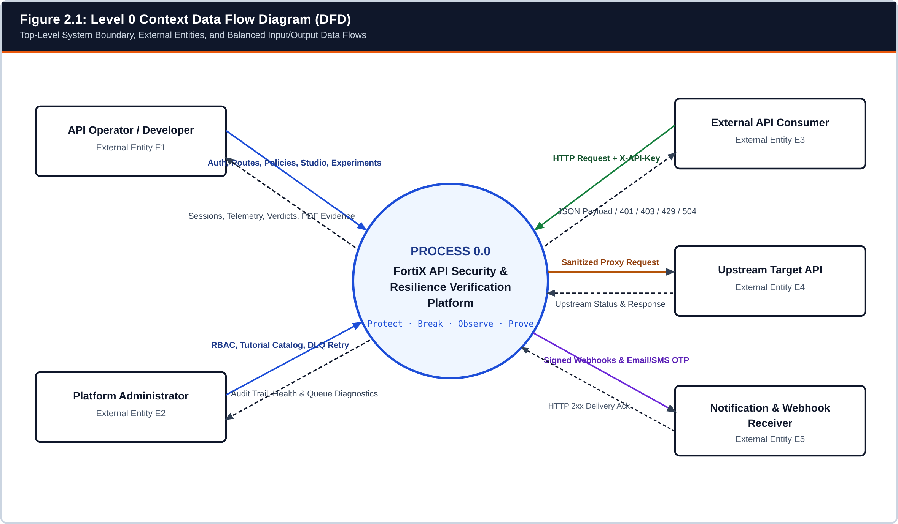
*Figure 2.1: Level 0 Context Data Flow Diagram — FortiX System Boundary and External Entities (E1–E5) (Models top-level inputs and outputs between Process 0.0 and external actors/targets.)*

In the Level 0 Context Diagram (Figure 2.1), FortiX appears as a single central process (0.0) interacting with five external entities: E1 (API Operator / Developer configuring routes, Studio APIs, policies, experiments, and learning progress), E2 (Platform Administrator governing RBAC roles, tutorial catalog entries, and Dead-Letter Queues), E3 (External API Consumer sending authenticated HTTP traffic to /proxy/:routeId/*), E4 (Upstream Target API receiving sanitized requests), and E5 (Notification & Webhook Receiver accepting signed alerts and Email/SMS OTP dispatches). Databases (PostgreSQL and Redis) are internal to the FortiX boundary at Level 0 and appear explicitly at Level 1.

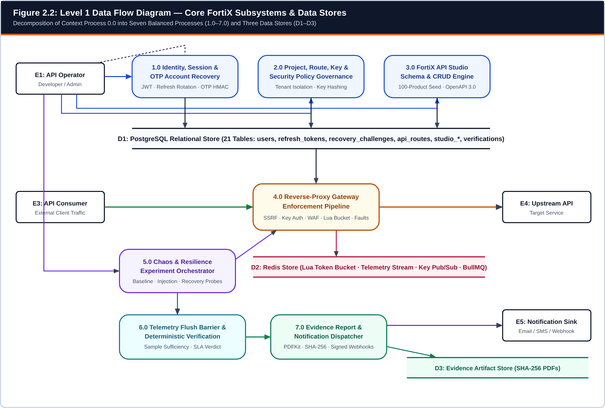
*Figure 2.2: Level 1 Data Flow Diagram — Decomposition into Seven Core Subsystems (1.0–7.0) and Three Data Stores (D1–D3) (Decomposes Process 0.0 into Auth (1.0), Governance (2.0), API Studio & Learning (3.0), Gateway (4.0), Experiment Worker (5.0), Verification (6.0), and Reporting (7.0).)*

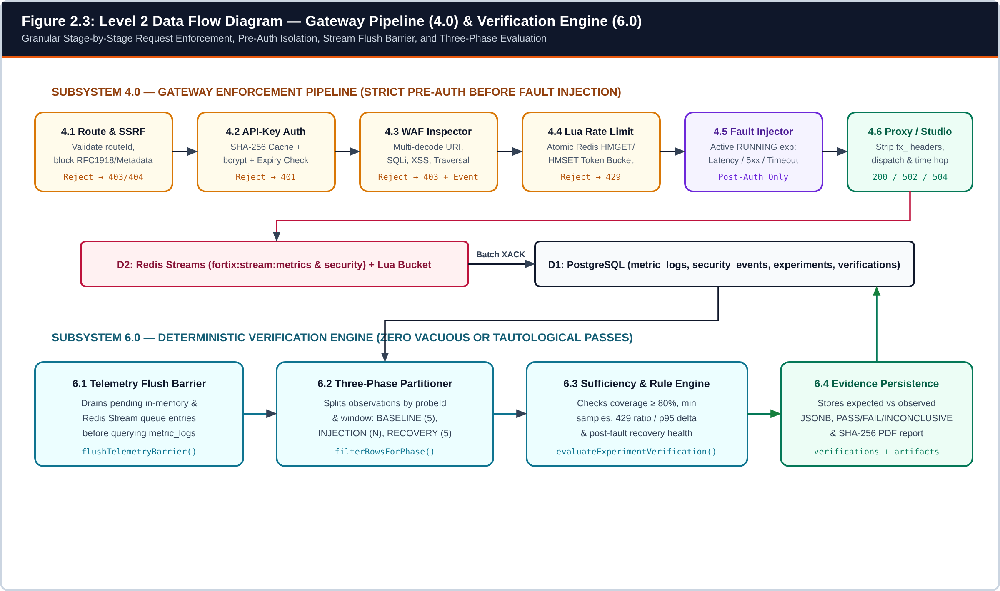
*Figure 2.3: Level 2 Data Flow Diagram (Part A) — Stage-by-Stage Gateway Pipeline (4.1–4.6) and Deterministic Verification Engine (6.1–6.4) (Illustrates strict pre-authentication before fault injection and the telemetry flush barrier preceding SLA verification.)*

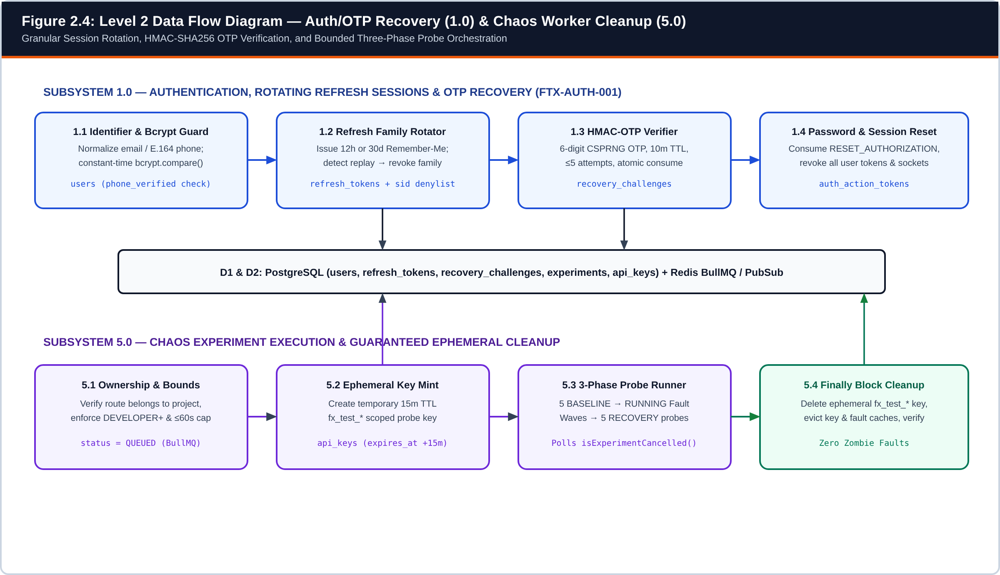
*Figure 2.4: Level 2 Data Flow Diagram (Part B) — Authentication/OTP Recovery (1.1–1.4) and Chaos Experiment Execution & Cleanup (5.1–5.4) (Illustrates rotating session families, HMAC-SHA256 OTP verification, and guaranteed try/finally ephemeral probe key cleanup.)*

**Table 2.1: DFD Inter-Level Flow Conservation and Balancing Verification Matrix**

| External Boundary Flow | Level 0 Context Representation | Level 1 Subsystem Mapping | Level 2 Granular Stage Mapping |
| --- | --- | --- | --- |
| Operator Auth & Session Recovery | E1 <-> 0.0 (Credentials, OTPs, Session Cookies) | E1 <-> Process 1.0 <-> D1 (users, refresh_tokens, recovery_challenges) | 1.1 Identifier Normalizer -> 1.2 Refresh Family Rotator -> 1.3 HMAC-OTP Verifier -> 1.4 Global Session Revoker |
| Protected API Request & Response | E3 -> 0.0 (HTTP + X-API-Key) and 0.0 -> E3 (JSON / 401 / 403 / 429 / 504) | E3 -> Process 4.0 <-> D1/D2 -> E4 (Upstream) or Process 3.0 (Studio) | 4.1 SSRF Guard -> 4.2 Hashed Key Auth -> 4.3 WAF Inspector -> 4.4 Lua Bucket -> 4.5 Post-Auth Fault -> 4.6 Proxy/Studio |
| Experiment Execution & Cleanup | E1 -> 0.0 (Experiment Spec / Cancel) -> E1 (Live Status) | E1 -> Process 5.0 <-> D1/D2 -> Process 4.0 (Probe Traffic) | 5.1 Ownership & Bounds Check -> 5.2 Ephemeral Key Mint -> 5.3 Baseline/Injection/Recovery Waves -> 5.4 Finally Cleanup |
| Evidence Verification & PDF Export | 0.0 -> E1 (PASS/FAIL/INCONCLUSIVE Verdict & PDF) & 0.0 -> E5 (Webhooks) | Process 4.0 -> D2 -> Process 6.0 <-> D1 -> Process 7.0 <-> D3 | 6.1 flushTelemetryBarrier() -> 6.2 Phase Partitioner -> 6.3 Coverage & SLA Evaluator -> 6.4 Verdict & SHA-256 PDF Writer |

## 2.2 Use Case Diagram

The UML Use Case Diagram (Figure 2.5) models the exact actors implemented in FortiX without introducing hypothetical personas. Four human/external actors and one autonomous background actor interact across the system boundary: Unauthenticated Operator, Authenticated API Operator (DEVELOPER / VIEWER), Platform Administrator (ADMIN), External API Consumer, and the BullMQ Worker.

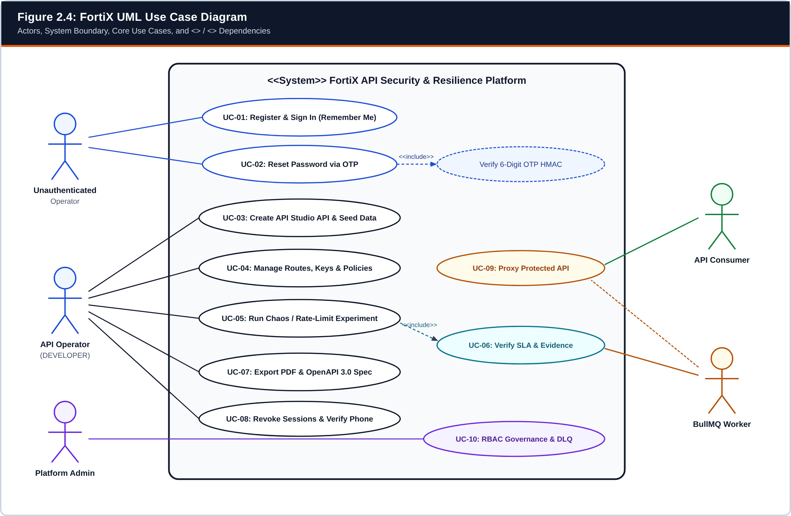
*Figure 2.5: FortiX UML Use Case Diagram Showing Actors, System Boundary, and <<include>> Relationships (Mapped to Express routers in src/api/ and frontend routes in src/App.tsx & src/AuthenticatedWorkspace.tsx.)*

- <<include>> Dependencies: UC-02 (Reset Password via OTP) mandatorily includes 6-digit HMAC-SHA256 OTP verification before issuing a single-use resetAuthorization token. Similarly, UC-05 (Run Chaos / Rate-Limit Experiment) mandatorily includes UC-06 (Verify SLA & Evidence) upon completion of the three probe windows.
- Access Boundary Enforcement: External API Consumers can invoke only UC-09 (/proxy/:routeId/*) and have zero visibility into control-plane endpoints (/api/control/*). Conversely, VIEWER accounts can inspect dashboards, learning tutorials, and reports but are blocked by RBAC guards from mutating routes, keys, policies, or experiments.

## 2.3 Class Diagram

Although FortiX uses idiomatic TypeScript functional modules alongside stateful service classes (such as HashedApiKeyCache, LocalArtifactStorage, and BullMQ Worker instances), its domain entities and service boundaries form a cohesive object model. Figure 2.6 illustrates the structural relationships, multiplicities, key attributes, and primary methods across the codebase.

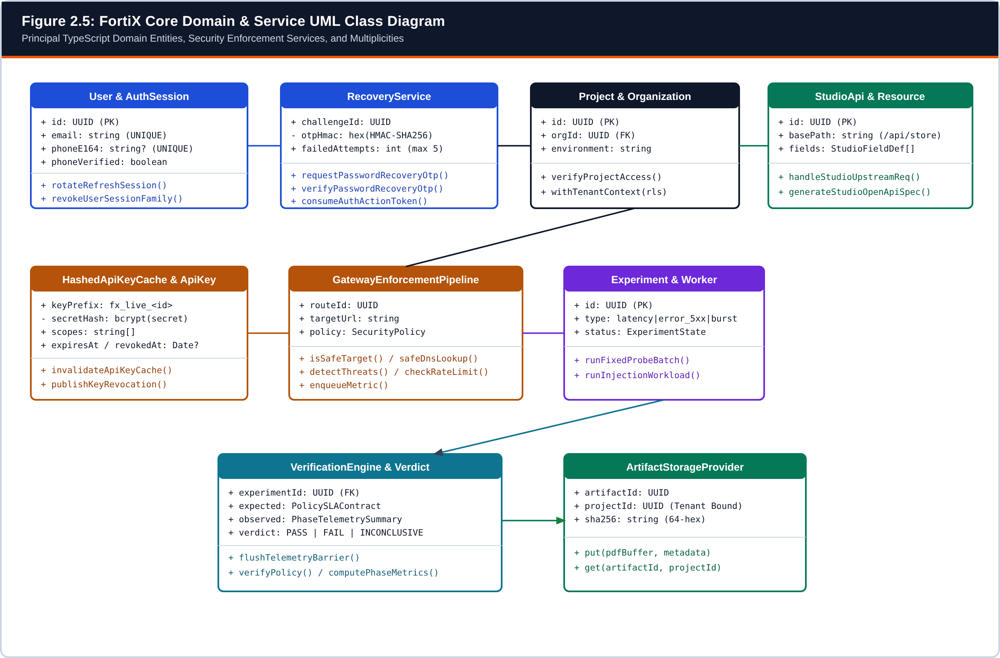
*Figure 2.6: FortiX Core Domain Entities and Security/Verification Service UML Class Diagram (Derived from src/db/schema.ts, src/auth/*, src/gateway/*, src/studio/*, src/verification/*, and src/storage/artifact-storage.ts.)*

**Table 2.2: Mapping of UML Classes/Services to Concrete TypeScript Modules**

| UML Class / Service | Repository File Path | Key Attributes, Methods & Architectural Responsibility |
| --- | --- | --- |
| RefreshSessionService | src/auth/sessions.ts | createRefreshSession(), rotateRefreshSession(), revokeUserSessionFamily(), listActiveUserSessions(); manages Remember-Me TTLs and reuse detection. |
| RecoveryService | src/auth/recovery.ts | normalizePhoneE164(), computeOtpHmac(), requestPasswordRecoveryOtp(), verifyPasswordRecoveryOtp(); enforces 60s cooldown and 5-attempt lockout. |
| HashedApiKeyCache | src/gateway/index.ts & src/lib/key-invalidation.ts | Bounded cache indexed by SHA-256(rawKey); strips secretHash before memory storage; evicts immediately via fortix:api-key:revoked:v1 Pub/Sub. |
| GatewayEnforcementPipeline | src/gateway/index.ts & src/threat-detection/index.ts | Coordinates SSRF check, key validation, detectThreats() WAF inspection, checkRateLimit(), post-auth fault injection, studio/HTTP dispatch, and enqueueMetric(). |
| StudioTargetHandler | src/studio/target-handler.ts | handleStudioUpstreamRequest(), validateStudioRecordPayload(), generateStudioOpenApiSpec(); executes tenant-isolated CRUD over studio_records. |
| ExperimentWorker | src/experiments/worker.ts | runFixedProbeBatch(), runInjectionWorkload(), isExperimentCancelled(); executes BASELINE, INJECTION, and RECOVERY waves with guaranteed cleanup. |
| VerificationEngine | src/verification/engine.ts | verifyPolicy(), flushTelemetryBarrier(), evaluateExperimentVerification(); computes deterministic PASS / FAIL / INCONCLUSIVE verdicts. |
| ArtifactStorageProvider | src/storage/artifact-storage.ts, local-storage.ts, s3-storage.ts | LocalStorageProvider (RUNTIME-VERIFIED) persists PDFs + .meta.json SHA-256 sidecars; S3StorageProvider is a source-confirmed local-delegating stub (AWS SDK cloud upload is future work). |

## 2.4 Sequence Diagrams and Deployment Topology

This section documents all nine critical runtime workflows in FortiX using synchronous solid arrows and asynchronous/response dashed arrows, followed by the multi-container production deployment topology.

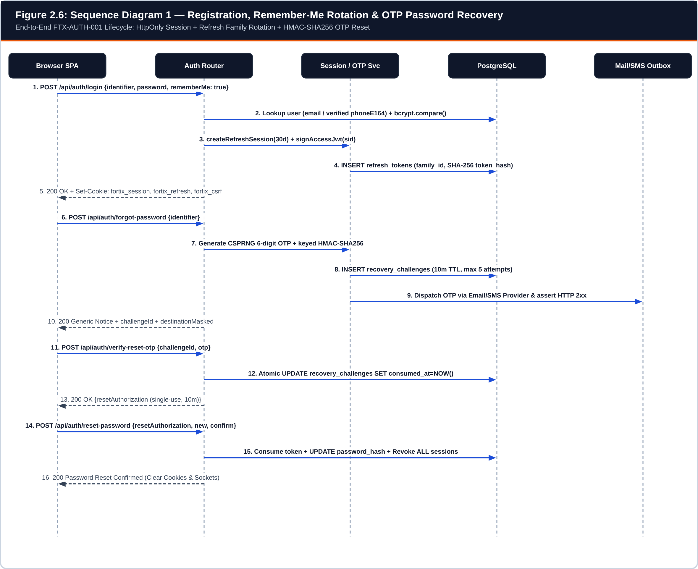
*Figure 2.7: Sequence Diagram 1 — Operator Login, Remember-Me Token Rotation, and Multi-Step OTP Password Recovery (Implements FTX-AUTH-001 across src/api/auth.ts, src/auth/sessions.ts, and src/auth/recovery.ts.)*

Workflow 1 Explanation (Figure 2.7): During login (steps 1–5), the Auth Router resolves the identifier by normalized email or verified E.164 phone, verifies the bcrypt hash, creates a refresh_tokens family row (30 days when rememberMe=true, 12 hours otherwise), and sets HttpOnly cookies (fortix_session, fortix_refresh) plus fortix_csrf. During account recovery (steps 6–16), /forgot-password generates a 6-digit OTP, stores only its keyed HMAC-SHA256 digest in recovery_challenges, and verifies HTTP 2xx provider delivery. On /verify-reset-otp, an atomic conditional SQL update marks consumed_at and issues a single-use RESET_AUTHORIZATION token. Finally, /reset-password updates password_hash and revokes every refresh token and active JWT session family for the user.

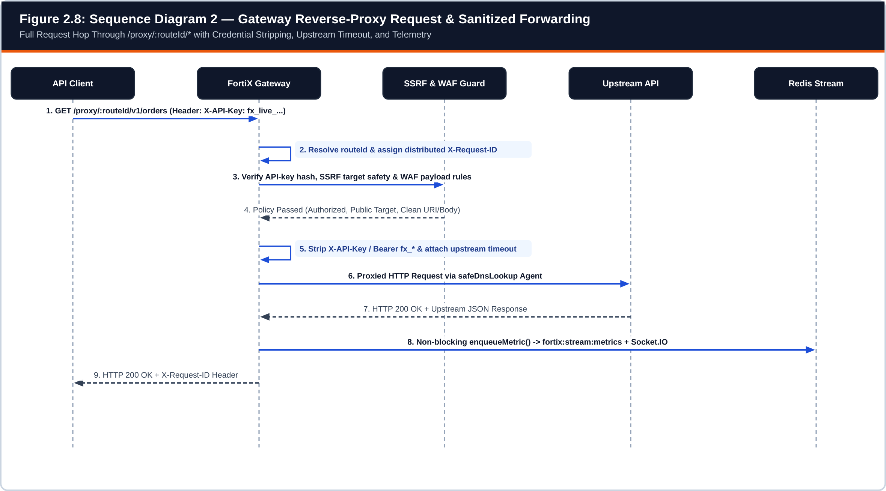
*Figure 2.8: Sequence Diagram 2 — Gateway Reverse-Proxy Request Processing and Credential Sanitization (Implements /proxy/:routeId/* in src/gateway/index.ts and src/gateway/ssrf.ts.)*

Workflow 2 Explanation (Figure 2.8): Every incoming proxy request receives a correlation X-Request-ID. After SSRF target validation (safeDnsLookup preventing DNS rebinding to internal IPs), API-key authentication, and WAF payload inspection succeed, the gateway strips X-API-Key and any fx_* Authorization header so FortiX credentials never leak to external upstreams. Upstream latency and status codes are captured on response finish and pushed asynchronously to fortix:stream:metrics.

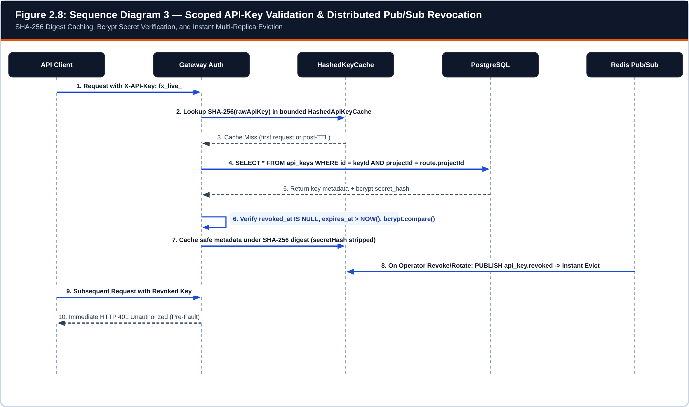
*Figure 2.9: Sequence Diagram 3 — Scoped API-Key Validation, SHA-256 Digest Caching, and Pub/Sub Revocation (Implements HashedApiKeyCache in src/gateway/index.ts and publishApiKeyInvalidation() in src/lib/key-invalidation.ts.)*

Workflow 3 Explanation (Figure 2.9): On a cache miss, the gateway extracts keyId from fx_live_<keyId>_<secret>, loads the project-scoped row from api_keys, verifies non-revocation, expiration, required route scopes, and bcrypt.compare(secret, secretHash), and caches non-sensitive metadata keyed by SHA-256(rawKey). When an operator revokes or deletes a key, publishApiKeyInvalidation() broadcasts on Redis channel fortix:api-key:revoked:v1 so all gateway replicas evict the cached digest immediately.

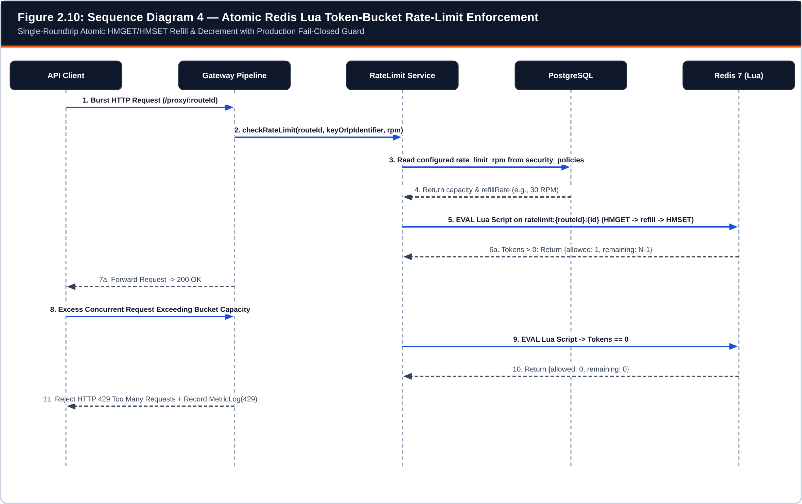
*Figure 2.10: Sequence Diagram 4 — Atomic Redis Lua Token-Bucket Rate-Limit Enforcement (Implements checkRateLimit() in src/rate-limit/redis.ts.)*

Workflow 4 Explanation (Figure 2.10): When external Redis 7 is active (isRealRedisActive === true, SOURCE-CONFIRMED), checkRateLimit() evaluates an embedded 3-ARGV Lua script via EVAL on key ratelimit:{routeId}:{identifier} (reading tokens and last_refill via HMGET, computing integer elapsed refill math.floor(time_passed * (refillRate / 60000)), decrementing 1 token if available, and persisting via HMSET + PEXPIRE 60000). In standalone sandbox/test mode (!isRealRedisActive, RUNTIME-VERIFIED), checkRateLimit() executes evaluateLocalBucket() in process memory.

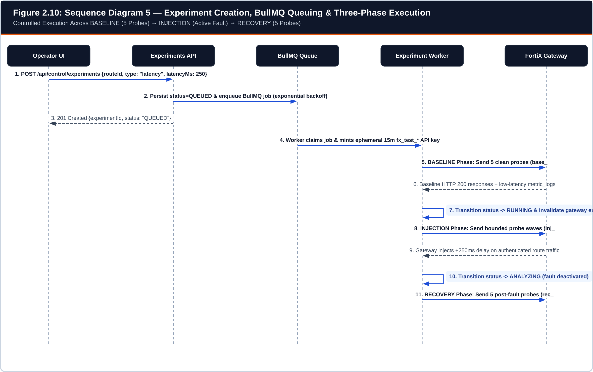
*Figure 2.11: Sequence Diagram 5 — Experiment Creation, BullMQ Queuing, and Three-Phase Execution (Implements src/api/experiments.ts and src/experiments/worker.ts.)*

Workflow 5 Explanation (Figure 2.11): Creating an experiment validates route ownership and Zod schema bounds (type in latency | error_5xx | timeout | traffic_burst; API durationMs 1,000–300,000 ms), persists status=QUEUED, and enqueues a BullMQ job (or triggers dispatchFallbackExperimentRunner() in sandbox mode). The worker clamps active execution duration to 500–10,000 ms (src/experiments/worker.ts:282), mints a 15-minute ephemeral fx_test_* API key, transitions status through QUEUED -> BASELINE -> RUNNING -> OBSERVING -> ANALYZING -> COMPLETED, and records tagged BASELINE (5), INJECTION, and RECOVERY (5) probe waves.

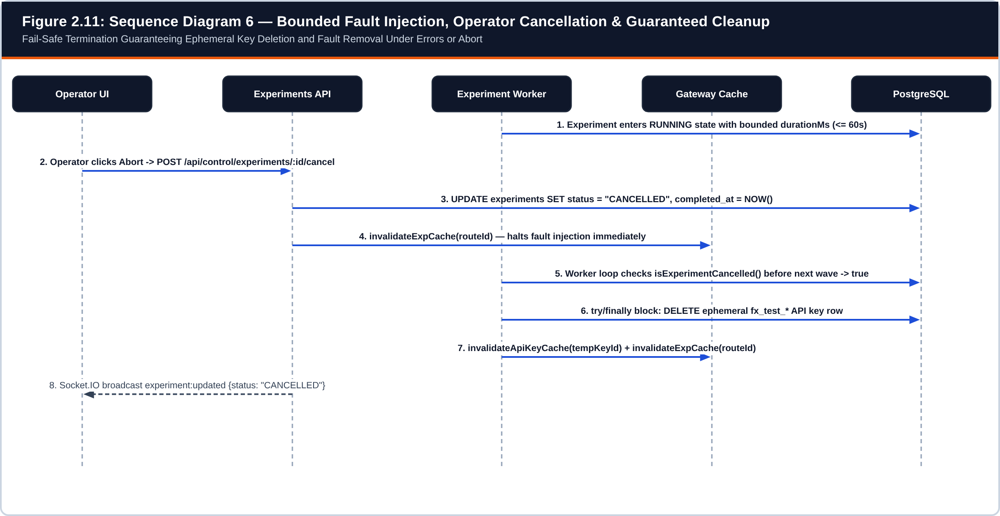
*Figure 2.12: Sequence Diagram 6 — Bounded Fault Injection, Operator Abort, and Guaranteed Cleanup (Illustrates fail-safe try/finally cleanup in src/experiments/worker.ts.)*

Workflow 6 Explanation (Figure 2.12): If an operator triggers POST /api/control/experiments/:id/cancel or an unexpected exception occurs mid-run, the API immediately sets status=CANCELLED and invalidates the gateway experiment cache. Before each probe wave, the worker checks isExperimentCancelled(), exits cleanly, and executes its finally block—unconditionally deleting the temporary fx_test_* API key row and clearing any cached fault state.

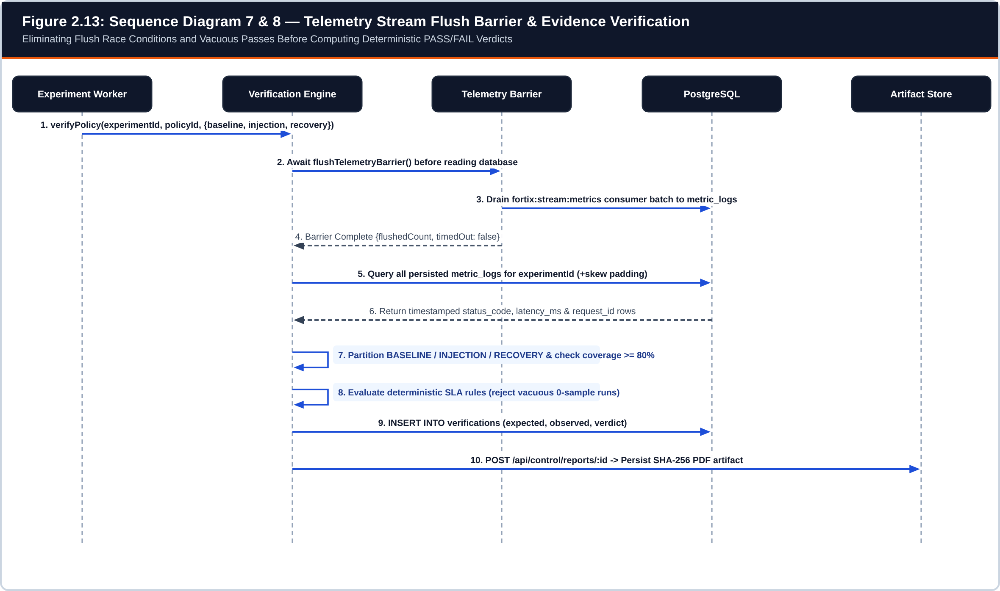
*Figure 2.13: Sequence Diagram 7 & 8 — Telemetry Stream Flush Barrier and Evidence-Based Verification (Implements flushTelemetryBarrier() and verifyPolicy() in src/verification/engine.ts.)*

Workflow 7 & 8 Explanation (Figure 2.13): Immediately after probe execution completes, VerificationEngine invokes flushTelemetryBarrier() so buffered stream/in-memory telemetry entries are committed to metric_logs before SQL evaluation begins. Observations are partitioned into BASELINE, INJECTION, and RECOVERY windows using exact probe request IDs and timestamp bounds. If expected probe coverage falls below 80% or zero injection samples exist, the engine refuses to emit a vacuous PASS and records INCONCLUSIVE; otherwise it persists PASS or FAIL and enables server-side PDFKit report generation stamped with an X-FortiX-Artifact-SHA256 checksum.

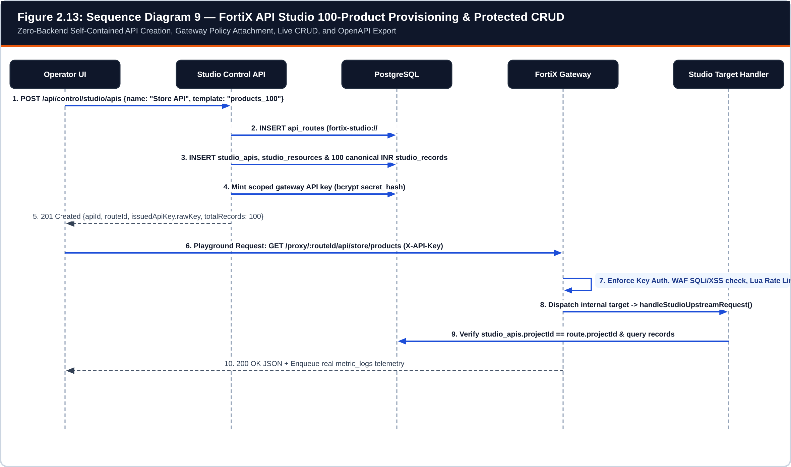
*Figure 2.14: Sequence Diagram 9 — FortiX API Studio 100-Product Provisioning and Protected Gateway CRUD (Implements src/api/studio.ts and src/studio/target-handler.ts.)*

Workflow 9 Explanation (Figure 2.14): Selecting the Store Products (100) template in API Studio creates an internal route (targetUrl = http://fortix-studio.internal/studio/<apiId>), attaches WAF/SSRF/rate-limit policies, seeds 100 deterministic Indian e-commerce products into studio_records, and issues a ready-to-use scoped API key. Subsequent GET/POST/PATCH/DELETE calls traverse the exact same /proxy/:routeId/* enforcement pipeline before reaching handleStudioUpstreamRequest(), allowing complete security and chaos verification with zero external services.

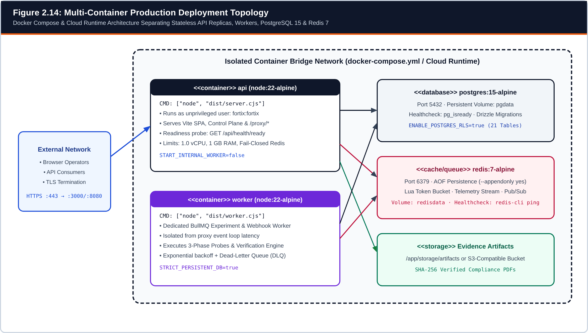
*Figure 2.15: FortiX Component & Multi-Container Production Deployment Topology (Docker Compose & Cloud Runtime) (Reconstructed directly from Dockerfile and docker-compose.yml.)*

---

# 3. DATA DICTIONARY

## 3.1 Database Tables SQL/NoSQL (PostgreSQL 15 Relational Schema & Redis 7 Keyspace)

FortiX employs a polyglot persistence architecture with strict separation of responsibilities: PostgreSQL 15 serves as the authoritative ACID relational database storing all 23 application tables defined in src/db/schema.ts and versioned through eight Drizzle ORM migrations (drizzle/0000_dizzy_moon_knight.sql through drizzle/0007_learning_center.sql), whereas Redis 7 is used strictly for atomic Lua token-bucket state, high-throughput telemetry stream buffering, multi-replica Pub/Sub invalidation, and BullMQ job queues—never as a substitute for durable relational records.

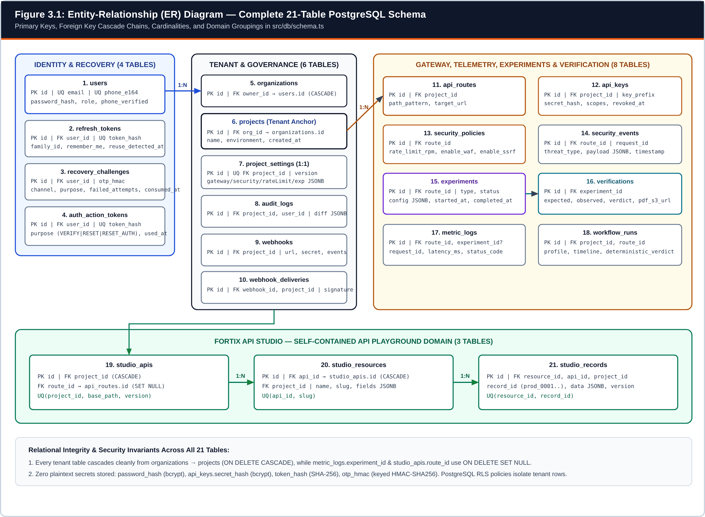
*Figure 3.1: Entity-Relationship (ER) Diagram of the Complete 23-Table PostgreSQL Schema Grouped Across Five Domains (Generated directly from src/db/schema.ts and migrations 0000_dizzy_moon_knight.sql through 0007_learning_center.sql.)*

**Table 3.1: Master Inventory of the 23 PostgreSQL Tables in FortiX**

| # | Table Name | Domain Subsystem | Primary / Foreign Keys | Isolation & RLS Policy Scope |
| --- | --- | --- | --- | --- |
| 1 | users | Identity & Auth | PK: id | Identity lookup root; unique email & phone_e164 |
| 2 | auth_action_tokens | Identity & Auth | PK: id; FK: user_id -> users | RLS enabled: user_id = app.current_user_id |
| 3 | refresh_tokens | Session Rotation | PK: id; FK: user_id -> users | RLS enabled: user_id = app.current_user_id |
| 4 | recovery_challenges | OTP Account Recovery | PK: id; FK: user_id -> users | RLS enabled: user_id = app.current_user_id |
| 5 | organizations | Tenant Hierarchy | PK: id; FK: owner_id -> users | RLS enabled: owner_id = app.current_user_id |
| 6 | projects | Tenant Anchor | PK: id; FK: org_id -> organizations | RLS enabled: via organizations.owner_id |
| 7 | project_settings | Governance | PK: id; UQ FK: project_id -> projects | RLS enabled: tenant-scoped via project_id |
| 8 | audit_logs | Compliance Audit | PK: id; FK: project_id, user_id | Append-only log; query-scoped by project_id |
| 9 | api_routes | Gateway Routing | PK: id; FK: project_id -> projects | RLS enabled: tenant-scoped via project_id |
| 10 | api_keys | Gateway Auth | PK: id; FK: project_id -> projects | RLS enabled: tenant-scoped via project_id |
| 11 | security_policies | Policy Enforcement | PK: id; FK: route_id -> api_routes | RLS enabled: route -> project ownership chain |
| 12 | experiments | Chaos Engine | PK: id; FK: route_id -> api_routes | RLS enabled: route -> project ownership chain |
| 13 | verifications | Verification Engine | PK: id; FK: experiment_id -> experiments | RLS enabled: experiment -> route -> project |
| 14 | metric_logs | Observability | PK: id; FK: route_id, experiment_id | Worker batch sink; query-scoped via route_id |
| 15 | security_events | WAF & Threat Log | PK: id; FK: route_id -> api_routes | Worker batch sink; query-scoped via route_id |
| 16 | webhooks | Outbound Integrations | PK: id; FK: project_id -> projects | RLS enabled: tenant-scoped via project_id |
| 17 | webhook_deliveries | Webhook Audit | PK: id; FK: webhook_id, project_id | Worker delivery log; query-scoped via project_id |
| 18 | workflow_runs | Autonomous Workflows | PK: id; FK: project_id, route_id | RLS enabled: tenant-scoped via project_id |
| 19 | studio_apis | API Studio | PK: id; FK: project_id, route_id | RLS enabled: tenant-scoped via project_id |
| 20 | studio_resources | API Studio | PK: id; FK: api_id, project_id | RLS enabled: tenant-scoped via project_id |
| 21 | studio_records | API Studio Dataset | PK: id; FK: resource_id, api_id, project_id | RLS enabled: tenant-scoped via project_id |
| 22 | learning_tutorials | Learning Center | PK: id; UQ: slug | Shared platform catalog; ADMIN-only mutations |
| 23 | learning_progress | Learning Center | PK: id; FK: user_id, tutorial_id | RLS enabled: user_id = app.current_user_id |

Table Purpose (users): Stores operator credentials, RBAC role assignments, normalized E.164 phone numbers, and verification flags. Indexes & Relationships: Unique constraints on email and phone_e164 (nullable PostgreSQL UNIQUE allows multiple NULL rows); referenced by organizations, refresh_tokens, recovery_challenges, auth_action_tokens, and learning_progress.

**Table 3.2: PostgreSQL Data Dictionary — users**

| Column Name | SQL Type | PK / FK / Constraints | Default | Synthetic Example / Notes |
| --- | --- | --- | --- | --- |
| id | TEXT (UUID) | PRIMARY KEY, NOT NULL | None | "550e8400-e29b-41d4-a716-446655440000" |
| email | TEXT | UNIQUE, NOT NULL | None | "operator@example.edu" (lowercased) |
| phone_e164 | TEXT | UNIQUE, NULLABLE | NULL | "+919876543210" (normalized E.164) |
| phone_verified | BOOLEAN | NOT NULL | false | true (required before SMS OTP recovery) |
| password_hash | TEXT | NOT NULL | None | "$2b$10$N9qo8uLOickgx2ZMRZoMye..." |
| role | TEXT | NOT NULL | 'DEVELOPER' | 'ADMIN' \| 'DEVELOPER' \| 'VIEWER' |
| email_verified | BOOLEAN | NOT NULL | false | true |
| created_at | TIMESTAMP | NOT NULL | now() | "2026-11-03 10:15:00" |

Table Purpose (auth_action_tokens): Stores SHA-256 digests of single-use email verification, password reset, and OTP-issued RESET_AUTHORIZATION tokens. Indexes & Relationships: FK user_id -> users.id ON DELETE CASCADE; UNIQUE(token_hash); composite index auth_action_tokens_user_purpose_idx(user_id, purpose).

**Table 3.3: PostgreSQL Data Dictionary — auth_action_tokens**

| Column Name | SQL Type | PK / FK / Constraints | Default | Synthetic Example / Notes |
| --- | --- | --- | --- | --- |
| id | TEXT (UUID) | PRIMARY KEY, NOT NULL | None | "6d9c1f10-31c2-4a0e-9e21-88a120001122" |
| user_id | TEXT (UUID) | FK -> users.id (CASCADE), NOT NULL | None | "550e8400-e29b-41d4-a716-446655440000" |
| purpose | TEXT | NOT NULL | None | 'RESET_AUTHORIZATION' \| 'EMAIL_VERIFICATION' |
| token_hash | TEXT (64-hex) | UNIQUE, NOT NULL | None | "9f86d081884c7d659a2feaa0c55ad015..." |
| expires_at | TIMESTAMP | NOT NULL | None | "2026-11-03 10:25:00" (10m TTL for reset auth) |
| used_at | TIMESTAMP | NULLABLE | NULL | "2026-11-03 10:18:14" (atomic single-use mark) |
| created_at | TIMESTAMP | NOT NULL | now() | "2026-11-03 10:15:00" |

Table Purpose (refresh_tokens): Tracks rotating Remember-Me (30d) and standard (12h) refresh session families, device metadata hashes, and token reuse detection. Indexes & Relationships: FK user_id -> users.id ON DELETE CASCADE; UNIQUE(token_hash); indexes refresh_tokens_family_idx(family_id) and refresh_tokens_user_idx(user_id).

**Table 3.4: PostgreSQL Data Dictionary — refresh_tokens**

| Column Name | SQL Type | PK / FK / Constraints | Default | Synthetic Example / Notes |
| --- | --- | --- | --- | --- |
| id | TEXT (UUID) | PRIMARY KEY, NOT NULL | None | "8b11e240-90a1-4b51-a111-223344556677" |
| user_id | TEXT (UUID) | FK -> users.id (CASCADE), NOT NULL | None | "550e8400-e29b-41d4-a716-446655440000" |
| token_hash | TEXT (64-hex) | UNIQUE, NOT NULL | None | "e3b0c44298fc1c149afbf4c8996fb924..." |
| family_id | TEXT (UUID) | NULLABLE (Indexed) | NULL | "fam-91a4b2c8-1122-4333-8444-556677889900" |
| replaced_by_id | TEXT (UUID) | NULLABLE | NULL | "9c22f351-a1b2-4c62-b222-334455667788" |
| remember_me | BOOLEAN | NOT NULL | false | true (30-day persistent cookie policy) |
| expires_at | TIMESTAMP | NOT NULL | None | "2026-12-03 10:15:00" |
| absolute_expires_at | TIMESTAMP | NULLABLE | NULL | "2026-12-03 10:15:00" (hard family cap) |
| last_used_at | TIMESTAMP | NULLABLE | NULL | "2026-11-03 11:02:19" |
| revoked_at | TIMESTAMP | NULLABLE | NULL | NULL (active) or revocation timestamp |
| reuse_detected_at | TIMESTAMP | NULLABLE | NULL | Populated if rotated token is replayed |
| user_agent_hash | TEXT | NULLABLE | NULL | "a41c92e1b8d03f77" (privacy-preserving digest) |
| ip_hash | TEXT | NULLABLE | NULL | "7c89f012e4b1192a" |
| created_at | TIMESTAMP | NOT NULL | now() | "2026-11-03 10:15:00" |

Table Purpose (recovery_challenges): Stores time-limited 6-digit OTP verification challenges using keyed HMAC-SHA256 digests, attempt counters, and resend cooldown timestamps. Indexes & Relationships: FK user_id -> users.id ON DELETE CASCADE; composite index recovery_challenges_user_purpose_idx(user_id, purpose, created_at).

**Table 3.5: PostgreSQL Data Dictionary — recovery_challenges**

| Column Name | SQL Type | PK / FK / Constraints | Default | Synthetic Example / Notes |
| --- | --- | --- | --- | --- |
| id | TEXT (UUID) | PRIMARY KEY, NOT NULL | None | "ch-71f0a211-44d2-48b9-9f01-aa22bb33cc44" |
| user_id | TEXT (UUID) | FK -> users.id (CASCADE), NOT NULL | None | "550e8400-e29b-41d4-a716-446655440000" |
| channel | TEXT | NOT NULL | None | 'EMAIL' \| 'SMS' |
| purpose | TEXT | NOT NULL | None | 'PASSWORD_RESET' \| 'PHONE_VERIFICATION' |
| destination_masked | TEXT | NOT NULL | None | "op***@example.edu" or "+91******3210" |
| otp_hmac | TEXT (64-hex) | NOT NULL | None | HMAC-SHA256(key, challengeId:purpose:otp) |
| expires_at | TIMESTAMP | NOT NULL | None | "2026-11-03 10:25:00" (10-minute window) |
| failed_attempts | INTEGER | NOT NULL | 0 | 0..5 (locked when failed_attempts >= max_attempts) |
| max_attempts | INTEGER | NOT NULL | 5 | 5 |
| resend_count | INTEGER | NOT NULL | 0 | 1 (max 5 resends per challenge) |
| last_sent_at | TIMESTAMP | NOT NULL | now() | "2026-11-03 10:15:00" |
| resend_available_at | TIMESTAMP | NOT NULL | None | "2026-11-03 10:16:00" (60s cooldown) |
| consumed_at | TIMESTAMP | NULLABLE | NULL | Timestamp when valid OTP consumed challenge |
| invalidated_at | TIMESTAMP | NULLABLE | NULL | Set on lockout, supersede, or provider 5xx |
| invalidation_reason | TEXT | NULLABLE | NULL | 'MAX_ATTEMPTS_EXCEEDED' \| 'DELIVERY_FAILED' |
| created_at | TIMESTAMP | NOT NULL | now() | "2026-11-03 10:15:00" |

Table Purpose (organizations): Top-level tenant container owned by an operator account. Indexes & Relationships: FK owner_id -> users.id ON DELETE CASCADE; 1:N parent of projects.

**Table 3.6: PostgreSQL Data Dictionary — organizations**

| Column Name | SQL Type | PK / FK / Constraints | Default | Synthetic Example / Notes |
| --- | --- | --- | --- | --- |
| id | TEXT (UUID) | PRIMARY KEY, NOT NULL | None | "org-10293847-56a1-4b2c-9d3e-0f1e2d3c4b5a" |
| name | TEXT | NOT NULL | None | "Academic Evaluation Org" |
| owner_id | TEXT (UUID) | FK -> users.id (CASCADE), NOT NULL | None | "550e8400-e29b-41d4-a716-446655440000" |
| created_at | TIMESTAMP | NOT NULL | now() | "2026-11-03 10:15:00" |

Table Purpose (projects): Primary operational isolation boundary scoping routes, API keys, Studio APIs, experiments, webhooks, and settings. Indexes & Relationships: FK org_id -> organizations.id ON DELETE CASCADE; 1:N parent of api_routes, api_keys, studio_apis, webhooks, audit_logs, workflow_runs.

**Table 3.7: PostgreSQL Data Dictionary — projects**

| Column Name | SQL Type | PK / FK / Constraints | Default | Synthetic Example / Notes |
| --- | --- | --- | --- | --- |
| id | TEXT (UUID) | PRIMARY KEY, NOT NULL | None | "proj-dd7b1eb5-6d4d-4a4b-b313-8646128537b1" |
| org_id | TEXT (UUID) | FK -> organizations.id (CASCADE), NOT NULL | None | "org-10293847-56a1-4b2c-9d3e-0f1e2d3c4b5a" |
| name | TEXT | NOT NULL | None | "Default Project" |
| environment | TEXT | NOT NULL | 'development' | 'development' \| 'staging' \| 'production' |
| created_at | TIMESTAMP | NOT NULL | now() | "2026-11-03 10:15:00" |

Table Purpose (api_routes): Maps external gateway path patterns (/proxy/:routeId/*) to external HTTPS targets or internal FortiX API Studio targets. Indexes & Relationships: FK project_id -> projects.id ON DELETE CASCADE; 1:N parent of security_policies, experiments, metric_logs, security_events.

**Table 3.8: PostgreSQL Data Dictionary — api_routes**

| Column Name | SQL Type | PK / FK / Constraints | Default | Synthetic Example / Notes |
| --- | --- | --- | --- | --- |
| id | TEXT (UUID) | PRIMARY KEY, NOT NULL | None | "rt-7a88c112-3f44-4d91-8122-9900aabbccdd" |
| project_id | TEXT (UUID) | FK -> projects.id (CASCADE), NOT NULL | None | "proj-dd7b1eb5-6d4d-4a4b-b313-8646128537b1" |
| path_pattern | TEXT | NOT NULL | None | "/api/store/*" |
| target_url | TEXT | NOT NULL | None | "http://fortix-studio.internal/studio/91c0..." or "https://api.example.org" |
| created_at | TIMESTAMP | NOT NULL | now() | "2026-11-03 10:16:00" |

Table Purpose (api_keys): Stores hashed gateway client credentials, visible lookup prefixes, route scopes, expiration timestamps, and revocation markers. Indexes & Relationships: FK project_id -> projects.id ON DELETE CASCADE; secret_hash stores bcrypt digest only—raw key is returned once at creation.

**Table 3.9: PostgreSQL Data Dictionary — api_keys**

| Column Name | SQL Type | PK / FK / Constraints | Default | Synthetic Example / Notes |
| --- | --- | --- | --- | --- |
| id | TEXT (16-hex) | PRIMARY KEY, NOT NULL | None | "410b67148f2d5e53" |
| project_id | TEXT (UUID) | FK -> projects.id (CASCADE), NOT NULL | None | "proj-dd7b1eb5-6d4d-4a4b-b313-8646128537b1" |
| key_prefix | TEXT | NOT NULL | None | "fx_live_<REDACTED_HEX_TOKEN>" |
| secret_hash | TEXT | NOT NULL | None | "$2b$10$w8Q9zP3xV1..." (bcrypt hash of secret) |
| name | TEXT | NOT NULL | None | "Store API Gateway Key" |
| purpose | TEXT | NULLABLE | NULL | "FortiX API Studio Key" |
| scopes | JSONB | NULLABLE | NULL | ["gateway:proxy"] |
| expires_at | TIMESTAMP | NULLABLE | NULL | NULL or 15m TTL for ephemeral worker keys |
| revoked_at | TIMESTAMP | NULLABLE | NULL | NULL (active) or revocation timestamp |
| created_at | TIMESTAMP | NOT NULL | now() | "2026-11-03 10:16:02" |

Table Purpose (security_policies): Defines per-route rate-limiting RPM ceilings and boolean toggles for WAF payload inspection and SSRF enforcement. Indexes & Relationships: FK route_id -> api_routes.id ON DELETE CASCADE.

**Table 3.10: PostgreSQL Data Dictionary — security_policies**

| Column Name | SQL Type | PK / FK / Constraints | Default | Synthetic Example / Notes |
| --- | --- | --- | --- | --- |
| id | TEXT (UUID) | PRIMARY KEY, NOT NULL | None | "pol-31b9e442-11c0-4a88-9e10-112233445566" |
| route_id | TEXT (UUID) | FK -> api_routes.id (CASCADE), NOT NULL | None | "rt-7a88c112-3f44-4d91-8122-9900aabbccdd" |
| rate_limit_rpm | INTEGER | NULLABLE | NULL | 30 (tokens replenished per minute) |
| enable_waf | BOOLEAN | NOT NULL | false | true (blocks SQLi, XSS, path traversal) |
| enable_ssrf | BOOLEAN | NOT NULL | false | true (blocks RFC1918, loopback, metadata IPs) |
| created_at | TIMESTAMP | NOT NULL | now() | "2026-11-03 10:16:02" |

Table Purpose (experiments): Stores controlled chaos and resilience experiment definitions, lifecycle states, and bounded fault parameters. Indexes & Relationships: FK route_id -> api_routes.id ON DELETE CASCADE; 1:N parent of verifications and optional FK target of metric_logs.

**Table 3.11: PostgreSQL Data Dictionary — experiments**

| Column Name | SQL Type | PK / FK / Constraints | Default | Synthetic Example / Notes |
| --- | --- | --- | --- | --- |
| id | TEXT (UUID) | PRIMARY KEY, NOT NULL | None | "exp-99c1d220-77a4-4e11-b009-445566778899" |
| route_id | TEXT (UUID) | FK -> api_routes.id (CASCADE), NOT NULL | None | "rt-7a88c112-3f44-4d91-8122-9900aabbccdd" |
| type | TEXT | NOT NULL | None | 'latency' \| 'error_5xx' \| 'timeout' \| 'traffic_burst' |
| status | TEXT | NOT NULL | None | 'QUEUED' \| 'BASELINE' \| 'RUNNING' \| 'OBSERVING' \| 'ANALYZING' \| 'COMPLETED' \| 'FAILED' \| 'CANCELLED' |
| config | JSONB | NOT NULL | None | {"latencyMs": 200, "durationMs": 2000} |
| scheduled_for | TIMESTAMP | NULLABLE | NULL | NULL (immediate) or scheduled UTC time |
| started_at | TIMESTAMP | NULLABLE | NULL | "2026-11-03 10:17:00" |
| completed_at | TIMESTAMP | NULLABLE | NULL | "2026-11-03 10:17:04" |
| created_at | TIMESTAMP | NOT NULL | now() | "2026-11-03 10:16:59" |

Table Purpose (verifications): Stores deterministic SLA evaluation contracts, three-phase observed telemetry summaries, PASS/FAIL/INCONCLUSIVE verdicts, and PDF artifact URIs. Indexes & Relationships: FK experiment_id -> experiments.id ON DELETE CASCADE.

**Table 3.12: PostgreSQL Data Dictionary — verifications**

| Column Name | SQL Type | PK / FK / Constraints | Default | Synthetic Example / Notes |
| --- | --- | --- | --- | --- |
| id | TEXT (UUID) | PRIMARY KEY, NOT NULL | None | "ver-51d2e330-88b5-4f22-a110-556677889900" |
| experiment_id | TEXT (UUID) | FK -> experiments.id (CASCADE), NOT NULL | None | "exp-99c1d220-77a4-4e11-b009-445566778899" |
| expected | JSONB | NOT NULL | None | {"minBaselineSamples":5,"expectedInjectedLatencyMs":200} |
| observed | JSONB | NOT NULL | None | {"baseline":{"count":5,"p95Ms":8},"injection":{"count":12,"p95Ms":211},"recovery":{"count":5,"errorRate":0}} |
| verdict | TEXT | NOT NULL | None | 'PASS' \| 'FAIL' \| 'INCONCLUSIVE' |
| pdf_s3_url | TEXT | NULLABLE | NULL | "reports/proj-dd7b.../verification-51d2....pdf" (legacy column name; stored locally via LocalStorageProvider) |
| created_at | TIMESTAMP | NOT NULL | now() | "2026-11-03 10:17:05" |

Table Purpose (metric_logs): Time-series request telemetry capturing per-request latency, HTTP status code, correlation request_id, and optional experiment association. Indexes & Relationships: FK route_id -> api_routes.id (CASCADE); FK experiment_id -> experiments.id (SET NULL); composite index route_time_idx(route_id, timestamp).

**Table 3.13: PostgreSQL Data Dictionary — metric_logs**

| Column Name | SQL Type | PK / FK / Constraints | Default | Synthetic Example / Notes |
| --- | --- | --- | --- | --- |
| id | TEXT (UUID) | PRIMARY KEY, NOT NULL | None | "met-10a2b3c4-d5e6-4f78-9012-3456789abcde" |
| route_id | TEXT (UUID) | FK -> api_routes.id (CASCADE), NOT NULL | None | "rt-7a88c112-3f44-4d91-8122-9900aabbccdd" |
| experiment_id | TEXT (UUID) | FK -> experiments.id (SET NULL), NULLABLE | NULL | "exp-99c1d220-77a4-4e11-b009-445566778899" |
| request_id | TEXT | NULLABLE | NULL | "inj_exp-99c1d220_4" (probe correlation tag) |
| latency_ms | INTEGER | NOT NULL | None | 209 |
| status_code | INTEGER | NOT NULL | None | 200 (or 401, 403, 429, 503, 504) |
| timestamp | TIMESTAMP | NOT NULL | now() | "2026-11-03 10:17:02" |

Table Purpose (security_events): Immutable log of blocked WAF attacks (SQLi, XSS, path traversal) and SSRF violations. Indexes & Relationships: FK route_id -> api_routes.id ON DELETE CASCADE; composite index threat_route_time_idx(route_id, timestamp).

**Table 3.14: PostgreSQL Data Dictionary — security_events**

| Column Name | SQL Type | PK / FK / Constraints | Default | Synthetic Example / Notes |
| --- | --- | --- | --- | --- |
| id | TEXT (UUID) | PRIMARY KEY, NOT NULL | None | "sec-77e8f901-23a4-4b56-8c7d-9e0f1a2b3c4d" |
| route_id | TEXT (UUID) | FK -> api_routes.id (CASCADE), NOT NULL | None | "rt-7a88c112-3f44-4d91-8122-9900aabbccdd" |
| request_id | TEXT | NULLABLE | NULL | "req-88112233-4455-4666-8777-889900aabbcc" |
| threat_type | TEXT | NOT NULL | None | 'SQL_INJECTION' \| 'XSS' \| 'PATH_TRAVERSAL' \| 'SSRF' |
| payload | JSONB | NULLABLE | NULL | {"method":"GET","matchedRule":"SQLI_UNION_OR"} |
| timestamp | TIMESTAMP | NOT NULL | now() | "2026-11-03 10:16:40" |

Table Purpose (webhooks): Stores tenant-registered outbound HTTP webhook endpoints, HMAC signing secrets, and subscribed event types. Indexes & Relationships: FK project_id -> projects.id ON DELETE CASCADE; 1:N parent of webhook_deliveries.

**Table 3.15: PostgreSQL Data Dictionary — webhooks**

| Column Name | SQL Type | PK / FK / Constraints | Default | Synthetic Example / Notes |
| --- | --- | --- | --- | --- |
| id | TEXT (UUID) | PRIMARY KEY, NOT NULL | None | "wh-12345678-90ab-4cde-8f01-234567890abc" |
| project_id | TEXT (UUID) | FK -> projects.id (CASCADE), NOT NULL | None | "proj-dd7b1eb5-6d4d-4a4b-b313-8646128537b1" |
| name | TEXT | NOT NULL | None | "SecOps Incident Receiver" |
| url | TEXT | NOT NULL | None | "https://hooks.example.org/fortix-events" |
| secret | TEXT | NULLABLE | NULL | "[REDACTED_WEBHOOK_SIGNING_SECRET]" |
| events | JSONB | NOT NULL | None | ["verification.completed","security.threat_blocked"] |
| is_active | BOOLEAN | NOT NULL | true | true |
| created_at | TIMESTAMP | NOT NULL | now() | "2026-11-03 10:18:00" |

Table Purpose (webhook_deliveries): Records every outbound webhook delivery attempt, HTTP status, latency, failure reason, and X-FortiX-Signature digest. Indexes & Relationships: FK webhook_id -> webhooks.id (CASCADE), FK project_id -> projects.id (CASCADE); indexes on (webhook_id, created_at) and (project_id, created_at).

**Table 3.16: PostgreSQL Data Dictionary — webhook_deliveries**

| Column Name | SQL Type | PK / FK / Constraints | Default | Synthetic Example / Notes |
| --- | --- | --- | --- | --- |
| id | TEXT (UUID) | PRIMARY KEY, NOT NULL | None | "whd-90ab12cd-34ef-4567-8901-abcdef123456" |
| webhook_id | TEXT (UUID) | FK -> webhooks.id (CASCADE), NOT NULL | None | "wh-12345678-90ab-4cde-8f01-234567890abc" |
| project_id | TEXT (UUID) | FK -> projects.id (CASCADE), NOT NULL | None | "proj-dd7b1eb5-6d4d-4a4b-b313-8646128537b1" |
| event_type | TEXT | NOT NULL | None | "verification.completed" |
| payload | JSONB | NOT NULL | None | {"verdict":"PASS","experimentId":"exp-99c1..."} |
| attempt_number | INTEGER | NOT NULL | None | 1 |
| max_attempts | INTEGER | NOT NULL | 5 | 5 |
| status_code | INTEGER | NULLABLE | NULL | 200 |
| response_body | TEXT | NULLABLE | NULL | {"ok":true} |
| error_message | TEXT | NULLABLE | NULL | NULL |
| latency_ms | INTEGER | NULLABLE | NULL | 84 |
| success | BOOLEAN | NOT NULL | None | true |
| signature | TEXT | NULLABLE | NULL | "t=1762165082,v1=6f4e2a9c..." (X-FortiX-Signature-256 format) |
| created_at | TIMESTAMP | NOT NULL | now() | "2026-11-03 10:18:02" |

Table Purpose (project_settings): 1:1 versioned configuration document per project governing default gateway timeouts, WAF sensitivity, rate-limit defaults, and telemetry retention. Indexes & Relationships: UNIQUE FK project_id -> projects.id (CASCADE); FK updated_by -> users.id (SET NULL); optimistic locking via version integer.

**Table 3.17: PostgreSQL Data Dictionary — project_settings**

| Column Name | SQL Type | PK / FK / Constraints | Default | Synthetic Example / Notes |
| --- | --- | --- | --- | --- |
| id | TEXT (UUID) | PRIMARY KEY, NOT NULL | None | "ps-22334455-6677-4888-9999-aabbccddeeff" |
| project_id | TEXT (UUID) | UQ FK -> projects.id (CASCADE), NOT NULL | None | "proj-dd7b1eb5-6d4d-4a4b-b313-8646128537b1" |
| version | INTEGER | NOT NULL | 1 | 2 (incremented atomically on update) |
| gateway_config | JSONB | NOT NULL | None | {"upstreamTimeoutMs":5000,"stripAuthHeaders":true} |
| security_config | JSONB | NOT NULL | None | {"defaultEnableWaf":true,"defaultEnableSsrf":true} |
| rate_limit_config | JSONB | NOT NULL | None | {"defaultRpm":60,"burstMultiplier":1} |
| experiment_config | JSONB | NOT NULL | None | {"maxDurationMs":60000,"requireCleanup":true} |
| telemetry_config | JSONB | NOT NULL | None | {"retentionDays":30,"realtimePush":true} |
| updated_by | TEXT (UUID) | FK -> users.id (SET NULL), NULLABLE | NULL | "550e8400-e29b-41d4-a716-446655440000" |
| created_at | TIMESTAMP | NOT NULL | now() | "2026-11-03 10:15:00" |
| updated_at | TIMESTAMP | NOT NULL | now() | "2026-11-03 10:19:00" |

Table Purpose (audit_logs): Append-only governance log recording before/after configuration diffs, version transitions, and operator attribution. Indexes & Relationships: FK project_id -> projects.id (CASCADE), FK user_id -> users.id (SET NULL); composite index audit_project_time_idx(project_id, timestamp).

**Table 3.18: PostgreSQL Data Dictionary — audit_logs**

| Column Name | SQL Type | PK / FK / Constraints | Default | Synthetic Example / Notes |
| --- | --- | --- | --- | --- |
| id | TEXT (UUID) | PRIMARY KEY, NOT NULL | None | "aud-66778899-aabb-4ccd-8eef-001122334455" |
| project_id | TEXT (UUID) | FK -> projects.id (CASCADE), NOT NULL | None | "proj-dd7b1eb5-6d4d-4a4b-b313-8646128537b1" |
| user_id | TEXT (UUID) | FK -> users.id (SET NULL), NULLABLE | NULL | "550e8400-e29b-41d4-a716-446655440000" |
| action | TEXT | NOT NULL | None | 'SETTINGS_UPDATED' \| 'SETTINGS_RESET' |
| domain | TEXT | NOT NULL | None | 'security' \| 'gateway' \| 'rateLimit' |
| previous_version | INTEGER | NOT NULL | None | 1 |
| new_version | INTEGER | NOT NULL | None | 2 |
| diff | JSONB | NOT NULL | None | {"defaultRpm":{"from":60,"to":30}} |
| metadata | JSONB | NULLABLE | NULL | {"requestId":"req-991a..."} |
| timestamp | TIMESTAMP | NOT NULL | now() | "2026-11-03 10:19:00" |

Table Purpose (workflow_runs): Tracks orchestrated multi-step verification workflow runs, execution timelines, deterministic verdicts, and cleanup status. Indexes & Relationships: FK project_id -> projects.id (CASCADE), FK route_id -> api_routes.id (CASCADE); index workflow_run_project_idx(project_id, created_at).

**Table 3.19: PostgreSQL Data Dictionary — workflow_runs**

| Column Name | SQL Type | PK / FK / Constraints | Default | Synthetic Example / Notes |
| --- | --- | --- | --- | --- |
| id | TEXT (UUID) | PRIMARY KEY, NOT NULL | None | "wfr-44556677-8899-4aab-bccd-ddeeff001122" |
| project_id | TEXT (UUID) | FK -> projects.id (CASCADE), NOT NULL | None | "proj-dd7b1eb5-6d4d-4a4b-b313-8646128537b1" |
| route_id | TEXT (UUID) | FK -> api_routes.id (CASCADE), NOT NULL | None | "rt-7a88c112-3f44-4d91-8122-9900aabbccdd" |
| profile | TEXT | NOT NULL | None | 'rate_limit_verification' \| 'latency_resilience' |
| status | TEXT | NOT NULL | None | 'COMPLETED' \| 'FAILED' \| 'CANCELLED' |
| params | JSONB | NOT NULL | None | {"targetRpm":30,"burstCount":45} |
| timeline | JSONB | NOT NULL | None | [{"step":"BASELINE","status":"DONE"}] |
| deterministic_verdict | JSONB | NULLABLE | NULL | {"verdict":"PASS","throttledCount":15} |
| ai_analysis | JSONB | NULLABLE | NULL | {"available":false} (optional post-run advisory; deterministic_verdict is authoritative) |
| evidence_summary | JSONB | NULLABLE | NULL | {"coverage":1.0,"sampleCount":45} |
| cleanup_status | TEXT | NOT NULL | 'NOT_REQUIRED' | 'COMPLETED' \| 'NOT_REQUIRED' |
| error_message | TEXT | NULLABLE | NULL | NULL |
| started_at | TIMESTAMP | NULLABLE | NULL | "2026-11-03 10:20:00" |
| completed_at | TIMESTAMP | NULLABLE | NULL | "2026-11-03 10:20:06" |
| created_at | TIMESTAMP | NOT NULL | now() | "2026-11-03 10:20:00" |
| updated_at | TIMESTAMP | NOT NULL | now() | "2026-11-03 10:20:06" |

Table Purpose (studio_apis): Defines user-created APIs inside FortiX API Studio, binding base paths and versions to gateway api_routes. Indexes & Relationships: FK project_id -> projects.id (CASCADE), FK route_id -> api_routes.id (SET NULL); unique index (project_id, base_path, version).

**Table 3.20: PostgreSQL Data Dictionary — studio_apis**

| Column Name | SQL Type | PK / FK / Constraints | Default | Synthetic Example / Notes |
| --- | --- | --- | --- | --- |
| id | TEXT (UUID) | PRIMARY KEY, NOT NULL | None | "sapi-91c0d2e3-f4a5-4678-9012-abcdef987654" |
| project_id | TEXT (UUID) | FK -> projects.id (CASCADE), NOT NULL | None | "proj-dd7b1eb5-6d4d-4a4b-b313-8646128537b1" |
| route_id | TEXT (UUID) | FK -> api_routes.id (SET NULL), NULLABLE | NULL | "rt-7a88c112-3f44-4d91-8122-9900aabbccdd" |
| name | TEXT | NOT NULL | None | "Store Products API" |
| description | TEXT | NOT NULL | '' | "Self-contained e-commerce catalog API" |
| base_path | TEXT | NOT NULL | None | "/api/store" |
| version | TEXT | NOT NULL | 'v1' | 'v1' |
| created_at | TIMESTAMP | NOT NULL | now() | "2026-11-03 10:16:00" |
| updated_at | TIMESTAMP | NOT NULL | now() | "2026-11-03 10:16:00" |

Table Purpose (studio_resources): Defines typed REST collections (e.g., products, customers, orders) and field validation rules within a Studio API. Indexes & Relationships: FK api_id -> studio_apis.id (CASCADE), FK project_id -> projects.id (CASCADE); unique index (api_id, slug).

**Table 3.21: PostgreSQL Data Dictionary — studio_resources**

| Column Name | SQL Type | PK / FK / Constraints | Default | Synthetic Example / Notes |
| --- | --- | --- | --- | --- |
| id | TEXT (UUID) | PRIMARY KEY, NOT NULL | None | "sres-33445566-7788-4999-aaaa-bbbbccccdddd" |
| api_id | TEXT (UUID) | FK -> studio_apis.id (CASCADE), NOT NULL | None | "sapi-91c0d2e3-f4a5-4678-9012-abcdef987654" |
| project_id | TEXT (UUID) | FK -> projects.id (CASCADE), NOT NULL | None | "proj-dd7b1eb5-6d4d-4a4b-b313-8646128537b1" |
| name | TEXT | NOT NULL | None | "Products" |
| slug | TEXT | NOT NULL | None | "products" (mounted at /api/store/products) |
| fields | JSONB | NOT NULL | None | [{"name":"sku","type":"string","required":true},{"name":"price","type":"number"}] |
| created_at | TIMESTAMP | NOT NULL | now() | "2026-11-03 10:16:00" |

Table Purpose (studio_records): Stores individual JSONB entity rows (such as prod_0001..prod_0100) served by FortiX API Studio CRUD endpoints. Indexes & Relationships: FK resource_id -> studio_resources.id (CASCADE), FK api_id -> studio_apis.id (CASCADE), FK project_id -> projects.id (CASCADE); unique index (resource_id, record_id).

**Table 3.22: PostgreSQL Data Dictionary — studio_records**

| Column Name | SQL Type | PK / FK / Constraints | Default | Synthetic Example / Notes |
| --- | --- | --- | --- | --- |
| id | TEXT (UUID) | PRIMARY KEY, NOT NULL | None | "srec-77889900-1122-4333-8444-5566778899aa" |
| resource_id | TEXT (UUID) | FK -> studio_resources.id (CASCADE), NOT NULL | None | "sres-33445566-7788-4999-aaaa-bbbbccccdddd" |
| api_id | TEXT (UUID) | FK -> studio_apis.id (CASCADE), NOT NULL | None | "sapi-91c0d2e3-f4a5-4678-9012-abcdef987654" |
| project_id | TEXT (UUID) | FK -> projects.id (CASCADE), NOT NULL | None | "proj-dd7b1eb5-6d4d-4a4b-b313-8646128537b1" |
| record_id | TEXT | NOT NULL | None | "prod_0001" |
| data | JSONB | NOT NULL | None | {"id":"prod_0001","sku":"ELEC-1001","name":"Wireless ANC Headphones","price":4999,"currency":"INR","stock":42} |
| version | INTEGER | NOT NULL | 1 | 1 (incremented on PATCH) |
| created_at | TIMESTAMP | NOT NULL | now() | "2026-11-03 10:16:01" |
| updated_at | TIMESTAMP | NOT NULL | now() | "2026-11-03 10:16:01" |

Table Purpose (learning_tutorials): Stores structured tutorial metadata, lifecycle stage mappings (PROTECT through IMPROVE), allowlisted video references, objectives, steps, and documentation links for the In-App Video Learning Center (FTX-LEARN-001). Indexes & Relationships: UNIQUE(slug); composite B-tree indexes learning_tutorials_published_sort_idx(published, sort_order), learning_tutorials_category_sort_idx(category, sort_order), and learning_tutorials_lifecycle_idx(lifecycle_stage, sort_order).

**Table 3.23: PostgreSQL Data Dictionary — learning_tutorials**

| Column Name | SQL Type | PK / FK / Constraints | Default | Synthetic Example / Notes |
| --- | --- | --- | --- | --- |
| id | TEXT (UUID) | PRIMARY KEY, NOT NULL | None | "tut-01-getting-started" |
| slug | TEXT | UNIQUE, NOT NULL | None | "getting-started-with-fortix" |
| title | TEXT | NOT NULL | None | "Getting Started: Protect & Verify Your First API" |
| description | TEXT | NOT NULL | None | "Guided walkthrough of the five-stage FortiX lifecycle." |
| module_name | TEXT | NOT NULL | None | "API Studio" \| "Security Policies" \| "Experiments" |
| lifecycle_stage | TEXT | NOT NULL | None | 'PROTECT' \| 'BREAK' \| 'OBSERVE' \| 'PROVE' \| 'IMPROVE' |
| category | TEXT | NOT NULL | None | "Onboarding" \| "Gateway Security" \| "Resilience" |
| difficulty | TEXT | NOT NULL | None | 'Beginner' \| 'Intermediate' \| 'Advanced' |
| video_provider | TEXT | NOT NULL | 'none' | 'self_hosted' \| 'https_allowlist' \| 'youtube_nocookie' \| 'none' |
| video_reference | TEXT | NULLABLE | NULL | "/learning/videos/fortix-platform-overview.webm" or 11-char ID / allowlisted HTTPS URL |
| video_source_note | TEXT | NULLABLE | NULL | "Interactive step-by-step guided simulation" |
| thumbnail_url | TEXT | NULLABLE | NULL | NULL or validated HTTPS asset path |
| captions_url | TEXT | NULLABLE | NULL | "/learning/captions/fortix-platform-overview.vtt" |
| duration_seconds | INTEGER | NOT NULL | None | 240 |
| learning_objectives | JSONB | NOT NULL | None | ["Create Store API","Enforce 30 RPM policy"] |
| prerequisites | JSONB | NOT NULL | None | ["Active FortiX project workspace"] |
| steps | JSONB | NOT NULL | None | [{"stepNumber":1,"title":"Open API Studio","actionRoute":"/studio"}] |
| warnings | JSONB | NOT NULL | None | ["Chaos probes run post-authentication only."] |
| related_slugs | JSONB | NOT NULL | None | ["token-bucket-rate-limiting"] |
| doc_links | JSONB | NOT NULL | None | [{"label":"Security Policies","href":"/security"}] |
| featured | BOOLEAN | NOT NULL | false | true |
| published | BOOLEAN | NOT NULL | true | true |
| sort_order | INTEGER | NOT NULL | 100 | 10 |
| created_at / updated_at | TIMESTAMP | NOT NULL | now() | "2026-11-03 10:15:00" |

Table Purpose (learning_progress): Tracks per-operator video playback resume timestamps, monotonic maximum watched duration, and completion state across sessions. Indexes & Relationships: FK user_id -> users.id (CASCADE), FK tutorial_id -> learning_tutorials.id (CASCADE); UNIQUE(user_id, tutorial_id); index learning_progress_user_watched_idx(user_id, last_watched_at); RLS isolated per user.

**Table 3.24: PostgreSQL Data Dictionary — learning_progress**

| Column Name | SQL Type | PK / FK / Constraints | Default | Synthetic Example / Notes |
| --- | --- | --- | --- | --- |
| id | TEXT (UUID) | PRIMARY KEY, NOT NULL | None | "lprog-8812a3b4-c5d6-4e7f-8901-23456789abcd" |
| user_id | TEXT (UUID) | FK -> users.id (CASCADE), NOT NULL | None | "550e8400-e29b-41d4-a716-446655440000" |
| tutorial_id | TEXT (UUID) | FK -> learning_tutorials.id (CASCADE), NOT NULL | None | "tut-01-getting-started" |
| last_position_seconds | INTEGER | NOT NULL | 0 | 145 (resume playback cursor) |
| max_watched_seconds | INTEGER | NOT NULL | 0 | 180 (monotonic high-water mark) |
| completed | BOOLEAN | NOT NULL | false | true |
| completed_at | TIMESTAMP | NULLABLE | NULL | "2026-11-03 10:24:12" |
| last_watched_at | TIMESTAMP | NOT NULL | now() | "2026-11-03 10:24:12" |
| updated_at | TIMESTAMP | NOT NULL | now() | "2026-11-03 10:24:12" |

### 3.1.1 Normalization, JSONB Trade-Offs, Indexing, Transactions, and Row-Level Security (RLS)

- First, Second, and Third Normal Form (1NF–3NF): Core relational entities—users, organizations, projects, api_routes, api_keys, security_policies, experiments, verifications, refresh_tokens, recovery_challenges, learning_tutorials, and learning_progress—satisfy 3NF. Every non-key attribute depends solely on the table UUID primary key without transitive dependencies between non-key attributes. Controlled denormalization of project_id onto studio_resources, studio_records, and webhook_deliveries is deliberately employed so PostgreSQL Row-Level Security (RLS) policies and B-tree indexes can filter tenant rows in O(log N) without three-table joins on every request.
- Justified JSONB Columns: PostgreSQL JSONB is used strictly where schemas are inherently polymorphic or structured arrays: Studio dynamic resource payloads (studio_records.data), experiment fault configurations (experiments.config), verification phase histograms (verifications.observed), tutorial step checklists (learning_tutorials.steps), and audit diffs (audit_logs.diff). All JSONB writes are validated beforehand by Zod schemas or validateStudioRecordPayload().
- Composite B-Tree Indexing Strategy: Hot read paths use targeted composite indexes—route_time_idx(route_id, timestamp) for time-windowed verification queries, threat_route_time_idx(route_id, timestamp) for WAF dashboards, refresh_tokens_family_idx(family_id) for instant token-family revocation, recovery_challenges_user_purpose_idx(user_id, purpose, created_at) for OTP cooldown checks, studio_records_resource_record_id_idx(resource_id, record_id) for O(log N) CRUD lookups, and learning_progress_user_tutorial_idx(user_id, tutorial_id) for idempotent progress upserts.
- Referential Integrity & Atomic Transactions: Deleting a project cascades cleanly across routes, keys, policies, Studio APIs, experiments, and logs, whereas deleting an experiment sets metric_logs.experiment_id to NULL (ON DELETE SET NULL) so historical route traffic metrics remain intact. Single-use token consumption (consumeAuthActionToken and verifyPasswordRecoveryOtp) uses atomic conditional UPDATE ... WHERE consumed_at IS NULL RETURNING * statements to prevent race conditions under concurrent requests.
- Defense-in-Depth PostgreSQL Row-Level Security (RLS — SOURCE-CONFIRMED, External DB Required): In drizzle/postgres_rls_policies.sql and src/db/rls.ts, FortiX defines non-superuser role fortix_app (NOBYPASSRLS), binds set_config('app.current_user_id', userId, true) inside withTenantContext(), and declares ENABLE ROW LEVEL SECURITY across 17 tenant/user tables. Two operational boundaries are explicitly noted: (1) in pg-mem sandbox mode (!isPersistentStorage()), withTenantContext() bypasses set_config because pg-mem does not emulate PostgreSQL RLS; and (2) policies include COALESCE(current_setting('app.current_user_id', true), '') = '' OR ... so background worker connections without a bound user setting remain functional—making Express project ownership middleware (src/middleware/project.ts) the primary runtime-enforced gate.

**Verbatim SQL Migration — Auth Sessions & OTP Recovery (Lines 1–50)** — `Source: drizzle/0006_auth_sessions_and_recovery.sql (lines 1–50)`

```sql
ALTER TABLE "users" ADD COLUMN IF NOT EXISTS "phone_e164" text;
--> statement-breakpoint
ALTER TABLE "users" ADD COLUMN IF NOT EXISTS "phone_verified" boolean DEFAULT false NOT NULL;
--> statement-breakpoint
CREATE UNIQUE INDEX IF NOT EXISTS "users_phone_e164_unique_idx" ON "users" USING btree ("phone_e164");
--> statement-breakpoint
ALTER TABLE "refresh_tokens" ADD COLUMN IF NOT EXISTS "family_id" text;
--> statement-breakpoint
ALTER TABLE "refresh_tokens" ADD COLUMN IF NOT EXISTS "replaced_by_id" text;
--> statement-breakpoint
ALTER TABLE "refresh_tokens" ADD COLUMN IF NOT EXISTS "remember_me" boolean DEFAULT false NOT NULL;
--> statement-breakpoint
ALTER TABLE "refresh_tokens" ADD COLUMN IF NOT EXISTS "absolute_expires_at" timestamp;
--> statement-breakpoint
ALTER TABLE "refresh_tokens" ADD COLUMN IF NOT EXISTS "last_used_at" timestamp;
--> statement-breakpoint
ALTER TABLE "refresh_tokens" ADD COLUMN IF NOT EXISTS "reuse_detected_at" timestamp;
--> statement-breakpoint
ALTER TABLE "refresh_tokens" ADD COLUMN IF NOT EXISTS "user_agent_hash" text;
--> statement-breakpoint
ALTER TABLE "refresh_tokens" ADD COLUMN IF NOT EXISTS "ip_hash" text;
--> statement-breakpoint
CREATE UNIQUE INDEX IF NOT EXISTS "refresh_tokens_token_hash_idx" ON "refresh_tokens" USING btree ("token_hash");
--> statement-breakpoint
CREATE INDEX IF NOT EXISTS "refresh_tokens_family_idx" ON "refresh_tokens" USING btree ("family_id");
--> statement-breakpoint
CREATE INDEX IF NOT EXISTS "refresh_tokens_user_idx" ON "refresh_tokens" USING btree ("user_id");
--> statement-breakpoint
CREATE TABLE IF NOT EXISTS "recovery_challenges" (
	"id" text PRIMARY KEY NOT NULL,
	"user_id" text NOT NULL,
	"channel" text NOT NULL,
	"purpose" text NOT NULL,
	"destination_masked" text NOT NULL,
	"otp_hmac" text NOT NULL,
	"expires_at" timestamp NOT NULL,
	"failed_attempts" integer DEFAULT 0 NOT NULL,
	"max_attempts" integer DEFAULT 5 NOT NULL,
	"resend_count" integer DEFAULT 0 NOT NULL,
	"last_sent_at" timestamp DEFAULT now() NOT NULL,
	"resend_available_at" timestamp NOT NULL,
	"consumed_at" timestamp,
	"invalidated_at" timestamp,
	"invalidation_reason" text,
	"created_at" timestamp DEFAULT now() NOT NULL,
	CONSTRAINT "recovery_challenges_user_id_users_id_fk" FOREIGN KEY ("user_id") REFERENCES "users"("id") ON DELETE cascade ON UPDATE no action
);
--> statement-breakpoint
CREATE INDEX IF NOT EXISTS "recovery_challenges_user_purpose_idx" ON "recovery_challenges" USING btree ("user_id","purpose","created_at");

```

**Table 3.25: Redis 7 Operational Keyspace, Constants, and Sandbox Fallback Mapping (SOURCE-CONFIRMED)**

| Redis Key / Channel Pattern | Redis Type | TTL / Retention | Operational Role & Lifecycle |
| --- | --- | --- | --- |
| ratelimit:{routeId}:{identifier} | HASH | PEXPIRE 60000 ms (60s) | Mutated atomically by the 3-ARGV Lua script in src/rate-limit/redis.ts when external Redis is active; falls back to in-memory evaluateLocalBucket() when !isRealRedisActive. |
| fortix:stream:metrics & fortix:stream:security | STREAM | MAXLEN ~ 10,000 | Appended via XADD (src/lib/telemetry.ts:11) and drained by consumer group fortix:telemetry_group; uses inMemoryStreams + direct DB persistence in sandbox mode. |
| fortix:revoked-jwt:{jtiOrHash} | STRING | Remaining JWT exp | Distributed access-JWT revocation denylist checked on control-plane requests (backed by bounded local Map when external Redis is absent). |
| fortix:revoked-sid:{familyId} | STRING | Up to 30 days | Invalidates active access JWTs immediately when a refresh session family is revoked or token reuse is detected. |
| fortix:api-key:revoked:v1 | PUB/SUB | Transient broadcast | Broadcasts API-key revocation events (src/lib/key-invalidation.ts) across gateway replicas alongside immediate local HashedApiKeyCache eviction. |
| bull:experiments:* / bull:fortix-webhooks:* | LIST / ZSET / HASH | Removed on completion; DLQ retained | BullMQ queues ("experiments" and "fortix-webhooks"); sandbox mode dispatches via in-process setTimeout fallback runners. |

---

# 4. IMPLEMENTATION

## 4.1 Screen Layouts with Validations

All fifteen user interface screenshots in this chapter (Figures 4.1–4.15) were captured programmatically via Playwright Headless Chromium from the live running FortiX server on http://127.0.0.1:3000 (scripts/report/capture-assets.ts) with automatic DOM redaction of raw fx_live_* API keys, session tokens, OTP digits, and personal email addresses. Authenticated workspace views (Figures 4.5–4.15) reflect the live ephemeral sandbox runtime (pg-mem + ioredis-mock); companion document docs/reports/SCREENSHOT_REQUIREMENTS.md lists additional views (such as /reset-password, /learning-center/:slug active video playback, and persistent Docker readiness) recommended when presenting a persistent multi-container deployment.

**Table 4.1: Screen Inventory, Client/Server Validation Rules, and Backend Endpoint Bindings**

| Screen / Route | React Component | Input Validations & Error/Success States | Backend API Endpoints |
| --- | --- | --- | --- |
| Sign In & Register (/login) | src/components/Login.tsx | Validates non-empty email or E.164 phone, password >= 8 chars on register, Remember-Me toggle; shows generic 401 anti-enumeration banner on invalid credentials; zero password persistence in browser storage. | POST /api/auth/login, POST /api/auth/register |
| Forgot Password (/forgot-password) | src/pages/PasswordRecovery.tsx | Accepts email or E.164 phone (max 254 chars); always displays neutral confirmation notice regardless of account existence to prevent user enumeration. | POST /api/auth/forgot-password |
| Verify Reset OTP (/verify-reset) | src/pages/PasswordRecovery.tsx | Strips non-digits, enforces exact 6-digit numeric OTP (/^\d{6}$/), displays remaining attempts (max 5) and 60s resend countdown timer. | POST /api/auth/verify-reset-otp, POST /api/auth/resend-reset-otp |
| New Password (/reset-password) | src/pages/PasswordRecovery.tsx | Requires 8–128 chars and exact newPassword === confirmPassword match; revokes all sessions on success and redirects to /login. | POST /api/auth/reset-password |
| Command Dashboard (/) | src/pages/Dashboard.tsx | Displays project-scoped request volume, P50/P95/P99 latency charts, error ratios, active routes, and live Socket.IO event feed. | GET /api/control/metrics, Socket.IO subscribe:project |
| FortiX API Studio (/studio) | src/pages/ApiStudio.tsx | Validates basePath (/^\/[a-zA-Z0-9/_-]+$/), resource slug, typed field rules; supports 100-Product seed, live CRUD playground, and OpenAPI 3.0.3 JSON export. | GET/POST /api/control/studio/apis, ALL /proxy/:routeId/* |
| Protected APIs (/apis) | src/pages/APIs.tsx | Validates route pathPattern and HTTPS/Studio targetUrl (rejects SSRF private/loopback/metadata IPs with 400/403); issues one-time fx_live_* keys. | GET/POST/DELETE /api/control/routes, /api/control/keys |
| Security Policies (/security) | src/pages/Security.tsx | Validates positive integer rateLimitRpm and boolean enableWaf / enableSsrf toggles per route; persists immediately to gateway policy cache. | GET/POST/PUT /api/control/policies |
| Threat Monitor (/threats) | src/pages/Threats.tsx | Filters blocked SQLi, XSS, path-traversal, and SSRF events by route and severity with sanitized evidence payloads. | GET /api/control/events |
| Chaos Experiments (/experiments) | src/pages/Experiments.tsx | Validates type (latency \| error_5xx \| timeout \| traffic_burst), API Zod durationMs 1,000–300,000 ms (clamped to 500–10,000 ms in worker); live QUEUED -> BASELINE -> RUNNING -> OBSERVING -> ANALYZING -> COMPLETED badges and Abort. | GET/POST /api/control/experiments, POST /:id/cancel |
| Verifications & PDF (/verifications) | src/pages/Verifications.tsx | Renders PASS / FAIL / INCONCLUSIVE badges, Baseline vs Injection vs Recovery metrics, and one-click SHA-256 checksummed PDF compliance report generation. | GET /api/control/verifications, POST /api/control/reports/:id |
| Resilience Posture (/resilience) | src/pages/Resilience.tsx | Computes deterministic route/project resilience scores from verified policy coverage, WAF/SSRF enablement, and recovery pass ratios. | GET /api/control/verifications, /policies, /metrics |
| Gateway Topology (/topology) | src/pages/Topology.tsx | Visualizes live client -> FortiX Gateway -> Studio/External upstream route bindings, health states, and policy badges. | GET /api/control/topology |
| Video Learning Center (/learning-center & /:slug) | src/pages/LearningCenter.tsx & TutorialDetail.tsx | Filters tutorials by lifecycle stage/category/difficulty, validates allowlisted video sources, renders WebM/VTT playback + checklist, and persists resume cursor & completion. | GET /api/learning/tutorials, GET /:slug, PUT /api/learning/progress/:tutorialId |
| Account & Governance (/settings) | src/pages/Settings.tsx | Validates E.164 phone enrollment + 6-digit SMS OTP, lists active refresh session families with Revoke buttons, rotates password, and enforces optimistic version locking on project settings. | GET/DELETE /api/auth/sessions, POST /api/auth/phone/*, /api/control/account/*, /api/control/settings |

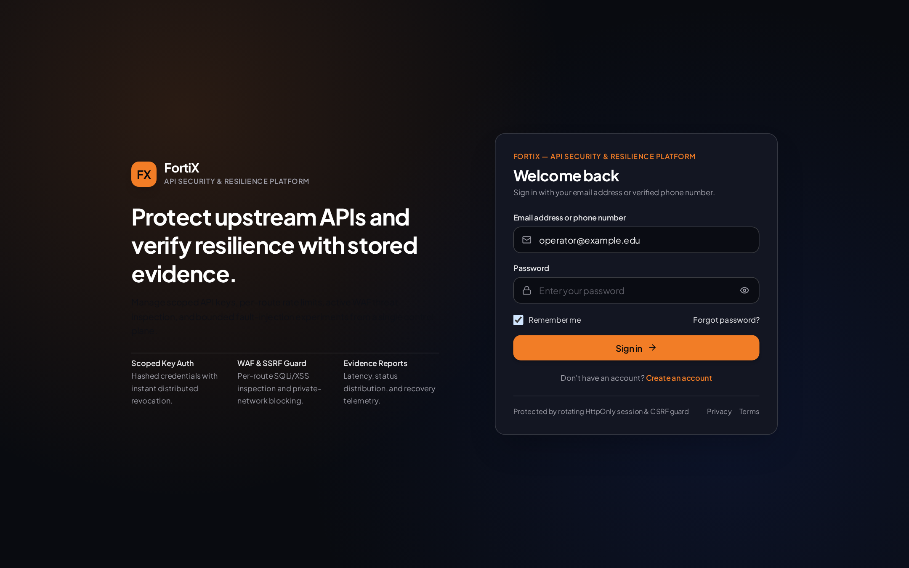
*Figure 4.1: FortiX Sign-In Screen (/login) Showing Dual Email/Phone Identifier Input, Remember-Me Toggle, Forgot Password Link, and Account Creation Entry (Captured live from src/components/Login.tsx (zero password storage in browser).)*

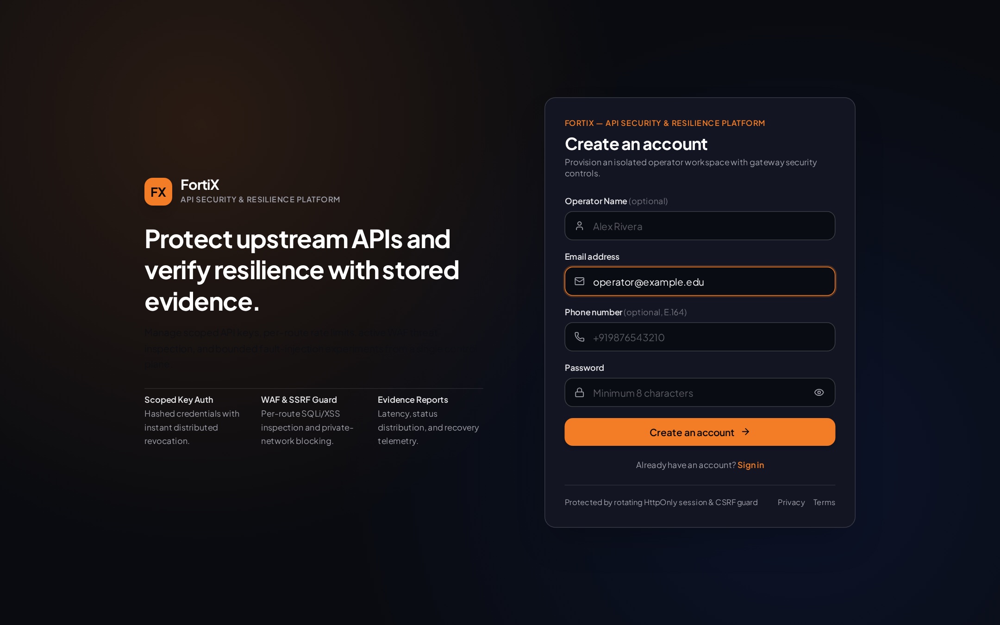
*Figure 4.2: FortiX Account Registration View (/login Create Account Mode) Enforcing Email Normalization and Minimum Password Length (Captured live from src/components/Login.tsx with redacted academic demo address.)*

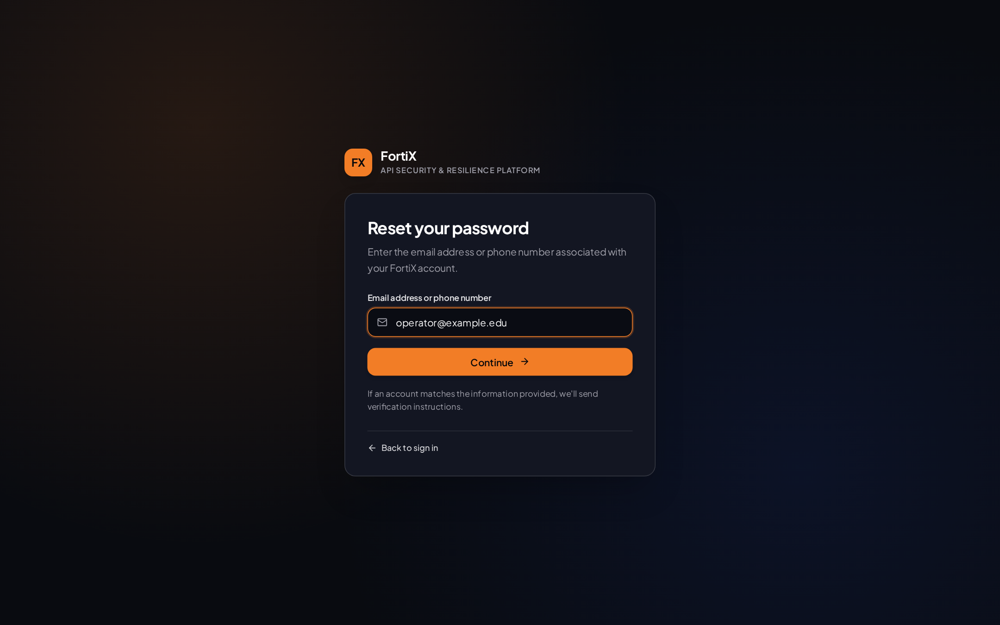
*Figure 4.3: Password Recovery Initiation Screen (/forgot-password) Accepting Registered Email or Verified E.164 Phone Number (Captured live from src/pages/PasswordRecovery.tsx with redacted demo email.)*

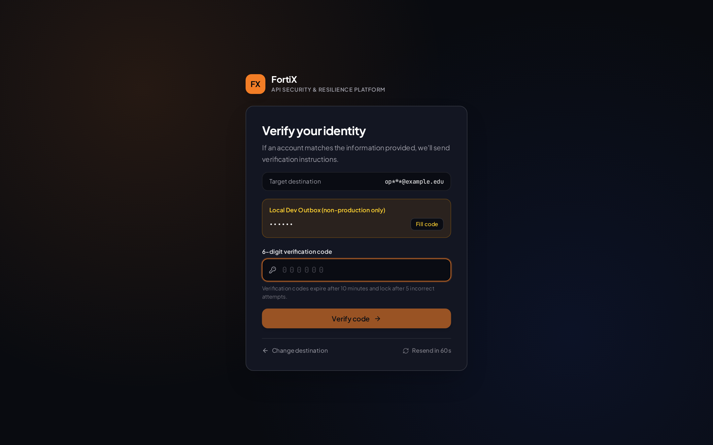
*Figure 4.4: Identity Verification OTP Screen (/verify-reset) Displaying Masked Destination, 6-Digit Numeric Input, and 60-Second Resend Cooldown (Captured live from src/pages/PasswordRecovery.tsx with OTP digits redacted (••••••).)*

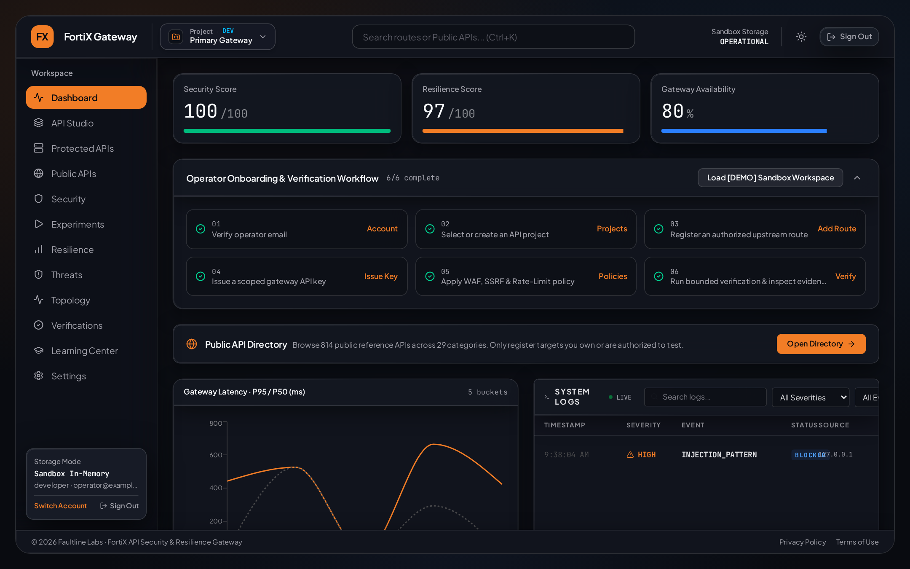
*Figure 4.5: FortiX Command Overview Dashboard (/) Showing Real Gateway Traffic Telemetry, Latency Distribution, and Active Route Status (Captured live from src/pages/Dashboard.tsx after Store Products API traffic and SQLi WAF block. [Runtime context: Live FortiX ephemeral-sandbox mode (pg-mem + in-memory Redis fallback), secrets redacted.])*

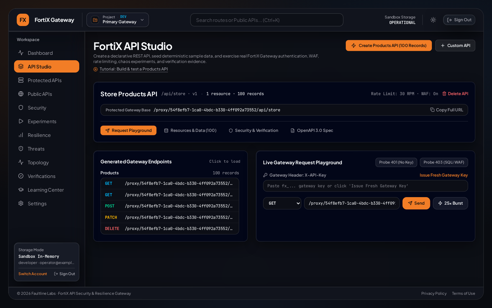
*Figure 4.6: FortiX API Studio Workspace (/studio) Showing Provisioned Store Products API (100 Records), Resource Schema, Playground, and OpenAPI Export (Captured live from src/pages/ApiStudio.tsx. [Runtime context: Live FortiX ephemeral-sandbox mode (pg-mem + in-memory Redis fallback), secrets redacted.])*

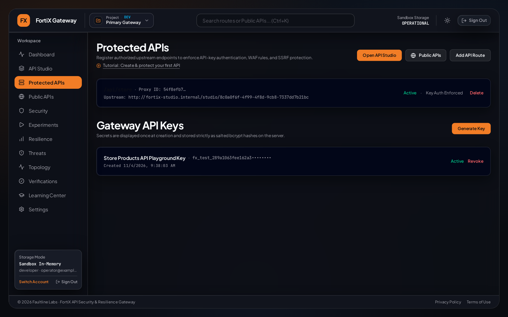
*Figure 4.7: Protected APIs & Gateway Route Registry (/apis) Showing Route Bindings and Scoped API-Key Management (Captured live from src/pages/APIs.tsx with raw API keys redacted. [Runtime context: Live FortiX ephemeral-sandbox mode (pg-mem + in-memory Redis fallback), secrets redacted.])*

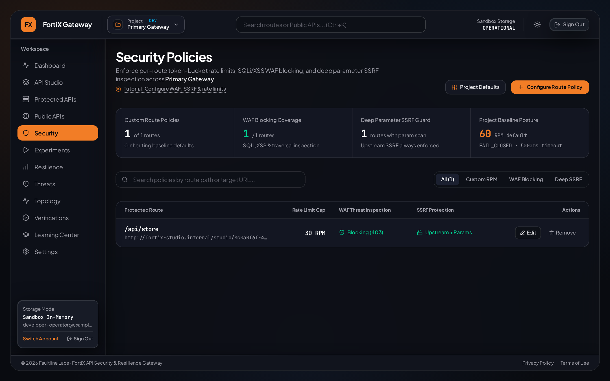
*Figure 4.8: Security Policies Screen (/security) Configuring Per-Route Token-Bucket RPM Limits, WAF Inspection, and SSRF Guards (Captured live from src/pages/Security.tsx. [Runtime context: Live FortiX ephemeral-sandbox mode (pg-mem + in-memory Redis fallback), secrets redacted.])*

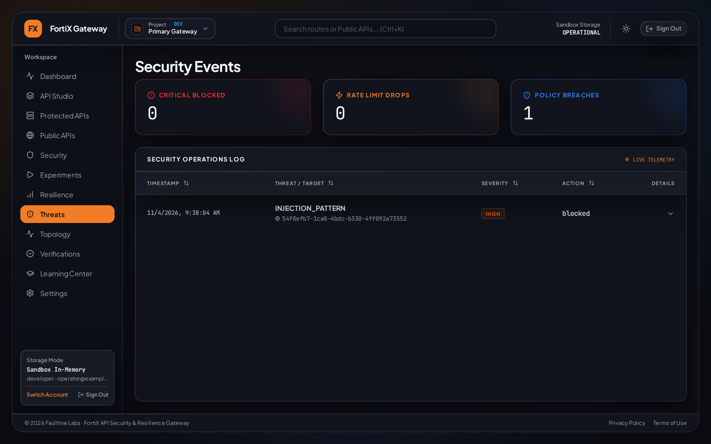
*Figure 4.9: WAF & Threat Intelligence Monitor (/threats) Displaying Real Blocked SQL Injection Event on Protected Store Route (Captured live from src/pages/Threats.tsx. [Runtime context: Live FortiX ephemeral-sandbox mode (pg-mem + in-memory Redis fallback), secrets redacted.])*

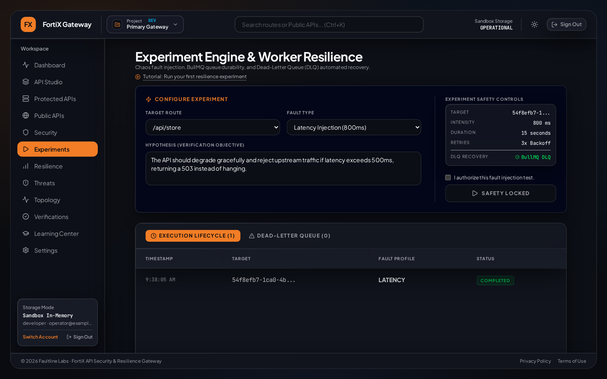
*Figure 4.10: Chaos & Resilience Experiments Screen (/experiments) Showing Bounded Fault Injection Configuration and Execution History (Captured live from src/pages/Experiments.tsx after completing a bounded 200ms latency experiment. [Runtime context: Live FortiX ephemeral-sandbox mode (pg-mem + in-memory Redis fallback), secrets redacted.])*

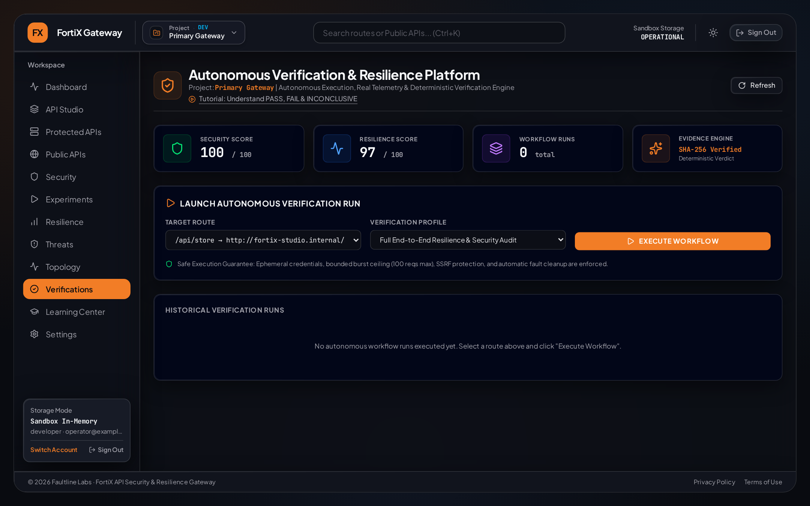
*Figure 4.11: Verification Results & Evidence Reports Screen (/verifications) Displaying Deterministic SLA Verdicts and PDF Export (Captured live from src/pages/Verifications.tsx. [Runtime context: Live FortiX ephemeral-sandbox mode (pg-mem + in-memory Redis fallback), secrets redacted.])*

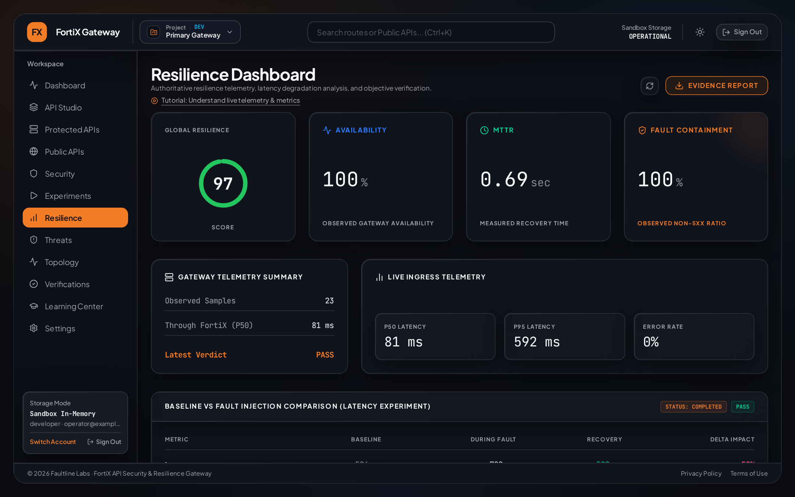
*Figure 4.12: Resilience Posture & Scoring Screen (/resilience) Summarizing Policy Enforcement Coverage and Verified Recovery Health (Captured live from src/pages/Resilience.tsx. [Runtime context: Live FortiX ephemeral-sandbox mode (pg-mem + in-memory Redis fallback), secrets redacted.])*

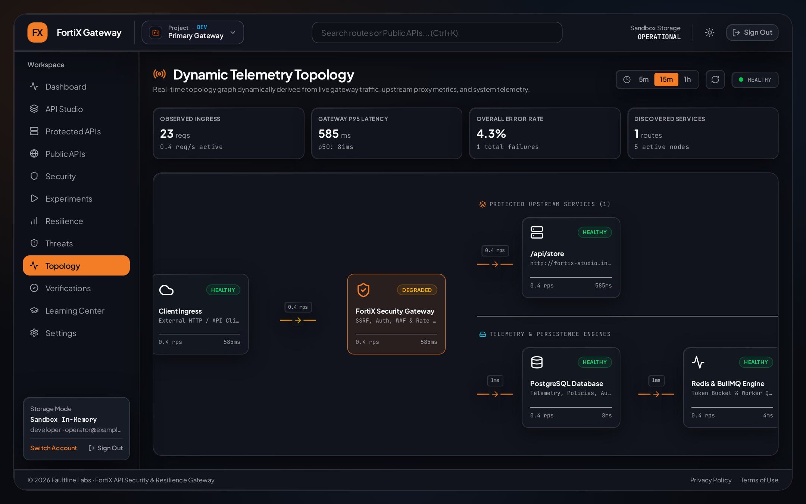
*Figure 4.13: Gateway Service Topology View (/topology) Mapping Client Ingress, Gateway Enforcement Plane, and Studio Upstream Target (Captured live from src/pages/Topology.tsx. [Runtime context: Live FortiX ephemeral-sandbox mode (pg-mem + in-memory Redis fallback), secrets redacted.])*

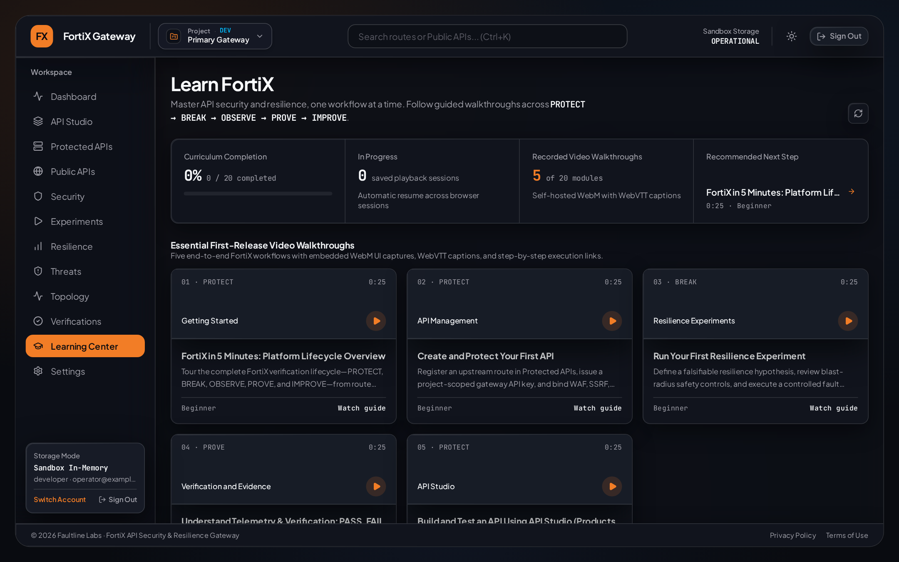
*Figure 4.14: In-App Video Learning Center (/learning-center) Showing Lifecycle-Categorized Guided Tutorials and Progress Tracking (FTX-LEARN-001) (Captured live from src/pages/LearningCenter.tsx. [Runtime context: Live FortiX ephemeral-sandbox mode (pg-mem + in-memory Redis fallback), secrets redacted.])*

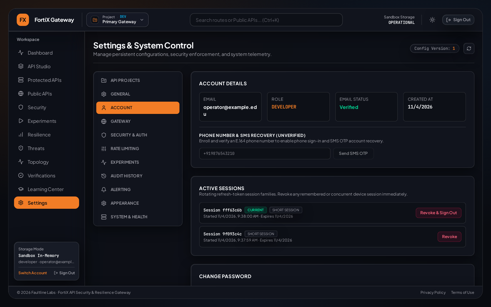
*Figure 4.15: Account Security Settings (/settings?tab=account) Showing Verified Phone Enrollment and Active Refresh Session Revocation (Captured live from src/pages/Settings.tsx. [Runtime context: Live FortiX ephemeral-sandbox mode (pg-mem + in-memory Redis fallback), secrets redacted.])*

## 4.2 Sample Coding (with Security Tasks)

This section presents character-for-character verbatim TypeScript excerpts extracted directly from the audited FortiX repository (commit a97c14fb53d0bd3c915016cfdfafe4524c288517) with exact source file paths and line ranges. Zero paraphrasing, signature condensation, or identifier renaming has been performed; build-time substring verification confirms every code block matches the repository file byte-for-byte.

**Sample 1 — Verbatim Refresh Session Rotation & Reuse Detection** — `Source: src/auth/sessions.ts (lines 110–305 — rotateRefreshSession)`

```typescript
export async function rotateRefreshSession(params: {
  rawRefreshToken: string;
  userAgent?: string;
  ip?: string;
}): Promise<
  | {
      ok: true;
      user: {
        id: string;
        email: string;
        role: string;
        emailVerified: boolean;
        phoneE164: string | null;
        phoneVerified: boolean;
      };
      accessJwt: string;
      accessMaxAgeMs: number;
      rawRefreshToken: string;
      refreshMaxAgeMs: number;
      rememberMe: boolean;
      familyId: string;
    }
  | { ok: false; reason: string; code: string; reuseDetected?: boolean; userId?: string }
> {
  if (!params.rawRefreshToken || typeof params.rawRefreshToken !== 'string' || params.rawRefreshToken.length < 32) {
    return { ok: false, reason: 'Invalid refresh session', code: 'INVALID_REFRESH_TOKEN' };
  }

  const tokenHash = hashRefreshToken(params.rawRefreshToken.trim());

  const prev = refreshRotationLocks.get(tokenHash) ?? Promise.resolve();
  let release!: () => void;
  const gate = new Promise<void>((resolve) => {
    release = resolve;
  });
  refreshRotationLocks.set(tokenHash, prev.then(() => gate));

  await prev;
  try {
    const [existing] = await db
      .select()
      .from(refreshTokens)
      .where(eq(refreshTokens.tokenHash, tokenHash))
      .limit(1);

    if (!existing) {
      return { ok: false, reason: 'Invalid refresh session', code: 'INVALID_REFRESH_TOKEN' };
    }

    const now = new Date();
    const familyId = existing.familyId || existing.id;

    // Replay / Reuse Detection:
    // If this refresh token was already rotated (`replacedById` set) or explicitly revoked,
    // revoke the ENTIRE token family immediately to terminate both attacker and compromised client chains.
    if (existing.replacedById !== null || existing.revokedAt !== null) {
      await db
        .update(refreshTokens)
        .set({
          revokedAt: now,
          reuseDetectedAt: now,
        })
        .where(
          and(
            eq(refreshTokens.familyId, familyId),
            isNull(refreshTokens.revokedAt)
          )
        );

      await revokeSessionFamilySid(familyId);

      logger.warn(
        {
          event: 'auth.session.refresh_reuse_detected',
          userId: existing.userId,
          familyId,
        },
        '[AuthSessions] Refresh token reuse detected; revoked entire session family'
      );

      return {
        ok: false,
        reason: 'Session invalidated due to refresh token reuse detection.',
        code: 'REFRESH_TOKEN_REUSED',
        reuseDetected: true,
        userId: existing.userId,
      };
    }

    const absoluteExp = existing.absoluteExpiresAt
      ? new Date(existing.absoluteExpiresAt)
      : new Date(existing.expiresAt);

    if (
      new Date(existing.expiresAt).getTime() <= now.getTime() ||
      absoluteExp.getTime() <= now.getTime()
    ) {
      await db
        .update(refreshTokens)
        .set({ revokedAt: now })
        .where(eq(refreshTokens.id, existing.id));
      return { ok: false, reason: 'Session has expired', code: 'REFRESH_TOKEN_EXPIRED' };
    }

    const [user] = await db.select().from(users).where(eq(users.id, existing.userId)).limit(1);
    if (!user) {
      return { ok: false, reason: 'Account not found', code: 'INVALID_REFRESH_TOKEN' };
    }

    const newRowId = uuidv4();
    const nextRawRefreshToken = crypto.randomBytes(32).toString('hex');
    const nextTokenHash = hashRefreshToken(nextRawRefreshToken);
    const baseTtlMs = existing.rememberMe ? getRememberSessionTtlMs() : getShortSessionTtlMs();
    const cappedExpiresAt = new Date(
      Math.min(now.getTime() + baseTtlMs, absoluteExp.getTime())
    );
    const refreshMaxAgeMs = Math.max(1000, cappedExpiresAt.getTime() - now.getTime());

    // Atomic conditional rotation update
    const rotated = await db
      .update(refreshTokens)
      .set({
        revokedAt: now,
        replacedById: newRowId,
        lastUsedAt: now,
      })
      .where(
        and(
          eq(refreshTokens.id, existing.id),
          isNull(refreshTokens.revokedAt),
          isNull(refreshTokens.replacedById)
        )
      )
      .returning({ id: refreshTokens.id });

    if (rotated.length !== 1) {
      await db
        .update(refreshTokens)
        .set({ revokedAt: now, reuseDetectedAt: now })
        .where(and(eq(refreshTokens.familyId, familyId), isNull(refreshTokens.revokedAt)));
      await revokeSessionFamilySid(familyId);
      return {
        ok: false,
        reason: 'Session invalidated due to concurrent refresh token replay.',
        code: 'REFRESH_TOKEN_REUSED',
        reuseDetected: true,
        userId: existing.userId,
      };
    }

    await db.insert(refreshTokens).values({
      id: newRowId,
      userId: user.id,
      tokenHash: nextTokenHash,
      familyId,
      rememberMe: existing.rememberMe,
      expiresAt: cappedExpiresAt,
      absoluteExpiresAt: absoluteExp,
      lastUsedAt: now,
      userAgentHash: hashClientMetadata(params.userAgent) ?? existing.userAgentHash,
      ipHash: hashClientMetadata(params.ip) ?? existing.ipHash,
    });

    const signed = signAccessJwt({
      id: user.id,
      email: user.email,
      role: user.role,
      passwordHash: user.passwordHash,
      rememberMe: existing.rememberMe,
      familyId,
    });

    return {
      ok: true,
      user: {
        id: user.id,
        email: user.email,
        role: user.role,
        emailVerified: Boolean(user.emailVerified),
        phoneE164: user.phoneE164 ?? null,
        phoneVerified: Boolean(user.phoneVerified),
      },
      accessJwt: signed.token,
      accessMaxAgeMs: signed.maxAgeMs,
      rawRefreshToken: nextRawRefreshToken,
      refreshMaxAgeMs,
      rememberMe: existing.rememberMe,
      familyId,
    };
  } finally {
    release();
    Promise.resolve().then(() => {
      refreshRotationLocks.delete(tokenHash);
    });
  }
}
```

Walkthrough & Security Analysis (src/auth/sessions.ts:110–305): rotateRefreshSession({ rawRefreshToken, userAgent, ip }) serializes concurrent calls per SHA-256 token digest using refreshRotationLocks, inspects existing.replacedById !== null || existing.revokedAt !== null to detect replay of an already-rotated token (immediately revoking the entire familyId and calling revokeSessionFamilySid(familyId)), enforces both rolling TTL and hard absoluteExpiresAt bounds, claims rotation via an atomic conditional UPDATE ... WHERE revoked_at IS NULL AND replaced_by_id IS NULL RETURNING id, inserts the successor hash, and signs a fresh access JWT. Runtime-verified in tests/unit/ftx-auth-001.test.ts and tests/e2e/auth-recovery.spec.ts.

**Sample 2a — Verbatim Domain-Separated OTP HMAC & Timing-Safe Compare** — `Source: src/auth/recovery.ts (lines 108–121 — computeOtpHmac & timingSafeHexEqual)`

```typescript
export function computeOtpHmac(challengeId: string, purpose: RecoveryPurpose, otp: string): string {
  return crypto
    .createHmac('sha256', getOtpHmacSecret())
    .update(`${challengeId}:${purpose}:${otp.trim()}`, 'utf8')
    .digest('hex');
}

function timingSafeHexEqual(hexA: string, hexB: string): boolean {
  if (!hexA || !hexB || hexA.length !== hexB.length) return false;
  const bufA = Buffer.from(hexA, 'hex');
  const bufB = Buffer.from(hexB, 'hex');
  if (bufA.length === 0 || bufA.length !== bufB.length) return false;
  return crypto.timingSafeEqual(bufA, bufB);
}
```

**Sample 2b — Verbatim OTP Verification, Anti-Enumeration & Single-Use Consumption** — `Source: src/auth/recovery.ts (lines 600–791 — verifyPasswordRecoveryOtp)`

```typescript
export async function verifyPasswordRecoveryOtp(params: {
  challengeId: string;
  otp: string;
  ip?: string;
}): Promise<
  | { ok: true; resetAuthorization: string; expiresInSeconds: number }
  | { ok: false; status: number; error: string; code: string; remainingAttempts?: number }
> {
  const rl = await checkMultiDimensionalOtpRateLimit({
    ip: params.ip,
    challengeId: params.challengeId,
    action: 'verify',
  });
  if (!rl.allowed) {
    return {
      ok: false,
      status: 429,
      error: 'Too many verification attempts. Please wait before trying again.',
      code: 'OTP_VERIFY_RATE_LIMITED',
    };
  }

  const normalizedOtp = (params.otp || '').trim();
  if (!/^\d{6}$/.test(normalizedOtp)) {
    return {
      ok: false,
      status: 400,
      error: 'Enter the 6-digit verification code.',
      code: 'INVALID_OTP_FORMAT',
    };
  }

  // Constant-work verification rejection for synthetic (unknown-account / unverified-phone) challenges
  if (isSyntheticChallengeId(params.challengeId)) {
    const candidateHmac = computeOtpHmac(params.challengeId, 'PASSWORD_RESET', normalizedOtp);
    const dummyHmac = computeOtpHmac(params.challengeId, 'PASSWORD_RESET', '000000');
    timingSafeHexEqual(candidateHmac, dummyHmac);
    return {
      ok: false,
      status: 400,
      error: 'Invalid or expired verification code.',
      code: 'INVALID_OTP',
    };
  }

  return withChallengeLock(params.challengeId, async () => {
    const [challenge] = await db
      .select()
      .from(recoveryChallenges)
      .where(
        and(
          eq(recoveryChallenges.id, params.challengeId),
          eq(recoveryChallenges.purpose, 'PASSWORD_RESET')
        )
      )
      .limit(1);

    if (!challenge) {
      return {
        ok: false,
        status: 400,
        error: 'Invalid or expired verification code.',
        code: 'INVALID_OTP',
      };
    }

    const now = new Date();
    if (challenge.consumedAt) {
      return {
        ok: false,
        status: 400,
        error: 'This verification code has already been used.',
        code: 'OTP_ALREADY_USED',
      };
    }

    if (challenge.invalidatedAt || challenge.failedAttempts >= challenge.maxAttempts) {
      return {
        ok: false,
        status: 400,
        error: 'Maximum verification attempts exceeded or code invalidated. Request a new code.',
        code: 'OTP_ATTEMPTS_EXCEEDED',
      };
    }

    if (new Date(challenge.expiresAt).getTime() <= now.getTime()) {
      return {
        ok: false,
        status: 400,
        error: 'Verification code has expired. Request a new code.',
        code: 'OTP_EXPIRED',
      };
    }

    const expectedHmac = computeOtpHmac(challenge.id, 'PASSWORD_RESET', normalizedOtp);
    const matches = timingSafeHexEqual(expectedHmac, challenge.otpHmac);

    if (!matches) {
      const nextAttempts = challenge.failedAttempts + 1;
      const exhausted = nextAttempts >= challenge.maxAttempts;
      await db
        .update(recoveryChallenges)
        .set({
          failedAttempts: nextAttempts,
          ...(exhausted
            ? { invalidatedAt: now, invalidationReason: 'MAX_ATTEMPTS_EXCEEDED' }
            : {}),
        })
        .where(eq(recoveryChallenges.id, challenge.id));

      logger.warn(
        {
          event: 'auth.recovery.otp_failed',
          failedAttempts: nextAttempts,
          exhausted,
        },
        '[AuthRecovery] Failed OTP verification attempt'
      );

      if (exhausted) {
        return {
          ok: false,
          status: 400,
          error: 'Too many incorrect verification attempts. Request a new code.',
          code: 'OTP_ATTEMPTS_EXCEEDED',
          remainingAttempts: 0,
        };
      }

      return {
        ok: false,
        status: 400,
        error: 'Invalid or expired verification code.',
        code: 'INVALID_OTP',
        remainingAttempts: Math.max(0, challenge.maxAttempts - nextAttempts),
      };
    }

    // Atomic conditional transition: consumed_at NULL -> NOW while within attempts & expiry
    const updatedRows = await db
      .update(recoveryChallenges)
      .set({ consumedAt: now })
      .where(
        and(
          eq(recoveryChallenges.id, challenge.id),
          isNull(recoveryChallenges.consumedAt),
          isNull(recoveryChallenges.invalidatedAt),
          lt(recoveryChallenges.failedAttempts, challenge.maxAttempts),
          gt(recoveryChallenges.expiresAt, now)
        )
      )
      .returning({ id: recoveryChallenges.id, userId: recoveryChallenges.userId });

    if (updatedRows.length !== 1) {
      return {
        ok: false,
        status: 400,
        error: 'This verification code has already been used.',
        code: 'OTP_ALREADY_USED',
      };
    }

    const [user] = await db.select().from(users).where(eq(users.id, challenge.userId)).limit(1);
    if (!user) {
      return {
        ok: false,
        status: 400,
        error: 'Invalid or expired verification code.',
        code: 'INVALID_OTP',
      };
    }

    const issuedAuth = await issueAuthActionToken(
      user.id,
      user.email,
      'RESET_AUTHORIZATION',
      10 * 60 * 1000,
      { skipDelivery: true }
    );

    logger.info(
      { event: 'auth.recovery.otp_verified', userId: user.id },
      '[AuthRecovery] OTP verified; issued short-lived single-use reset authorization'
    );

    return {
      ok: true,
      resetAuthorization: issuedAuth.rawToken,
      expiresInSeconds: 600,
    };
  });
}
```

Walkthrough & Security Analysis (src/auth/recovery.ts:108–121, 600–791): computeOtpHmac binds challengeId, purpose, and trimmed 6-digit OTP under getOtpHmacSecret(). verifyPasswordRecoveryOtp({ challengeId, otp, ip }) enforces multi-dimensional OTP rate limiting, executes constant-work dummy HMAC comparison when isSyntheticChallengeId(params.challengeId) is true (preventing account/phone enumeration), serializes per-challenge access via withChallengeLock, increments failedAttempts with automatic invalidation at maxAttempts (5), and executes a 5-clause conditional UPDATE setting consumedAt = now before issuing a 10-minute single-use RESET_AUTHORIZATION token. Runtime-verified in tests/unit/ftx-auth-001.test.ts.

**Sample 3 — Verbatim Token-Bucket Rate Limiter (Local Fallback + 3-ARGV Redis Lua Script)** — `Source: src/rate-limit/redis.ts (lines 91–205 — checkRateLimit)`

```typescript
export async function checkRateLimit(projectId: string, routeId: string, identifier: string) {
  // Phase 4: Atomic Token Bucket via Lua
  const key = `ratelimit:${routeId}:${identifier}`;
  
  // Fetch dynamic limits from the database policy
  let limit = 20;
  let refillRate = 20;
  try {
    const [policy] = await db.select().from(securityPolicies).where(eq(securityPolicies.routeId, routeId));
    if (policy && policy.rateLimitRpm) {
      limit = policy.rateLimitRpm;
      refillRate = policy.rateLimitRpm;
    }
  } catch (err) {
    console.error('[Rate Limit] DB Policy lookup failed, using defaults', err);
  }
  
  const evaluateLocalBucket = () => {
    pruneFallbackStore();
    const bucket = fallbackStore.get(key) || { tokens: limit, lastRefill: Date.now() };
    const now = Date.now();
    const timePassed = Math.max(0, now - bucket.lastRefill);
    const refill = Math.floor(timePassed * (refillRate / 60000));

    if (refill > 0) {
      bucket.tokens = Math.min(limit, bucket.tokens + refill);
      bucket.lastRefill = now;
    }

    let allowed = false;
    if (bucket.tokens > 0) {
      bucket.tokens -= 1;
      allowed = true;
    }

    fallbackStore.set(key, bucket);
    return { allowed, limit, remaining: bucket.tokens };
  };

  // Handle Redis connection unavailable
  if (redis.status !== 'ready') {
    const policy = getEffectiveRedisFailurePolicy();

    if (policy === 'fail-closed') {
      console.error('[Rate Limit] Redis unavailable, enforcing fail-closed policy (request blocked)');
      return { allowed: false, limit, remaining: 0 };
    }

    // In fail-open mode (development / preview only or explicit override), use bounded local in-memory fallback
    // NOTE: Local in-memory fallback enforces rate limits ONLY within this single process, NOT across distributed replicas.
    return evaluateLocalBucket();
  }

  // Standalone single-instance mode (no external Redis configured): enforce rate limits via bounded in-memory token bucket
  if (!isRealRedisActive) {
    return evaluateLocalBucket();
  }

  const script = `
    local key = KEYS[1]
    local capacity = tonumber(ARGV[1])
    local refillRate = tonumber(ARGV[2])
    local now = tonumber(ARGV[3])
    
    local bucket = redis.call("HMGET", key, "tokens", "last_refill")
    local tokens = tonumber(bucket[1])
    local last_refill = tonumber(bucket[2])
    
    if not tokens then
      tokens = capacity
      last_refill = now
    end
    
    local time_passed = math.max(0, now - last_refill)
    local refill = math.floor(time_passed * (refillRate / 60000))
    
    if refill > 0 then
      tokens = math.min(capacity, tokens + refill)
      last_refill = now
    end
    
    local allowed = 0
    if tokens > 0 then
      tokens = tokens - 1
      allowed = 1
    end
    
    redis.call("HMSET", key, "tokens", tokens, "last_refill", last_refill)
    redis.call("PEXPIRE", key, 60000)
    
    return { allowed, tokens }
  `;
  
  try {
    const result = await redis.eval(script, 1, key, limit, refillRate, Date.now()) as [number, number];
    
    return {
      allowed: result[0] === 1,
      limit,
      remaining: result[1]
    };
  } catch (error) {
    const policy = getEffectiveRedisFailurePolicy();
    if (policy === 'fail-open') {
      console.warn('[Rate Limit] Redis evaluation error, using bounded local token bucket per fail-open policy');
      return evaluateLocalBucket();
    }
    console.error('[Rate Limit] Redis evaluation error, failing closed per policy');
    return {
      allowed: false,
      limit,
      remaining: 0
    };
  }
}
```

Walkthrough & Security Analysis (src/rate-limit/redis.ts:91–205): checkRateLimit(projectId, routeId, identifier) loads route rateLimitRpm and explicitly handles two runtime modes: when external Redis is unavailable or !isRealRedisActive (sandbox/Vitest mode, lines 145–147), it enforces per-process rate limits via evaluateLocalBucket() (unless fail-closed policy blocks on broken Redis); when external Redis 7 is connected (SOURCE-CONFIRMED, lines 149–191), it executes the 3-ARGV Lua script atomically via redis.eval(script, 1, key, limit, refillRate, Date.now()) with PEXPIRE key 60000.

**Sample 4a — Verbatim Upstream Proxy Credential Sanitization & Socket Timeout** — `Source: src/gateway/index.ts (lines 147–162 — createSharedGatewayProxy on.proxyReq)`

```typescript
      proxyReq: (proxyReq, req, res) => {
        const ctx: ProxyRequestContext | undefined = (req as any).__fortixProxyCtx;

        // Strip FortiX gateway credentials before forwarding to external upstreams
        proxyReq.removeHeader('x-api-key');
        proxyReq.removeHeader('x-fortix-token');
        const authVal = proxyReq.getHeader('authorization');
        if (typeof authVal === 'string' && authVal.startsWith('Bearer fx_')) {
          proxyReq.removeHeader('authorization');
        }

        const timeoutMs = ctx?.upstreamTimeoutMs || 5000;
        proxyReq.setTimeout(timeoutMs, () => {
          proxyReq.destroy(Object.assign(new Error(`Upstream target timed out after ${timeoutMs}ms`), { code: 'ETIMEDOUT' }));
        });

```

**Sample 4b — Verbatim Pre-Auth Static SSRF Check & Hashed API-Key Validation** — `Source: src/gateway/index.ts (lines 336–417 — setupGateway pre-auth guard)`

```typescript
      // 2. Static SSRF Protection Check (before authentication or fault execution)
      if (!isSafeTarget(route.targetUrl)) {
        return res.status(502).json({ error: 'Bad Gateway: Invalid target' });
      }

      // 3. API Key Auth (strictly enforced BEFORE fault injection so unauthenticated callers cannot trigger delays/metrics)
      const rawKey = extractGatewayApiKey(req);
      if (!rawKey) return res.status(401).json({ error: 'Missing API Key' });

      const parts = rawKey.split('_');
      // Expected: fx_{env}_{keyId}_{secret}
      if (parts.length !== 4 || parts[0] !== 'fx') {
        const eventId = uuidv4();
        enqueueSecurityEvent({
          id: eventId,
          routeId,
          requestId,
          type: 'INVALID_API_KEY',
          severity: 'MEDIUM',
          action: 'blocked',
          sourceIp: req.ip || 'unknown',
        });
        broadcast(route.projectId, 'security:event', {
          id: eventId,
          routeId,
          type: 'INVALID_API_KEY',
          severity: 'MEDIUM',
        });
        return res.status(401).json({ error: 'Malformed API Key' });
      }

      const keyId = parts[2];
      const secret = parts[3];

      let validKey: any = null;
      const nowMs = Date.now();

      // Check fast hashed cache first (enforcing projectId, revocation, AND expiration)
      const cached = apiKeyCache.get(rawKey);
      if (cached && nowMs - cached.cachedAt < 30000) {
        const notExpired = !cached.key?.expiresAt || new Date(cached.key.expiresAt).getTime() > nowMs;
        if (cached.key && cached.key.projectId === route.projectId && !cached.key.revokedAt && notExpired) {
          validKey = cached.key;
        } else {
          apiKeyCache.delete(rawKey);
        }
      }

      if (!validKey) {
        const [k] = await db.select().from(apiKeys).where(eq(apiKeys.id, keyId)).limit(1);

        if (k && k.projectId === route.projectId && !k.revokedAt) {
          if (!k.expiresAt || new Date(k.expiresAt).getTime() > nowMs) {
            const isValid = await bcrypt.compare(secret, k.secretHash);
            if (isValid) {
              validKey = k;
              apiKeyCache.set(rawKey, { key: k, cachedAt: nowMs });
            }
          }
        }
      }

      if (!validKey) {
        const eventId = uuidv4();
        enqueueSecurityEvent({
          id: eventId,
          routeId,
          requestId,
          type: 'INVALID_API_KEY',
          severity: 'MEDIUM',
          action: 'blocked',
          sourceIp: req.ip || 'unknown',
        });
        broadcast(route.projectId, 'security:event', {
          id: eventId,
          routeId,
          type: 'INVALID_API_KEY',
          severity: 'MEDIUM',
        });
        return res.status(401).json({ error: 'Invalid or Revoked API Key' });
      }

```

**Sample 4c — Verbatim 13-Pattern Regex Threat Detection & Rate-Limit Gate** — `Source: src/gateway/index.ts (lines 498–565 — detectThreats & checkRateLimit)`

```typescript
      // 4.5 Threat Detection (WAF enforced by default; monitor-only if route policy explicitly sets enableWaf=false)
      const wafShouldBlock = routePolicy ? Boolean(routePolicy.enableWaf) : true;
      const threats = detectThreats(req);
      if (threats.length > 0) {
        for (const threat of threats) {
          const eventId = uuidv4();
          enqueueSecurityEvent({
            id: eventId,
            routeId,
            requestId,
            type: threat,
            severity: 'HIGH',
            action: wafShouldBlock ? 'blocked' : 'monitored',
            sourceIp: req.ip || 'unknown',
          });
          broadcast(route.projectId, 'security:event', {
            id: eventId,
            routeId,
            type: threat,
            severity: 'HIGH',
          });
        }
        if (wafShouldBlock) {
          enqueueMetric({
            id: uuidv4(),
            routeId,
            requestId,
            experimentId: experimentCorrelationId,
            latencyMs: Math.round(Number(process.hrtime.bigint() - startHrTime) / 1000000),
            statusCode: 403,
          });
          return res.status(403).json({ error: 'Forbidden: Suspicious activity detected' });
        }
      }

      // 5. Rate Limiting
      const limitResult = await checkRateLimit(route.projectId, routeId, apiKeyId || req.ip || 'anonymous');
      if (limitResult) {
        res.setHeader('X-RateLimit-Limit', limitResult.limit);
        res.setHeader('X-RateLimit-Remaining', limitResult.remaining);
        if (!limitResult.allowed) {
          const eventId = uuidv4();
          enqueueSecurityEvent({
            id: eventId,
            routeId,
            requestId,
            type: 'RATE_LIMIT_EXCEEDED',
            severity: 'LOW',
            action: 'blocked',
            sourceIp: req.ip || 'unknown',
          });
          enqueueMetric({
            id: uuidv4(),
            routeId,
            requestId,
            experimentId: experimentCorrelationId,
            latencyMs: Math.round(Number(process.hrtime.bigint() - startHrTime) / 1000000),
            statusCode: 429,
          });
          broadcast(route.projectId, 'security:event', {
            id: eventId,
            routeId,
            type: 'RATE_LIMIT_EXCEEDED',
            severity: 'LOW',
          });
          return res.status(429).json({ error: 'Too Many Requests' });
        }
      }
```

Walkthrough & Security Analysis (src/gateway/index.ts:147–162, 336–417, 498–565): The gateway strictly validates isSafeTarget(route.targetUrl) and scoped fx_{env}_{keyId}_{secret} credentials (via 30s apiKeyCache + bcrypt.compare) BEFORE inspecting threats (detectThreats(req) returning matched signature names), enforcing checkRateLimit(), or applying RUNNING experiment faults. On external proxy dispatch, proxyReq.removeHeader strips x-api-key, x-fortix-token, and Bearer fx_* headers so gateway secrets never leak upstream. Runtime-verified in tests/security/auth.spec.ts and tests/security/all.spec.ts.

**Sample 5 — Verbatim Telemetry Flush Barrier & Three-Phase SLA Verification Engine** — `Source: src/verification/engine.ts (lines 66–245 — verifyPolicy)`

```typescript
export async function verifyPolicy(
  experimentId: string,
  policyId: string | null | undefined,
  startTime: Date,
  endTime: Date,
  options?: VerifyPolicyOptions
) {
  const existingLock = activeVerificationLocks.get(experimentId);
  if (existingLock) {
    return existingLock;
  }

  const executionPromise = (async () => {
    if (!options?.forceReverify) {
      const [existing] = await db
        .select()
        .from(verifications)
        .where(eq(verifications.experimentId, experimentId))
        .orderBy(desc(verifications.createdAt))
        .limit(1);

      if (existing) {
        return existing;
      }
    }

    const overallStart = options?.phases?.baseline?.startTime
      ? new Date(Math.min(startTime.getTime(), options.phases.baseline.startTime.getTime()))
      : startTime;
    const overallEnd = options?.phases?.recovery?.endTime
      ? new Date(Math.max(endTime.getTime(), options.phases.recovery.endTime.getTime()))
      : endTime;

    // 1. Synchronize telemetry pipeline before reading metricLogs
    const telemetrySync: TelemetrySyncResult = await flushTelemetryBarrier({
      timeoutMs: options?.syncTimeoutMs ?? 3000,
      since: overallStart,
    });

    // Double-check idempotency after async barrier in case another caller persisted beforehand
    if (!options?.forceReverify) {
      const [existingAfterSync] = await db
        .select()
        .from(verifications)
        .where(eq(verifications.experimentId, experimentId))
        .orderBy(desc(verifications.createdAt))
        .limit(1);
      if (existingAfterSync) {
        return existingAfterSync;
      }
    }

    const [exp] = await db.select().from(experiments).where(eq(experiments.id, experimentId)).limit(1);

    let policy: typeof securityPolicies.$inferSelect | undefined;
    if (policyId) {
      const [foundPolicy] = await db
        .select()
        .from(securityPolicies)
        .where(eq(securityPolicies.id, policyId))
        .limit(1);
      policy = foundPolicy;
    } else if (exp?.routeId) {
      const [foundRoutePolicy] = await db
        .select()
        .from(securityPolicies)
        .where(eq(securityPolicies.routeId, exp.routeId))
        .limit(1);
      policy = foundRoutePolicy;
    }

    // 2. Fetch persisted metrics with small clock-skew padding around overall window
    const queryStart = new Date(overallStart.getTime() - 250);
    const queryEnd = new Date(overallEnd.getTime() + 500);
    const allExperimentMetrics = await db
      .select()
      .from(metricLogs)
      .where(
        and(
          eq(metricLogs.experimentId, experimentId),
          gte(metricLogs.timestamp, queryStart),
          lte(metricLogs.timestamp, queryEnd)
        )
      );

    // 3. Partition metrics cleanly across BASELINE -> INJECTION -> RECOVERY
    const baselineWindow = options?.phases?.baseline;
    const recoveryWindow = options?.phases?.recovery;
    const injectionWindow: PhaseExecutionWindow = options?.phases?.injection || {
      startTime,
      endTime,
    };

    const nonInjectionReqIds = new Set<string>([
      ...(baselineWindow?.requestIds || []),
      ...(recoveryWindow?.requestIds || []),
    ]);

    const baselineRows = baselineWindow ? filterRowsForPhase(allExperimentMetrics, baselineWindow) : null;
    const recoveryRows = recoveryWindow ? filterRowsForPhase(allExperimentMetrics, recoveryWindow) : null;
    const injectionRows = filterRowsForPhase(allExperimentMetrics, injectionWindow, nonInjectionReqIds);

    const baselineMetrics =
      baselineWindow && baselineRows
        ? computePhaseMetrics('BASELINE', baselineRows, {
            windowStart: baselineWindow.startTime,
            windowEnd: baselineWindow.endTime,
            requestsSent: baselineWindow.requestsSent,
          })
        : null;

    const injectionMetrics = computePhaseMetrics('INJECTION', injectionRows, {
      windowStart: injectionWindow.startTime,
      windowEnd: injectionWindow.endTime,
      requestsSent: injectionWindow.requestsSent,
    });

    const recoveryMetrics =
      recoveryWindow && recoveryRows
        ? computePhaseMetrics('RECOVERY', recoveryRows, {
            windowStart: recoveryWindow.startTime,
            windowEnd: recoveryWindow.endTime,
            requestsSent: recoveryWindow.requestsSent,
          })
        : null;

    // 4. Evaluate deterministic verification rules
    const evaluation = evaluateExperimentVerification({
      experiment: exp
        ? {
            id: exp.id,
            type: exp.type,
            status: exp.status,
            config: (exp.config as Record<string, any>) || {},
          }
        : null,
      policy: policy
        ? {
            id: policy.id,
            rateLimitRpm: policy.rateLimitRpm,
            enableWaf: policy.enableWaf,
            enableSsrf: policy.enableSsrf,
          }
        : null,
      telemetrySync,
      baseline: baselineMetrics,
      injection: injectionMetrics,
      recovery: recoveryMetrics,
      recoveryDurationMs: options?.recoveryDurationMs ?? null,
      requireBaseline: options?.requireBaseline,
      requireRecovery: options?.requireRecovery,
      minInjectionSamples: options?.minInjectionSamples ?? MIN_INJECTION_SAMPLES,
      minBaselineSamples: options?.minBaselineSamples ?? MIN_BASELINE_SAMPLES,
      minRecoverySamples: options?.minRecoverySamples ?? MIN_RECOVERY_SAMPLES,
      minCoverageRatio: options?.minCoverageRatio ?? MIN_TELEMETRY_COVERAGE_RATIO,
    });

    if (!exp) {
      return null;
    }

    const [verification] = await db
      .insert(verifications)
      .values({
        id: uuidv4(),
        experimentId,
        expected: evaluation.expected,
        observed: evaluation.observed,
        verdict: evaluation.verdict,
      })
      .returning();

    return verification;
  })().finally(() => {
    activeVerificationLocks.delete(experimentId);
  });

  activeVerificationLocks.set(experimentId, executionPromise);
  return executionPromise;
}
```

Walkthrough & Security Analysis (src/verification/engine.ts:66–245): verifyPolicy(experimentId, policyId, startTime, endTime, options?) prevents duplicate concurrent evaluations via activeVerificationLocks, awaits flushTelemetryBarrier({ timeoutMs: 3000, since: overallStart }), queries persisted metricLogs within padded window bounds, partitions BASELINE, INJECTION, and RECOVERY cohorts via filterRowsForPhase and computePhaseMetrics, delegates deterministic threshold/coverage evaluation (>=80% coverage gate preventing vacuous PASS) to evaluateExperimentVerification, and inserts the resulting row into verifications. Runtime-verified in tests/unit/verification-defects.test.ts.

**Sample 6a — Verbatim API Studio Project-Scoped Tenant Ownership Check** — `Source: src/studio/target-handler.ts (lines 180–210 — handleStudioUpstreamRequest)`

```typescript
export async function handleStudioUpstreamRequest(
  req: Request,
  res: Response,
  ctx: StudioGatewayDispatchContext
): Promise<number> {
  const sendJson = (status: number, payload: unknown): number => {
    res.setHeader('X-FortiX-Studio-Api', ctx.studioApiId);
    res.status(status).json(payload);
    return status;
  };

  // Strict tenant boundary check: Studio API MUST exist and belong to the exact same projectId as the gateway route
  const [studioApi] = await db
    .select()
    .from(studioApis)
    .where(and(eq(studioApis.id, ctx.studioApiId), eq(studioApis.projectId, ctx.route.projectId)))
    .limit(1);

  if (!studioApi) {
    return sendJson(502, {
      error: 'Bad Gateway: Studio API upstream target is unavailable or unlinked',
      code: 'STUDIO_TARGET_NOT_FOUND',
    });
  }

  const resources = await db
    .select()
    .from(studioResources)
    .where(and(eq(studioResources.apiId, studioApi.id), eq(studioResources.projectId, ctx.route.projectId)))
    .orderBy(asc(studioResources.createdAt));

```

**Sample 6b — Verbatim API Studio Collection Filtering (category, status, q) & POST Validation** — `Source: src/studio/target-handler.ts (lines 301–391 — GET/POST collection handler)`

```typescript
  // Collection endpoints: GET /:slug, POST /:slug
  if (!resolved.recordId) {
    if (method === 'GET') {
      const rawLimit = typeof req.query.limit === 'string' ? Number.parseInt(req.query.limit, 10) : 20;
      const rawOffset = typeof req.query.offset === 'string' ? Number.parseInt(req.query.offset, 10) : 0;

      if (req.query.limit !== undefined && (!Number.isFinite(rawLimit) || rawLimit < 1 || rawLimit > 100)) {
        return sendJson(400, {
          error: 'Query parameter "limit" must be an integer between 1 and 100',
          code: 'INVALID_PAGINATION',
        });
      }
      if (req.query.offset !== undefined && (!Number.isFinite(rawOffset) || rawOffset < 0 || rawOffset > 10_000)) {
        return sendJson(400, {
          error: 'Query parameter "offset" must be a non-negative integer <= 10000',
          code: 'INVALID_PAGINATION',
        });
      }

      const limit = Number.isFinite(rawLimit) ? Math.min(Math.max(1, rawLimit), 100) : 20;
      const offset = Number.isFinite(rawOffset) ? Math.max(0, rawOffset) : 0;

      const allRows = await db
        .select()
        .from(studioRecords)
        .where(
          and(
            eq(studioRecords.resourceId, targetResource.id),
            eq(studioRecords.projectId, ctx.route.projectId)
          )
        )
        .orderBy(asc(studioRecords.recordId));

      const categoryFilter = typeof req.query.category === 'string' ? req.query.category.trim().toLowerCase() : '';
      const statusFilter = typeof req.query.status === 'string' ? req.query.status.trim().toLowerCase() : '';
      const searchFilter =
        typeof req.query.q === 'string'
          ? req.query.q.trim().toLowerCase()
          : typeof req.query.search === 'string'
            ? req.query.search.trim().toLowerCase()
            : '';

      const filtered = allRows.filter((row) => {
        const d = (row.data && typeof row.data === 'object' ? row.data : {}) as Record<string, unknown>;
        if (categoryFilter && String(d.category ?? '').toLowerCase() !== categoryFilter) {
          return false;
        }
        if (statusFilter && String(d.status ?? '').toLowerCase() !== statusFilter) {
          return false;
        }
        if (searchFilter) {
          const hay = `${row.recordId} ${Object.values(d).map((v) => String(v ?? '')).join(' ')}`.toLowerCase();
          if (!hay.includes(searchFilter)) {
            return false;
          }
        }
        return true;
      });

      const total = filtered.length;
      const pageRows = filtered.slice(offset, offset + limit);

      return sendJson(200, {
        items: pageRows.map((r) => formatStudioRecord(r.recordId, r.data)),
        pagination: {
          total,
          limit,
          offset,
          hasMore: offset + pageRows.length < total,
        },
      });
    }

    if (method === 'POST') {
      const parsedBody = await readJsonBodySafe(req);
      if (!parsedBody.ok) {
        return sendJson(parsedBody.status, {
          error: parsedBody.error,
          code: parsedBody.status === 413 ? 'PAYLOAD_TOO_LARGE' : 'INVALID_JSON',
        });
      }

      const validation = validateStudioRecordPayload(fields, parsedBody.body, { partial: false });
      if (!validation.ok) {
        return sendJson(validation.status, {
          error: validation.error,
          code: 'SCHEMA_VALIDATION_ERROR',
          ...(validation.issues ? { issues: validation.issues } : {}),
        });
      }

```

Walkthrough & Security Analysis (src/studio/target-handler.ts:180–210, 301–391): handleStudioUpstreamRequest(req, res, ctx) binds studioApis.projectId === ctx.route.projectId (returning 502 STUDIO_TARGET_NOT_FOUND on cross-tenant mismatch), enforces pagination bounds (limit 1–100, offset 0–10000), filters GET collections by category, status, and q/search substring matching, and validates POST JSON bodies via readJsonBodySafe() and validateStudioRecordPayload() (checking validation.ok). Runtime-verified in tests/unit/api-studio.test.ts and tests/e2e/api-studio.spec.ts.

**Sample 7 — Verbatim Allowlisted Video Provider & Origin Validator (FTX-LEARN-001)** — `Source: src/learning/video-validator.ts (lines 107–199 — validateVideoSource)`

```typescript
export function validateVideoSource(
  providerInput: unknown,
  referenceInput: unknown,
  env: NodeJS.ProcessEnv = process.env
): VideoValidationResult {
  if (typeof providerInput !== 'string' || !(VIDEO_PROVIDERS as readonly string[]).includes(providerInput)) {
    return {
      valid: false,
      error: `Invalid videoProvider. Must be one of: ${VIDEO_PROVIDERS.join(', ')}.`,
    };
  }

  const provider = providerInput as VideoProvider;

  if (provider === 'none') {
    if (referenceInput !== undefined && referenceInput !== null && String(referenceInput).trim() !== '') {
      return {
        valid: false,
        error: 'videoReference must be empty or null when videoProvider is "none".',
      };
    }
    return { valid: true, provider: 'none', reference: null };
  }

  if (typeof referenceInput !== 'string' || !referenceInput.trim()) {
    return {
      valid: false,
      error: `videoReference is required when videoProvider is "${provider}".`,
    };
  }

  const ref = referenceInput.trim();
  if (ref.length > 512 || DANGEROUS_MARKUP_OR_SCHEME_RE.test(ref)) {
    return {
      valid: false,
      error: 'Unsafe video reference rejected: raw HTML, iframe markup, and executable URI schemes are prohibited.',
    };
  }

  if (provider === 'self_hosted') {
    if (ref.includes('..') || ref.includes('\\') || ref.includes('%') || !SELF_HOSTED_VIDEO_RE.test(ref)) {
      return {
        valid: false,
        error: 'Self-hosted videoReference must match /learning/videos/<filename>.(webm|mp4) without traversal.',
      };
    }
    return { valid: true, provider, reference: ref };
  }

  if (provider === 'youtube_nocookie') {
    if (!YOUTUBE_VIDEO_ID_RE.test(ref)) {
      return {
        valid: false,
        error: 'youtube_nocookie videoReference must be an exact 11-character video ID (never a raw URL or iframe).',
      };
    }
    return { valid: true, provider, reference: ref };
  }

  if (provider === 'https_allowlist') {
    let parsed: URL;
    try {
      parsed = new URL(ref);
    } catch {
      return { valid: false, error: 'https_allowlist videoReference must be a valid HTTPS URL.' };
    }

    if (parsed.protocol !== 'https:') {
      return { valid: false, error: 'External video URLs must use HTTPS.' };
    }
    if (parsed.username || parsed.password) {
      return { valid: false, error: 'External video URLs must not contain embedded credentials.' };
    }
    if (isPrivateOrDisallowedHost(parsed.hostname)) {
      return { valid: false, error: 'External video URLs targeting private, loopback, or internal hosts are prohibited.' };
    }
    if (!/\.(webm|mp4)$/i.test(parsed.pathname)) {
      return { valid: false, error: 'Allowlisted HTTPS video URL must point to a .mp4 or .webm media asset.' };
    }

    const allowedOrigins = getAllowedExternalVideoOrigins(env);
    if (!allowedOrigins.has(parsed.origin.toLowerCase())) {
      return {
        valid: false,
        error: 'Video URL origin is not in LEARNING_ALLOWED_VIDEO_ORIGINS.',
      };
    }

    return { valid: true, provider, reference: parsed.toString() };
  }

  return { valid: false, error: 'Unsupported video provider.' };
}
```

Walkthrough & Security Analysis (src/learning/video-validator.ts:107–199): validateVideoSource(providerInput, referenceInput, env) rejects raw HTML/iframe/script schemes, enforces SELF_HOSTED_VIDEO_RE (/^\/learning\/videos\/[a-z0-9][a-z0-9._-]{1,120}\.(webm|mp4)$/i) without path traversal for self_hosted assets, requires an exact 11-character ID (YOUTUBE_VIDEO_ID_RE) for youtube_nocookie (subsequently formatted into a safe embed URL by resolveSafeVideoPlayback()), and checks private-host SSRF rules plus LEARNING_ALLOWED_VIDEO_ORIGINS for https_allowlist URLs. Runtime-verified in tests/unit/learning-center.test.ts.

### 4.2.1 Comprehensive 16-Domain Security Implementation Audit

- 1. Authentication: Dual-identifier login (email or verified E.164 phone) with dummy bcrypt comparison on unknown users to mitigate timing enumeration.
- 2. Authorization & RBAC: Role hierarchy (ADMIN, DEVELOPER, VIEWER) enforced server-side via src/middleware/entitlements.ts, src/api/admin.ts, and project BOLA guards (src/middleware/project.ts).
- 3. Password Handling: Hashed exclusively with bcryptjs (cost factor 10); never stored in localStorage, sessionStorage, cookies, or logs.
- 4. API-Key Protection: Raw fx_live_<id>_<secret> shown once; DB stores bcrypt secret_hash; gateway caches SHA-256 digest (30s TTL, max 5,000) with fortix:api-key:revoked:v1 invalidation.
- 5. Session Management: Short-lived access JWT in HttpOnly cookie + rotating refresh token families (12h standard / 30d Remember Me via SESSION_SHORT_TTL_HOURS and SESSION_REMEMBER_TTL_DAYS) with reuse detection.
- 6. Input Validation: Strict Zod schemas on every REST route, Studio dynamic field validation (64 KB body cap), and allowlisted tutorial media validation.
- 7. Rate Limiting: Express auth/OTP rate limiters on /api/auth/* and Redis Lua token-bucket script (with bounded local fallback in sandbox mode) on /proxy/:routeId/*.
- 8. SQL Injection & Payload Filtering: 100% parameterized queries via Drizzle ORM plus a lightweight 13-pattern regex request inspector (src/threat-detection/index.ts) covering 2-pass URL-decoded query/path, JSON depth <= 4, and 3 headers.
- 9. SSRF Protection: Blocks private RFC 1918, loopback, link-local/cloud metadata (169.254.169.254), and DNS-rebinding resolutions (src/gateway/ssrf.ts).
- 10. CORS & CSRF: Origin allowlist (ALLOWED_ORIGINS) with credentials support and double-submit CSRF validation (fortix_csrf cookie matched against X-CSRF-Token header).
- 11. Multi-Tenant Isolation: Primary runtime enforcement via Express project ownership middleware (RUNTIME-VERIFIED), backed by source-confirmed PostgreSQL 15 RLS DDL on 17 tables (requires persistent PostgreSQL 15 + withTenantContext(); skipped in pg-mem).
- 12. Secret Management: Fail-fast startup checks in production requiring cryptographic JWT_SECRET, OTP_HMAC_SECRET, DATABASE_URL, and REDIS_URL.
- 13. Logging & Redaction: Pino logger configured with explicit redact paths stripping authorization headers, cookies, password fields, OTPs, and raw keys.
- 14. Experiment Authorization & Blast Radius: Experiments execute only against routes owned by the caller project, strictly post-authentication, with worker duration clamp (500–10,000 ms) and guaranteed try/finally cleanup.
- 15. Artifact Checksums vs. Storage Stubs: LocalStorageProvider verifies SHA-256 sidecar checksums on PDF reads; S3StorageProvider is currently a local-delegating stub without AWS SDK calls, and PDFs are checksummed rather than digitally signed.
- 16. Error Handling & Known Security Boundaries: Central error middleware suppresses stack traces in production; WebAuthn/FIDO2 MFA, full OWASP CRS WAF anomaly scoring, asymmetric PKCS#7 PDF signing, and live external SMTP/SMS carrier credentials remain outside current sandbox scope.

## 4.3 Steps of the Execution Project and Navigation

FortiX defines two execution topologies in package.json and docker-compose.yml: (A) Standalone Sandbox / Development Mode (RUNTIME-VERIFIED in this audit on Node.js v22.23.3 using automatic pg-mem SQL migration bootstrap and in-memory Redis/queue fallbacks) and (B) Multi-Container Docker Compose Mode (SOURCE-CONFIRMED in Dockerfile and docker-compose.yml, requiring an external Docker Engine + PostgreSQL 15 + Redis 7 host; NOT executed inside the sandbox container).

**Sandbox-Verified Commands vs. Source-Confirmed Docker Production Commands** — `Source: package.json / docker-compose.yml / docs/reports/evidence-logs/`

```bash
# === PART A: RUNTIME-VERIFIED IN AUDIT SANDBOX (Commit a97c14fb53d0bd3c915016cfdfafe4524c288517) ===
npm run lint                        # tsc --noEmit -> EXIT_CODE=0 (02-typecheck-and-build.log)
npm run build                       # Vite v6.4.3 SPA + dist/server.cjs + dist/worker.cjs -> EXIT_CODE=0
npx vitest run                      # 35/35 suites, 269/269 tests passed in 122.23s (03-vitest.log)
npx playwright test --reporter=list # 13/13 E2E & security tests passed in 48.2s (04-playwright.log)
curl -s http://127.0.0.1:3000/api/health/live
curl -s http://127.0.0.1:3000/api/health/ready

# === PART B: SOURCE-CONFIRMED MULTI-CONTAINER DEPLOYMENT (NOT EXECUTED IN SANDBOX; REQUIRES DOCKER) ===
cp .env.example .env                # Populate JWT_SECRET, OTP_HMAC_SECRET, DATABASE_URL, REDIS_URL
docker compose up --build -d        # Starts postgres:15-alpine, redis:7-alpine, api, and worker
curl -s http://localhost:8080/api/health/ready
```

**Table 4.2: Verified Environment Configuration Variables Reference (.env.example & src/* — Variable Names Only)**

| Exact Variable Name | Requirement | Verified Operational Purpose in Codebase |
| --- | --- | --- |
| PORT / NODE_ENV | Required | HTTP listener port (3000 in dev) and runtime mode (development \| test \| production). |
| DATABASE_URL / STRICT_PERSISTENT_DB | Prod Required | PostgreSQL 15 URI and strict persistence gate; uses migrated pg-mem sandbox in dev/test when omitted. |
| ENABLE_POSTGRES_RLS | Optional (true) | Enables set_config(app.current_user_id) inside withTenantContext() when connected to persistent PostgreSQL 15. |
| REDIS_URL / REDIS_FAILURE_BEHAVIOR | Prod Required | Redis 7 connection URI and fail-closed vs fail-open rate-limit behavior (src/rate-limit/redis.ts). |
| JWT_SECRET / OTP_HMAC_SECRET | Prod Required | Cryptographic secrets signing access JWTs and domain-separated 6-digit recovery/phone OTP HMACs. |
| SESSION_REMEMBER_TTL_DAYS / SESSION_SHORT_TTL_HOURS | Optional (30 / 12) | Configures persistent Remember-Me refresh family lifetime (days) vs standard session lifetime (hours) in src/auth/sessions.ts. |
| AUTH_MAIL_WEBHOOK_URL / AUTH_SMS_WEBHOOK_URL | Prod Optional | External HTTPS webhook endpoints for transactional Email and E.164 SMS OTP delivery (src/auth/providers.ts). |
| ALLOWED_ORIGINS | Prod Required | Comma-separated allowlist of origins permitted to send credentialed cross-origin requests (src/lib/cors-csrf.ts). |
| FORTIX_STORAGE_PROVIDER | Optional (local) | Selects artifact storage adapter (local verified; s3 currently delegates locally as a stub in src/storage/s3-storage.ts). |
| LEARNING_ALLOWED_VIDEO_ORIGINS | Optional | Comma-separated HTTPS origins permitted for https_allowlist tutorial videos (src/learning/video-validator.ts). |

### 4.3.1 End-to-End Evaluation Walkthrough: PROTECT → BREAK → OBSERVE → PROVE → IMPROVE

1. Authenticate (/login): Register an operator account or sign in with Remember Me enabled; observe HttpOnly session cookie establishment without any credentials stored in localStorage.
2. Follow Guided Onboarding (/learning-center): Open the In-App Video Learning Center (/api/learning/tutorials) to watch self-hosted WebM walkthroughs with WebVTT captions and step checklists.
3. Provision Self-Contained API (/studio): Open FortiX API Studio, select the "Store Products API (100 INR Records)" template, set rateLimitRpm = 30, enableWaf = true, enableSsrf = true, and copy the one-time scoped fx_live_* API key.
4. PROTECT — Verify Live Enforcement: Send GET /proxy/:routeId/api/store/products with X-API-Key -> inspect HTTP 200 JSON (100 seeded products). Omit X-API-Key -> observe HTTP 401. Append ?q=' OR 1=1-- -> observe HTTP 403 regex filter block recorded in /threats.
5. BREAK — Execute Controlled Experiment (/experiments): Launch a bounded latency (latencyMs = 200, durationMs = 2000) or traffic_burst experiment on the Store Products route.
6. OBSERVE — Inspect Three-Phase Telemetry (/ & /topology): Watch real-time Socket.IO updates as the runner records 5 clean BASELINE probes, active INJECTION probes, and 5 post-fault RECOVERY probes.
7. PROVE — Audit Verdict & Export SHA-256 Checksummed PDF (/verifications): Inspect the deterministic PASS/FAIL/INCONCLUSIVE verdict and download the server-side PDFKit report carrying header X-FortiX-Artifact-SHA256.
8. IMPROVE — Harden Policy (/security & /resilience): Adjust RPM quotas or upstream timeout thresholds based on observed P95/429 evidence and re-run verification to confirm posture improvement.

---

# 5. CONCLUSION

## 5.1 Importance of the Worked-Out Tasks

FortiX demonstrates that API security and service resilience become verifiable when gateway enforcement, bounded fault injection, synchronized telemetry, and deterministic SLA evaluation operate as a single closed-loop system. Across this revision, every engineering claim is strictly bounded to its verified source and runtime scope.

**Table 5.1: Summary of Completed Engineering Objectives and Three-Tier Verification Outcomes**

| Project Objective | Verified Status & Scope | Empirical Repository & Runtime Evidence |
| --- | --- | --- |
| Hardened Auth, Remember-Me & OTP Recovery (FTX-AUTH-001) | SOURCE-CONFIRMED + RUNTIME-VERIFIED (Sandbox; External Carrier Blocked) | HttpOnly session + rotating refresh families, reuse detection, 6-digit HMAC OTP recovery, verified phone SMS gate; passed ftx-auth-001.test.ts & auth-recovery.spec.ts (6.4s Chromium E2E). |
| Multi-Layered Reverse-Proxy Protection | SOURCE-CONFIRMED + RUNTIME-VERIFIED (Sandbox Local Bucket; External Redis 7 Blocked) | Pre-auth ordering, SHA-256 key cache, 13-pattern SQLi/XSS/traversal regex filter, SSRF/DNS-rebind guard, and token-bucket rate limiting (Lua script source-confirmed; local bucket runtime-verified). |
| Zero-Friction API Studio (100-Product Seed) | SOURCE-CONFIRMED + RUNTIME-VERIFIED (Sandbox) | Instant 100-record Store Products CRUD API, category/status/q filtering, schema validation, gateway binding, and OpenAPI 3.0.3 export verified in api-studio.spec.ts (4.7s E2E). |
| Deterministic Three-Phase Verification Engine | SOURCE-CONFIRMED + RUNTIME-VERIFIED (Sandbox) | flushTelemetryBarrier() synchronization, BASELINE/INJECTION/RECOVERY partitioning, >=80% sample sufficiency gate (INCONCLUSIVE on starvation), verified in verification-defects.test.ts & golden-demo.spec.ts. |
| Checksummed PDF Reporting & Video Learning Center | LOCAL STORAGE & LEARNING CENTER VERIFIED (Cloud S3 Stub Only) | PDFKit reports with X-FortiX-Artifact-SHA256 on LocalStorageProvider, t=<ts>,v1=<hex> HMAC webhooks, and FTX-LEARN-001 (/api/learning/*) verified in learning-center.spec.ts (23.8s E2E). |

## 5.2 Further Enhancement in Future

The following capabilities are explicitly classified as planned future work (or incomplete stubs in the current codebase) and are NOT claimed as completed production features:

- Native AWS S3 & Google Cloud Storage Artifact SDKs: Replacing the local-delegating stub in src/storage/s3-storage.ts with real @aws-sdk/client-s3 PutObjectCommand/GetObjectCommand calls, S3 Object Lock (WORM), and a concrete GCS provider.
- Cryptographic Digital Signatures & Trusted Timestamps on PDFs: Extending SHA-256 content checksums (X-FortiX-Artifact-SHA256) with X.509/PKCS#7 detached digital signatures and RFC 3161 timestamping.
- Full OWASP ModSecurity Core Rule Set (CRS) WAF Engine: Expanding the current 13-pattern regex filter (src/threat-detection/index.ts) into anomaly-scored multipart/XML/GraphQL request inspection.
- Strict Always-On PostgreSQL RLS Enforcement: Requiring mandatory withTenantContext() binding across all queries and validating fortix_app NOBYPASSRLS isolation in automated PostgreSQL 15 CI containers.
- Hardware-Backed Multi-Factor Authentication (WebAuthn / Passkeys): Extending FTX-AUTH-001 with FIDO2 passkey challenges for privileged ADMIN and DEVELOPER accounts.
- Distributed W3C OpenTelemetry Tracing & mTLS Upstreams: Propagating traceparent headers across multi-hop microservices and authenticating gateway-to-upstream hops via per-project client certificates.
- Kubernetes Operator & Multi-Container CI Gate: Executing docker-compose.yml (postgres:15-alpine + redis:7-alpine + api + worker) and Kubernetes CRD regression suites in external CI pipelines.

---

# 6. REFERENCES

## 6.1 Peer-Reviewed Research Papers, Textbooks, IETF RFCs, OWASP Standards & Framework Specifications (IEEE Format)

1. M. Kleppmann, Designing Data-Intensive Applications: The Big Ideas Behind Reliable, Scalable, and Maintainable Systems, 1st ed. Sebastopol, CA, USA: O'Reilly Media, 2017.
2. M. T. Nygard, Release It!: Design and Deploy Production-Ready Software, 2nd ed. Raleigh, NC, USA: Pragmatic Bookshelf, 2018.
3. I. Sommerville, Software Engineering, 10th ed. Boston, MA, USA: Pearson, 2015.
4. A. Silberschatz, H. F. Korth, and S. Sudarshan, Database System Concepts, 7th ed. New York, NY, USA: McGraw-Hill, 2019.
5. E. Gamma, R. Helm, R. Johnson, and J. Vlissides, Design Patterns: Elements of Reusable Object-Oriented Software. Reading, MA, USA: Addison-Wesley, 1994.
6. A. Basiri et al., "Chaos Engineering," IEEE Software, vol. 33, no. 3, pp. 35–41, May–Jun. 2016, doi: 10.1109/MS.2016.60.
7. R. Natella, D. Cotroneo, and H. S. Madeira, "Assessing Dependability with Software Fault Injection: A Survey," ACM Computing Surveys, vol. 48, no. 3, Art. no. 44, Feb. 2016, doi: 10.1145/2841425.
8. V. Heorhiadi, S. Rajagopalan, H. Jamjoom, M. K. Reiter, and V. Sekar, "Gremlin: Systematic Resilience Testing of Microservices," in Proc. IEEE 36th Int. Conf. Distributed Computing Systems (ICDCS), Nara, Japan, 2016, pp. 57–66, doi: 10.1109/ICDCS.2016.11.
9. OWASP Foundation, "OWASP API Security Top 10 — 2023," OWASP.org, 2023. [Online]. Available: https://owasp.org/API-Security/editions/2023/en/0x11-t10/. [Accessed: Nov. 04, 2026].
10. OWASP Foundation, "OWASP Application Security Verification Standard (ASVS) v4.0.3," OWASP.org, 2021. [Online]. Available: https://owasp.org/www-project-application-security-verification-standard/. [Accessed: Nov. 04, 2026].
11. OWASP Foundation, "Authentication, Session Management, Forgot Password, and SSRF Prevention Cheat Sheets," OWASP Cheat Sheet Series. [Online]. Available: https://cheatsheetseries.owasp.org/. [Accessed: Nov. 04, 2026].
12. R. Fielding, M. Nottingham, and J. Reschke, "HTTP Semantics," Internet Engineering Task Force (IETF), RFC 9110, Jun. 2022. [Online]. Available: https://www.rfc-editor.org/rfc/rfc9110.
13. M. Jones, J. Bradley, and N. Sakimura, "JSON Web Token (JWT)," Internet Engineering Task Force (IETF), RFC 7519, May 2015. [Online]. Available: https://www.rfc-editor.org/rfc/rfc7519.
14. OpenJS Foundation, "Node.js v22 LTS Documentation (crypto, http, stream)," Nodejs.org. [Online]. Available: https://nodejs.org/docs/latest-v22.x/api/. [Accessed: Nov. 04, 2026].
15. Microsoft Corp., "TypeScript 5.8 Handbook and Compiler Specification," TypeScriptlang.org. [Online]. Available: https://www.typescriptlang.org/docs/. [Accessed: Nov. 04, 2026].
16. OpenJS Foundation, "Express 4.x API Reference," Expressjs.com. [Online]. Available: https://expressjs.com/en/4x/api.html. [Accessed: Nov. 04, 2026].
17. Meta Platforms, Inc., "React 19 Official Documentation," React.dev. [Online]. Available: https://react.dev/. [Accessed: Nov. 04, 2026].
18. PostgreSQL Global Development Group, "PostgreSQL 15 Documentation — Chapter 5.8 Row Security Policies & JSONB Types," Postgresql.org. [Online]. Available: https://www.postgresql.org/docs/15/ddl-rowsecurity.html. [Accessed: Nov. 04, 2026].
19. Drizzle Team, "Drizzle ORM PostgreSQL & Drizzle Kit Migration Documentation," Orm.drizzle.team. [Online]. Available: https://orm.drizzle.team/docs/overview. [Accessed: Nov. 04, 2026].
20. Redis Ltd., "Redis 7 Commands: EVAL (Lua Scripting), Streams (XADD/XREADGROUP), and Pub/Sub," Redis.io. [Online]. Available: https://redis.io/docs/latest/develop/. [Accessed: Nov. 04, 2026].
21. Taskforce.sh Inc., "BullMQ Distributed Queue & Worker Documentation," Docs.bullmq.io. [Online]. Available: https://docs.bullmq.io/. [Accessed: Nov. 04, 2026].
22. OpenAPI Initiative, "OpenAPI Specification v3.0.3," Spec.openapis.org. [Online]. Available: https://spec.openapis.org/oas/v3.0.3. [Accessed: Nov. 04, 2026].
23. Vitest Team and Microsoft Corp., "Vitest Testing Framework & Playwright End-to-End Testing Documentation," Vitest.dev / Playwright.dev. [Online]. Available: https://playwright.dev/docs/intro. [Accessed: Nov. 04, 2026].

## 6.2 Submitted FortiX Repository Implementation & Forensic Verification Artifacts

1. FortiX Source Repository, Branch main, Commit a97c14fb53d0bd3c915016cfdfafe4524c288517, https://github.com/mr-vdnt/FortiX (Verified read-only source tree: server.ts, src/*, drizzle/0000..0007*.sql, drizzle/postgres_rls_policies.sql, Dockerfile, docker-compose.yml).
2. FortiX Report Authenticity Audit & Correction Artifacts (FORTIX-REPORT-AUTH-001): docs/reports/REPORT_AUTHENTICITY_AUDIT.md, docs/reports/FEATURE_VERIFICATION_MATRIX.csv, docs/reports/FEATURE_VERIFICATION_MATRIX.xlsx, and docs/reports/FORTIX_REPORT_CORRECTION_LOG.md.
3. FortiX Empirical Test Execution Logs (Nov. 04, 2026 UTC): docs/reports/TEST_EVIDENCE.md and raw logs docs/reports/evidence-logs/01-env-and-git.log, 02-typecheck-and-build.log, 03-vitest.log (35/35 suites, 269/269 tests), and 04-playwright.log (13/13 E2E specs).
4. FortiX UI Screenshot Provenance & Final Capture Specification: docs/reports/SCREENSHOT_REQUIREMENTS.md and live sandbox captures docs/reports/screenshots/scr01_login.png through scr15_settings_account.png.

---

# Appendix A — API DOCUMENTATION

## A.1 Implemented Control-Plane, Authentication, Studio, Learning, and Gateway REST Endpoints

**Table A.1: Master FortiX HTTP API Specification (Verified Against src/api/index.ts, src/api/*, and src/gateway/index.ts)**

| Method | Exact Endpoint Path | Auth / Guard | Verified Contract, Status Codes & Behavior |
| --- | --- | --- | --- |
| POST | /api/auth/register | Public (Rate Limited) | Body: {email, password, name?, phone?}. Creates user + default Org/Project; returns 201 + HttpOnly cookies; 409 on duplicate. |
| POST | /api/auth/login | Public (Rate Limited) | Body: {identifier, password, rememberMe?}. Verifies email or verified E.164 phone; sets fortix_session, fortix_refresh & fortix_csrf cookies. |
| POST | /api/auth/refresh & /logout | Cookie fortix_refresh | /refresh rotates token within family_id (401 + family revoke on replay); /logout revokes JWT jti + refresh family and clears cookies. |
| POST | /api/auth/forgot-password | Public (Rate Limited) | Body: {identifier}. Generates 6-digit HMAC-SHA256 OTP (10m TTL, 60s resend cooldown); returns anti-enumeration 200 + challengeId. |
| POST | /api/auth/verify-reset-otp & /resend-reset-otp | Public (Rate Limited) | Verifies 6-digit OTP (<=5 attempts, atomic single-use consume) and issues 10m single-use resetAuthorization token. |
| POST | /api/auth/reset-password | Single-Use Token | Body: {resetAuthorization, newPassword, confirmPassword}. Updates bcrypt hash and revokes all refresh families, action tokens & sockets. |
| GET / DELETE / POST | /api/auth/sessions, /:familyId, /revoke-others | JWT + CSRF | Lists active refresh session families (listActiveUserSessions) or revokes a specific familyId / all other sessions. |
| POST | /api/auth/phone/request-verify & /confirm-verify | JWT + CSRF | Enrolls and verifies unique E.164 phone numbers via 6-digit SMS OTP challenge before enabling SMS password recovery. |
| GET / POST / DELETE | /api/control/account/me, /password, / | JWT + CSRF | Returns user profile + RBAC entitlements (/me), rotates password (/password), or deletes account + revokes keys with literal "DELETE" (/). |
| GET / POST | /api/control/projects & /settings | JWT + Project BOLA | Lists/creates tenant workspaces and manages version-locked project_settings with audit_logs diffs. |
| GET / POST / DELETE | /api/control/routes & /keys | JWT + Project BOLA | Registers SSRF-checked gateway routes and mints/revokes scoped fx_live_* API keys with fortix:api-key:revoked:v1 invalidation. |
| GET / POST / PUT | /api/control/policies | JWT + Project BOLA | Configures per-route rateLimitRpm, enableWaf, and enableSsrf toggles. |
| GET | /api/control/metrics, /events, /topology | JWT + Project BOLA | Returns time-series telemetry, blocked SQLi/XSS/traversal/SSRF events, and live route/upstream topology graph. |
| GET / POST | /api/control/studio/apis & /:id/openapi | JWT + Project BOLA | Provisions API Studio APIs (including 100-record Store Products seed) and exports OpenAPI 3.0.3 JSON specs. |
| GET / POST | /api/control/experiments & /:id/cancel | JWT + DEVELOPER+ | Queues latency, error_5xx, timeout, or traffic_burst runs (worker-clamped <=10s) and supports mid-run cancellation. |
| GET / POST | /api/control/verifications & /reports/:id | JWT + Project BOLA | Returns PASS/FAIL/INCONCLUSIVE verdicts and generates/downloads local PDFKit reports with X-FortiX-Artifact-SHA256. |
| GET / PUT / POST | /api/learning/tutorials, /:slug, /progress/:tutorialId | JWT (ADMIN for /admin/*) | Mounted at /api/learning (src/api/index.ts:158): serves tutorials/categories, upserts watch progress (/complete), and ADMIN authoring. |
| GET / POST | /api/control/admin/* & /api/metrics | ADMIN / Internal | Platform user-role governance, Dead-Letter Queue inspection/replay, and Prometheus metrics exposition. |
| ALL | /proxy/:routeId/* | X-API-Key (Gateway) | Enforces pre-auth SSRF, HashedApiKeyCache auth (401), 13-regex filter (403), rate limit (429), post-auth faults, and Upstream/Studio dispatch. |
| GET | /api/health/live & /api/health/ready | Public Health Probes | Reports process liveness and deploymentMode / persistenceVerified / postgresStorageMode / redisStorageMode readiness. |

---

# Appendix B — DATABASE SCHEMA & MIGRATION HISTORY

## B.1 Versioned Drizzle SQL Migrations and Constraint Summary

**Table B.1: Chronological Drizzle SQL Migration Ledger (Verified from drizzle/meta/_journal.json)**

| Idx | Migration SQL File | Schema Objects & Constraints Introduced |
| --- | --- | --- |
| 0 | 0000_dizzy_moon_knight.sql | Bootstraps initial 12 core tables: users, organizations, projects, refresh_tokens, api_routes, api_keys, security_policies, experiments, verifications, metric_logs, security_events, webhooks + route_time_idx. |
| 1 | 0001_spicy_jackpot.sql | Adds project_settings (1:1 versioned JSONB configuration), append-only audit_logs, audit_project_time_idx, and threat_route_time_idx. |
| 2 | 0002_webhook_deliveries.sql | Adds webhook_deliveries delivery audit table with composite indexes on (webhook_id, created_at) and (project_id, created_at). |
| 3 | 0003_workflow_runs.sql | Adds workflow_runs for multi-step autonomous verification timeline tracking, deterministic verdicts, and cleanup status auditing. |
| 4 | 0004_auth_security_tokens.sql | Adds email_verified on users and single-use auth_action_tokens table with UNIQUE(token_hash) and (user_id, purpose) index. |
| 5 | 0005_api_studio.sql | Adds studio_apis, studio_resources, and studio_records with composite unique constraints for FortiX API Studio. |
| 6 | 0006_auth_sessions_and_recovery.sql | FTX-AUTH-001: Adds phone_e164/phone_verified on users, family rotation & reuse detection columns on refresh_tokens, and recovery_challenges OTP table. |
| 7 | 0007_learning_center.sql | FTX-LEARN-001: Adds learning_tutorials (24 columns, unique slug, lifecycle/category sort indexes) and learning_progress (user-scoped unique progress table). |
| RLS | postgres_rls_policies.sql | Creates non-superuser role fortix_app (NOBYPASSRLS) and enforces PostgreSQL Row-Level Security (RLS) policies across 17 tenant-owned and user-owned tables bound to app.current_user_id. |

---

# Appendix C — TESTING AND VALIDATION

## C.1 Verified Automated Test Execution Evidence (Vitest, Playwright, and TypeScript Build)

All validation results below were re-executed on commit a97c14fb53d0bd3c915016cfdfafe4524c288517 on November 04, 2026 (14:34–14:44 UTC) and saved verbatim in docs/reports/evidence-logs/01..04.log. Table C.1 strictly separates checks executed in the Node.js 22 + Chromium sandbox from checks blocked by absent external infrastructure.

**Table C.1: Forensic Validation Ledger — Executed & Passed (Sandbox), Failed (0), Statically Audited, and Blocked by Infrastructure**

| Validation Tier | Command / Artifact | Observed Result | Environment & Evidence Scope |
| --- | --- | --- | --- |
| 1. Health & Readiness | curl /api/health/live & /ready | EXECUTED & PASSED (HTTP 200) | Reports ephemeral-sandbox mode (pg-mem + in-memory Redis); logged in 01-env-and-git.log. |
| 2. TypeScript Typecheck | npm run lint (tsc --noEmit) | EXECUTED & PASSED (0 Errors) | Full backend, gateway, Studio, Learning Center & React 19 TSX static check; 02-typecheck-and-build.log. |
| 3. Production Bundle | npm run build | EXECUTED & PASSED (EXIT 0) | Vite v6.4.3 SPA (2753 modules) + dist/server.cjs (840.2 KB) + dist/worker.cjs (169.1 KB); 02-typecheck-and-build.log. |
| 4. Vitest Unit/Integration | npx vitest run | EXECUTED & PASSED (35/35 Suites, 269/269 Tests, 122.2s) | Executed on migrated pg-mem + ioredis-mock + LocalStorageProvider; logged in 03-vitest.log. |
| 5. Playwright E2E/Security | npx playwright test --reporter=list | EXECUTED & PASSED (13/13 Tests, 8 Specs, 48.2s) | Executed with Headless Chromium v1243 against live sandbox server; logged in 04-playwright.log. |
| 6. Executed Failures | All above commands | 0 FAILURES | Zero failing unit, integration, typecheck, build, or Playwright tests after Chromium v1243 installation. |
| 7. Postgres 15 RLS DDL | tests/unit/postgres-rls.test.ts | STATICALLY AUDITED / LIVE DB BLOCKED | 17-table RLS SQL verified structurally; live fortix_app NOBYPASSRLS enforcement blocked (no postgres daemon in sandbox). |
| 8. Docker Compose Stack | docker compose up --build -d | BLOCKED BY INFRASTRUCTURE | Dockerfile & docker-compose.yml source-confirmed; docker daemon absent in sandbox (01-env-and-git.log). |
| 9. Live Redis 7 Lua/BullMQ | External REDIS_URL runtime | BLOCKED BY INFRASTRUCTURE | Lua script, Streams & BullMQ queues source-confirmed; redis-server absent (sandbox uses local fallbacks). |
| 10. Cloud S3 & Live Carrier | S3 SDK / SMTP / SMS gateways | STUB (S3) / BLOCKED (Carrier) | S3StorageProvider delegates locally without AWS SDK; webhook HTTP mock tested locally, paid carrier not run. |

---

# Appendix D — PROJECT DIRECTORY STRUCTURE

## D.1 Curated Repository Tree and Architectural Module Map

**FortiX Repository Structure (Verified Commit a97c14fb53d0bd3c915016cfdfafe4524c288517)** — `Source: /`

```text
FortiX/
├── server.ts                       # Express + HTTP Proxy + Socket.IO + Vite dev/prod entrypoint
├── package.json / README.md        # Build/test scripts (Note: retains legacy name "react-example" & pre-refactor README notes)
├── Dockerfile / docker-compose.yml # Source-confirmed multi-stage non-root Alpine image & 4-service Compose stack
├── drizzle/                        # 8 SQL migrations (0000..0007) & postgres_rls_policies.sql (17-table RLS DDL)
├── public/learning/                # Self-hosted FTX-LEARN-001 .webm tutorial videos & .vtt caption tracks
├── src/
│   ├── api/                        # Express routers (/api/auth, /api/learning, /api/control/*, /api/health/*, /api/metrics)
│   ├── auth/                       # FTX-AUTH-001 session rotation (sessions.ts), HMAC OTP (recovery.ts), providers.ts
│   ├── db/                         # 23-table Drizzle schema (schema.ts), migrate.ts, rls.ts & Postgres/pg-mem connector
│   ├── gateway/                    # /proxy/:routeId/* pipeline (index.ts), HashedApiKeyCache & ssrf.ts
│   ├── threat-detection/ & lib/    # 13-pattern regex filter, cors-csrf, jwt-security, key-invalidation, telemetry, webhooks
│   ├── middleware/                 # auth.ts, entitlements.ts (RBAC), project.ts (primary BOLA tenant guard)
│   ├── rate-limit/                 # 3-ARGV Redis Lua token-bucket script + evaluateLocalBucket fallback (redis.ts)
│   ├── studio/                     # 100-Product INR dataset, schema-validator, target-handler & openapi-generator
│   ├── learning/                   # FTX-LEARN-001 catalog-seed.ts, video-validator.ts & types.ts
│   ├── experiments/ & verification/# 3-phase probe worker (<=10s clamp) & flush-synchronized SLA verification engine
│   ├── storage/                    # LocalStorageProvider (SHA-256 sidecars) + S3StorageProvider (local-delegating stub)
│   ├── components/ & pages/        # React 19 UI (Login, PasswordRecovery, Dashboard, ApiStudio, LearningCenter, TutorialDetail, etc.)
├── scripts/report/                 # Asset capture, audit matrix generator, verbatim PDFKit & OpenXML DOCX builders
├── tests/                          # 35 Vitest suites (269 tests) + 8 Playwright spec files (13 tests)
└── docs/reports/                   # Original & Revised Reports, Audit, Matrix (.csv/.xlsx), Correction Log & Evidence Logs
```

---

# Appendix E — GLOSSARY

## E.1 Definitions of Core Security, Gateway, and Resilience Terms

**Table E.1: Technical Glossary of FortiX Domain Concepts**

| Term | Technical Definition in FortiX |
| --- | --- |
| API Gateway & Reverse Proxy | Intermediary HTTP enforcement server (/proxy/:routeId/*) that authenticates, inspects, rate-limits, and sanitizes client requests before forwarding to upstream services. |
| JSON Web Token (JWT) | Compact HMAC-SHA256 signed session claim token stored in HttpOnly cookies and bound to a refresh session family (sid). |
| Scoped API Key | Client credential formatted as fx_live_<id>_<secret> whose secret is verified via bcrypt and restricted to explicit project routes and scopes. |
| Role-Based Access Control (RBAC) | Permission model restricting control-plane operations across ADMIN, DEVELOPER, and VIEWER roles. |
| Multi-Tenancy & RLS | Isolation architecture ensuring one organization/project cannot read or mutate another tenant's routes, keys, or records at both API and PostgreSQL Row-Level Security layers. |
| Token-Bucket Rate Limiting | Traffic-policing algorithm executed atomically via Redis Lua script that replenishes capacity at a fixed RPM rate and rejects excess bursts with HTTP 429. |
| Controlled Fault Injection | Deliberate, bounded introduction of latency, HTTP 5xx errors, or upstream timeouts on authorized routes after authentication to test resilience. |
| Baseline & Recovery Windows | Pre-fault (5 probes) and post-fault (5 probes) observation intervals used to establish normal behavior and prove clean recovery after chaos stops. |
| Telemetry Flush Barrier | Synchronization step (flushTelemetryBarrier) draining asynchronous Redis Stream metrics into PostgreSQL before verification queries execute. |
| P50 / P95 / P99 Percentiles | Response latency thresholds below which 50%, 95%, and 99% of observed gateway requests complete. |
| PASS / FAIL / INCONCLUSIVE | Deterministic verification outcomes: PASS (SLA satisfied with >=80% sample coverage), FAIL (SLA breached), INCONCLUSIVE (insufficient telemetry samples—preventing vacuous passes). |

---

# Appendix F — PROJECT LIMITATIONS

## F.1 Known Operational Constraints and Honest Engineering Boundaries

**Table F.1: Documented Technical & Operational Limitations of the Audited FortiX Implementation**

| Limitation Area | Verified Boundary & Operational Implication |
| --- | --- |
| 1. S3 / Cloud Storage Stub | src/storage/s3-storage.ts does not install @aws-sdk/client-s3 and delegates put/get/list/delete to LocalStorageProvider; "gcs" is only a TypeScript union literal. Cloud object persistence is future work. |
| 2. PDF Checksum vs. Signature | Generated PDF reports include a SHA-256 content digest (X-FortiX-Artifact-SHA256) and local .meta.json verification, but do NOT implement PKCS#7/X.509 digital signatures, RFC 3161 timestamps, or WORM immutability. |
| 3. 13-Pattern Regex Filter Scope | src/threat-detection/index.ts evaluates 13 SQLi, XSS, and path-traversal regex patterns across 2-pass URL decoding, JSON bodies (depth <= 4), and 3 headers; it is not an enterprise ModSecurity / OWASP CRS WAF. |
| 4. PostgreSQL RLS Runtime Scope | drizzle/postgres_rls_policies.sql defines RLS across 17 tables, but pg-mem skips set_config in sandbox mode, and policies include COALESCE(current_setting('app.current_user_id', true), '') = '' when withTenantContext() is not called. |
| 5. Sandbox vs. External Infra | Docker Compose, live PostgreSQL 15, and live Redis 7 (Lua EVAL, XREADGROUP Streams, multi-process BullMQ) were not executed inside the container sandbox due to absent docker/postgres/redis daemons. |
| 6. Worker Fault Duration Clamp | While the REST Zod schema accepts durationMs up to 300,000 ms, src/experiments/worker.ts line 282 clamps active fault injection execution to 500–10,000 ms for safety. |
| 7. External Email / SMS Gateways | src/auth/providers.ts implements HTTPS webhook dispatchers (AUTH_MAIL_WEBHOOK_URL, AUTH_SMS_WEBHOOK_URL) with dev outbox fallback; real inbox/SMS delivery requires external provider credentials. |
| 8. Studio Query Filter Scope | FortiX API Studio GET collection endpoints filter by category, status, and q/search (with limit 1–100 and offset 0–10000), without numeric range query operators (such as minPrice/maxPrice). |
| 9. Single-Region HTTP/1.1 Scope | Gateway proxying targets HTTP/1.1 REST/JSON workloads; gRPC HTTP/2 trailers, GraphQL AST depth limiting, WebAuthn MFA, and multi-region active-active replication are out of scope. |
| 10. Root Repository Doc Drift | package.json ("react-example" / "0.0.0"), README.md, PROGRESS.md, and RELEASE_BASELINE.md retain earlier milestone descriptions/counts that lag behind the current main implementation. |

---
